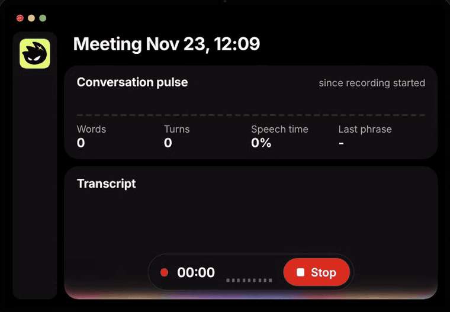

<p align="center">
  
</p>

<h1 align="center">Shade</h1>

<p align="center">
  <b>Private AI meeting notes for your Mac.</b><br>
  Recording, transcription and summaries happen on your computer: no bot in the call, no cloud.
</p>

<p align="center">
  <a href="https://github.com/aidbeisembin/shade/releases/latest"></a>
  
  <a href="LICENSE.md"></a>
</p>

<p align="center">
  <a href="https://aidbeisembin.com/shade/en">Website</a> · <a href="#install">Install</a> · <a href="https://t.me/shadebeta">Beta chat</a> · <a href="README.ru.md">Русский</a>
</p>

<p align="center">
  
</p>

## Why Shade

- **Nothing joins your call.** Shade records your microphone and the system audio of any app: Zoom, Google Meet, Teams, Slack huddles, a browser tab. Nobody sees a bot.
- **Your meetings stay on your Mac.** Speech is transcribed on the device; recordings, transcripts and summaries are plain files on your disk.
- **A summary when you want one.** Key points, decisions and action items from a built-in local model, or from a provider you pick yourself.
- **Speaks your language.** Russian and English interface; transcription in dozens of languages.

## What it does

- Records the microphone and system audio at the same time.
- Transcribes live with Whisper or Parakeet models, Metal-accelerated on Apple Silicon.
- Shows the conversation as it happens: a live transcript and a pulse of who is talking.
- Names the meeting after its content and writes a summary on request.
- Searches across all your meetings, keeps deleted ones in a trash, imports audio files.

## Privacy

Recordings, transcripts and summaries are stored only on your Mac and are never uploaded. Something leaves your computer only when you choose it: a cloud summary provider you set up, or feedback you send. Shade also sends anonymous usage stats: app start, recording start and summary ready, with no audio, text or meeting titles; you can turn this off in Settings. Details: [PRIVACY_POLICY.md](PRIVACY_POLICY.md).

- App data: `~/Library/Application Support/com.aidbeisembin.shade/`
- Recordings: `~/Movies/Shade`, with the trash inside

## Install

Open beta for Macs with Apple Silicon (M1 or newer). The beta is signed with its own certificate rather than an Apple Developer ID, so after installing from the .dmg macOS asks once whether to open Shade; the Terminal install skips that question. The signature is permanent, so microphone and system audio permissions survive updates.

### Option 1. One line in Terminal

```bash
curl -fsSL https://aidbeisembin.com/shade/install.sh | bash
```

The script downloads the latest release, checks its SHA-256 and the «Shade Beta Signing» signature, puts Shade in Applications and opens it. Your meetings and settings are left alone. If the checksum or the signature does not match, it installs nothing. The script is short: [scripts/install.sh](scripts/install.sh).

### Option 2. Download the .dmg

1. Download [Shade_aarch64.dmg](https://github.com/aidbeisembin/shade/releases/latest/download/Shade_aarch64.dmg) from the [latest release](https://github.com/aidbeisembin/shade/releases/latest), open it and drag Shade into Applications.
2. Open Shade from Applications. macOS says it cannot verify the app: click «Done».
3. Open System Settings → Privacy & Security. At the bottom, next to the line about Shade, click «Open Anyway» and confirm with your password or Touch ID.
4. In the «Open Shade?» dialog click «Open Anyway». From then on Shade opens normally.


The «Open Anyway» button stays visible for about an hour after the first launch attempt. If it is gone, open Shade from Applications again and go back to Settings. Still no button: run `xattr -cr /Applications/Shade.app` in Terminal (it clears the «downloaded from the internet» flag) and open Shade again.

### Updates

Shade checks for updates at launch and once a day, without any data about you in the request. It downloads a new version in the background and verifies its signature, but installs it only when you click «Update», and never during a recording. How a release is made: [docs/release.md](docs/release.md).

## Feedback

- Rate Shade and leave a note right in the app: the «How was Shade?» card after a recording.
- Talk to other beta testers in Telegram: [t.me/shadebeta](https://t.me/shadebeta).
- Bugs and ideas: [Issues](https://github.com/aidbeisembin/shade/issues).

## Build from source

You need macOS on Apple Silicon, Xcode Command Line Tools, Rust, Node.js 22 and pnpm.

```bash
git clone https://github.com/aidbeisembin/shade
cd shade/frontend
pnpm install --frozen-lockfile
pnpm tauri:build
```

To work on the interface in a browser with mock data: `pnpm dev`, then `http://localhost:3118/?mock=full`. More in [docs/dev.md](docs/dev.md); contributing: [CONTRIBUTING.md](CONTRIBUTING.md).

## License

MIT, see [LICENSE.md](LICENSE.md). Built on open-source components, see [THIRD_PARTY_NOTICES.md](THIRD_PARTY_NOTICES.md).
