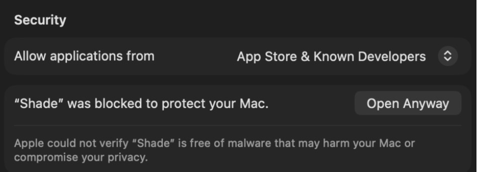

# Shade

Приватные заметки встреч для Mac: запись, расшифровка и итоги прямо на компьютере.

## Что умеет

- Записывает микрофон и системный звук одновременно: Zoom, Meet, Teams и любые другие созвоны.
- Расшифровывает речь на устройстве моделями Whisper или Parakeet, ускорение Metal на Apple Silicon.
- По кнопке подводит итоги встроенной локальной моделью или выбранным вами провайдером.
- Ищет по тексту встреч, удалённое держит в корзине, импортирует аудиофайлы.

## Приватность

Записи, расшифровки и итоги хранятся только на вашем Mac и никуда не отправляются. Наружу что-то уходит, только когда вы сами это выбрали: облачный провайдер итогов или отзыв по кнопке «Отправить». Статистику использования Shade не собирает. Подробно: [PRIVACY_POLICY.md](PRIVACY_POLICY.md).

- Данные приложения: `~/Library/Application Support/com.aidbeisembin.shade/`.
- Записи: `~/Movies/Shade`, корзина внутри, в папке `Корзина Shade`.

## Установка

Открытая бета для Mac с Apple Silicon (M1 и новее). Бета подписана своим сертификатом, а не Apple Developer ID, поэтому при первом запуске macOS один раз спросит, открывать ли Shade. Подпись постоянная: разрешения на микрофон и системный звук переживают обновления.

### Способ 1. Скачать .dmg

<!-- install-steps -->
1. Скачайте [Shade_aarch64.dmg](https://github.com/aidbeisembin/shade/releases/latest/download/Shade_aarch64.dmg) из [последнего релиза](https://github.com/aidbeisembin/shade/releases/latest), откройте его и перетащите Shade в «Программы».
2. Откройте Shade из «Программ». macOS скажет, что не может проверить приложение: нажмите «Готово».
3. Откройте Системные настройки → Конфиденциальность и безопасность. Внизу, у строки про Shade, нажмите «Всё равно открыть» и подтвердите паролем или Touch ID.
4. В окне «Открыть Shade?» нажмите «Всё равно открыть». Дальше Shade открывается как обычно.
<!-- /install-steps -->



Кнопка «Всё равно открыть» видна около часа после первой попытки запуска. Если её нет, снова откройте Shade из «Программ» и вернитесь в настройки. Путь одинаковый на macOS 15, 26 и 27, снимок с macOS 27 на английском. От скачивания до этой кнопки девять действий: скачать, открыть .dmg, перетащить, открыть Shade, «Готово», меню Apple, «Системные настройки», «Конфиденциальность и безопасность», прокрутить вниз.

### Способ 2. Быстрый способ через Терминал

```bash
curl -fsSL https://aidbeisembin.com/shade/install.sh | bash
```

Скрипт скачивает .dmg последнего релиза, сверяет SHA-256, ставит Shade в «Программы» и запускает; встречи и настройки не трогает. Исходник короткий: [scripts/install.sh](scripts/install.sh).

### Обновления

Shade проверяет обновления при запуске и раз в сутки, без данных о вас в запросе. Новую версию скачивает в фоне и проверяет подпись, а ставит только по кнопке «Обновить» в карточке «Доступна версия …», и никогда во время записи. Как выпускается релиз: [docs/release.md](docs/release.md).

## Обратная связь

- Оценка и отзыв в самом Shade: карточка «Как вам Shade?» после записи.
<!-- beta-chat -->
<!-- /beta-chat -->
- Ошибки и предложения: [Issues](https://github.com/aidbeisembin/shade/issues).

## Сборка из исходников

Нужны macOS на Apple Silicon, Xcode Command Line Tools, Rust, Node.js 22 и pnpm.

```bash
git clone https://github.com/aidbeisembin/shade
cd shade/frontend
pnpm install --frozen-lockfile
pnpm tauri:build
```

Разработка интерфейса в браузере на заглушках: `pnpm dev`, затем `http://localhost:3118/?mock=full`. Подробно: [docs/dev.md](docs/dev.md), участие: [CONTRIBUTING.md](CONTRIBUTING.md).

Built on open-source components, see [THIRD_PARTY_NOTICES.md](THIRD_PARTY_NOTICES.md).
