# #3 aid: одна система стилей (shadcn + lucide) и экран «Встреча»

- Статус: слит, 2026-11-02
- Ветка: `claude/tender-ride-8496pu` → `aid`
- Автор: katanana23
- Исходная ссылка: https://github.com/katanana23/shade/pull/3

## Описание

## Description

Чистка aid-слоя до одной системы (shadcn на Tailwind 3.4 + lucide-react) и экран «Встреча», доведённый до показа. Весь отчёт здесь, файлов-отчётов в репозитории нет.

### Аудит (состояние ветки `aid` до этого PR)
- **Экраны aid-слоя:** главная (`Home`), запись (`Recording`), встреча (`MeetingDetails`), настройки (`Settings`), витрина `/aid-kit` (`AidKit`), сайдбар.
- **Gravity UI:** `AidGravityThemeProvider` оборачивал всё приложение, в layout грузились `@gravity-ui/uikit/styles/*.css`, плюс `AidSidebar-gravity.tsx`. Компонентов Gravity на экранах уже не было, только тема и стили.
- **Solar:** иконки на всех четырёх страницах (Home, Recording, MeetingDetails, Settings). Lucide в сайдбаре и общих компонентах.
- **Дубли:** `Home-list-backup.tsx` и `Home-tailwind-backup.tsx`, два сайдбара, три механизма темы (theme.ts, ThemeSwitcher, gravity-theme). shadcn-компоненты aid лежали в оригинальной папке `src/components/ui`, а `button`, `tabs` и `switch` оттуда были изменены. Ещё два шрифта сразу: Inter через next/font и IBM Plex через CSS @import.
- **Сломано на заглушках:**
  - `?mock=full`: транскрипт встречи захардкожен (одни и те же 5 реплик у всех встреч), итоги не грузились, дат и длительности не было.
  - `?mock=recording`: запись не стартовала. Из главной пропали `useRecordingStart` и `useRecordingStop`, а «Пауза» только писала в консоль.
  - `?mock=error`: вместо ошибки главная показывала «Пока нет записей», индикатор говорил «Локально», хотя конфиг не прочитался.
  - `?mock=empty`: пустое состояние было, но с подсказкой «Нажмите кнопку записи внизу» про круглую кнопку с градиентом и анимацией ping.
  - Настройки aid были муляжом: устройства захардкожены, «Сохранить» ничего не сохраняла.
  - Режим `NEXT_PUBLIC_UI=original` сломан: страница встречи импортировала сама себя, у настроек не было default export. Из-за этого `tsc --noEmit` падал с 2 ошибками.
  - В `layout.tsx` пропали трей, drag-and-drop аудио и запрет контекстного меню.
  - Оригинальный `globals.css` попадал в бандл вместе с aid-стилями.

### Что удалено
- Пакеты `@gravity-ui/uikit`, `@gravity-ui/icons`, `solar-icon-set`. `package.json` и `pnpm-lock.yaml` побайтно совпадают с `main`. grep по `src`, `package.json` и lock-файлу пустой.
- Файлы: `AidSidebar-gravity.tsx`, `gravity-theme.tsx`, `Home-list-backup.tsx`, `Home-tailwind-backup.tsx`, `AidKit.tsx` и маршрут `/aid-kit`, `Settings.tsx` (муляж), `BentoCard.tsx`, `CopyButton.tsx`, `styles/fonts.css`.
- 22 самоотчёта из `docs/case`: все `*_DONE.md`, `*_REPORT.md`, `*_FINAL*.md`, `*_MIGRATION*.md`, `MIGRATION_*.md`, `READY_FOR_REVIEW.md`, `FUNCTIONAL_AUDIT.md`, `CIRCULAR_BUTTON_SIRI.md`, а ещё `FINAL-REPORT.md`, `aid-ui-notes.md`, `aid-ui-summary.md`, `screenshots-readme.md`. Остались только `mock.md`, `journal.md`, `metrics.md`, `decisions.md`.
- Правки aid в оригинальных `src/components` откатил к `main` (`SidebarProvider`, `ui/button`, `ui/tabs`, `ui/switch`). Добавленные туда `ui/badge`, `ui/card` и `ui/skeleton` удалил.

### Что сделано
- **shadcn в `src/aid/components/ui`:** button, card, tabs, skeleton, alert, badge, tooltip, input. Из UI-библиотек `src/aid` импортирует только эти компоненты и `lucide-react` (список в разделе Testing). Radix импортируется только внутри `components/ui`.
- **Токены** (`src/aid/styles/globals.css`):
  - одна светлая и одна тёмная тема, переключатель в сайдбаре; ключ `aid-meetings.theme` прежний, старое значение `system` читается как тема системы;
  - один акцент, индиго `--primary`; красный только для ошибок и записи;
  - радиусы: карточки 24, кнопки и поля 16;
  - кнопки 44, 48 и 56 px;
  - Inter latin + cyrillic через next/font;
  - градиентов, свечений и стекла нет.
- **Экран «Встреча»:**
  - шапка: название, дата, длительность (конец последней реплики; у длинной встречи последняя реплика дочитывается отдельно), число реплик;
  - индикатор приватности по `api_get_model_config` и `api_get_transcript_config`: «Локально», «Облако» или «Неизвестно», в подсказке видно, где обрабатываются транскрипция и итоги. Если конфиг не читается, честно «Неизвестно». `custom-openai` тоже «Неизвестно», потому что адрес сервера не проверяется. Ollama с удалённым адресом считается облаком;
  - вкладки «Итоги» и «Транскрипт», у каждой «Копировать» (обычный текст) и «Как Markdown». Для транскрипта копируется вся встреча, даже не подгруженная;
  - транскрипт со временем от начала записи и спикерами: имя показывается, только когда говорящий меняется. Подгрузка страницами по 200 реплик;
  - состояния: Skeleton при загрузке; «Итогов пока нет» с кнопкой «Сделать итоги» (тот же `api_process_transcript` с теми же аргументами, что у оригинала, потом опрос `api_get_summary`); «Готовим итоги»; ошибка итогов; ошибка загрузки (Alert с понятным текстом, «Повторить» и свёрнутым исходным текстом ошибки ядра); «Встреча не найдена».
- **Главная:**
  - список встреч с датами из `api_get_meeting_metadata`, поиск по названию;
  - пустое состояние и Alert при ошибке;
  - «Импортировать аудио» видна, только если бета-функция включена.
- **Запись:**
  - собрана на оригинальных `useRecordingStart`, `useRecordingStop` и `useRecordingStateSync`: старт, пауза и продолжение, стоп, живой транскрипт, экран «Сохраняем встречу», переход к встрече;
  - трей снова работает через `start-recording-from-sidebar`.
- **Переходники:**
  - оригинальные страницы восстановлены из `main` в `page-original.tsx`, и режим `original` снова собирается и открывается;
  - настройки в aid показывают оригинальную рабочую страницу на токенах aid;
  - оригиналы грузятся лениво: первая загрузка `/meeting-details` упала с 842 до 202 kB, главной с 245 до 151 kB.
- **`layout.tsx`:** взят из `main` плюс минимальная надстройка (заглушки, тема без мигания, Inter, aid-сайдбар). Стили выбираются условием, которое webpack вычисляет при сборке, поэтому оригинальный `globals.css` больше не перебивает токены.
- **`CLAUDE.md`:** 444 → 42 строки (проект, границы, стек, данные и секреты, как работать, стиль, вольт в конце).

Не тронуты: `frontend/src-tauri`, имена и аргументы команд и событий, форматы данных, миграции, ключи хранилищ, `frontend/src/dev/mock-tauri`, `docs/recon.md`, `docs/isolation.md`, `docs/FORK.md`, `docs/case/{mock,journal,metrics,decisions}.md`. Это проверено diff'ом с `aid`. Оригинальные `src/components`, `src/contexts` и `src/hooks` совпадают с `main`.

## Related Issue
Нет.

## Type of Change
- [x] Bug fix
- [x] New feature
- [x] Documentation update
- [x] Performance improvement
- [x] Code refactoring

## Testing
- [ ] Unit tests added/updated
- [x] Manual testing performed
- [x] All tests pass (`npx tsc --noEmit` без ошибок, `pnpm build` без ошибок и в режиме aid, и с `NEXT_PUBLIC_UI=original`)

Прогнал Playwright на `pnpm dev` с заглушками:
- нажал «Сделать итоги» и дождался готовых итогов;
- проверил буфер обмена для всех четырёх кнопок копирования (текст и Markdown, итоги и транскрипт);
- переключил тему, она сохранилась после перезагрузки;
- «Встреча не найдена» на несуществующем id;
- запись с главной: старт, пауза, продолжение, стоп и переход на `/meeting-details?id=…&source=recording`;
- длинная встреча на `?mock=long`: 2100 реплик, длительность «3 ч 52 мин».

Консоль на `full`, `empty` и `recording` без ошибок. На `error` в консоли 4 записи `console.error` из оригинальных `ConfigContext` и `SidebarProvider`: это залогированные и обработанные ошибки сценария, необработанных нет.

Импорты UI в `src/aid`: `@/aid/components/ui/{button,card,tabs,skeleton,alert,badge,tooltip,input}` и `lucide-react`. Остальное: react, next, tauri api, контексты и хуки оригинала, `react-markdown` с `remark-gfm` для текста итогов.

## Documentation
- [x] Documentation updated (`CLAUDE.md`)

## Checklist
- [x] Code follows project style
- [x] Self-reviewed the code
- [x] Added comments for complex code
- [ ] Updated README if needed
- [x] No merge conflicts

## Screenshots

Сняты на 1360×900 в браузере на заглушках. Файлы лежат в `docs/screenshots/aid-meeting/`; если в репозитории они не нужны, их можно удалить отдельным коммитом до слияния.

**«Встреча», `?mock=full`: итоги, светлая и тёмная**
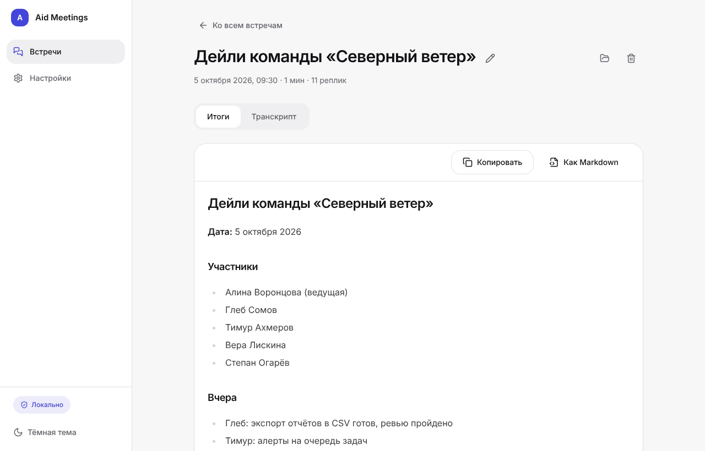 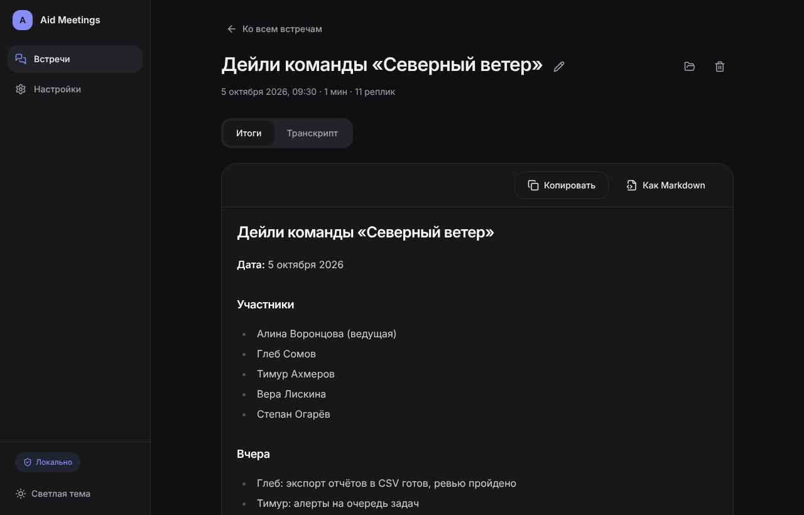

**«Встреча»: транскрипт, светлая и тёмная**
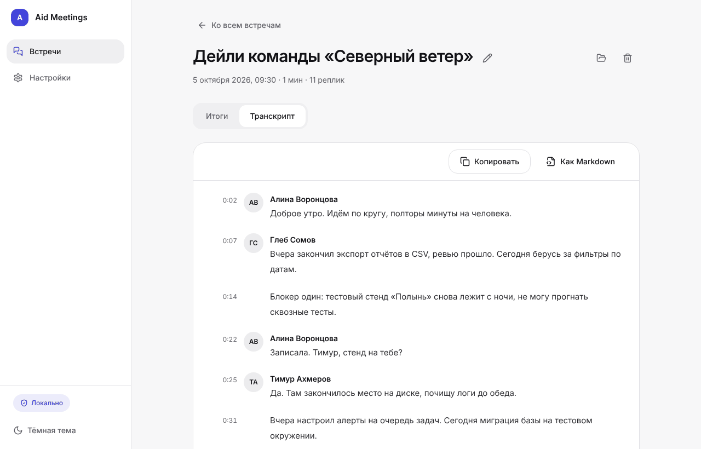 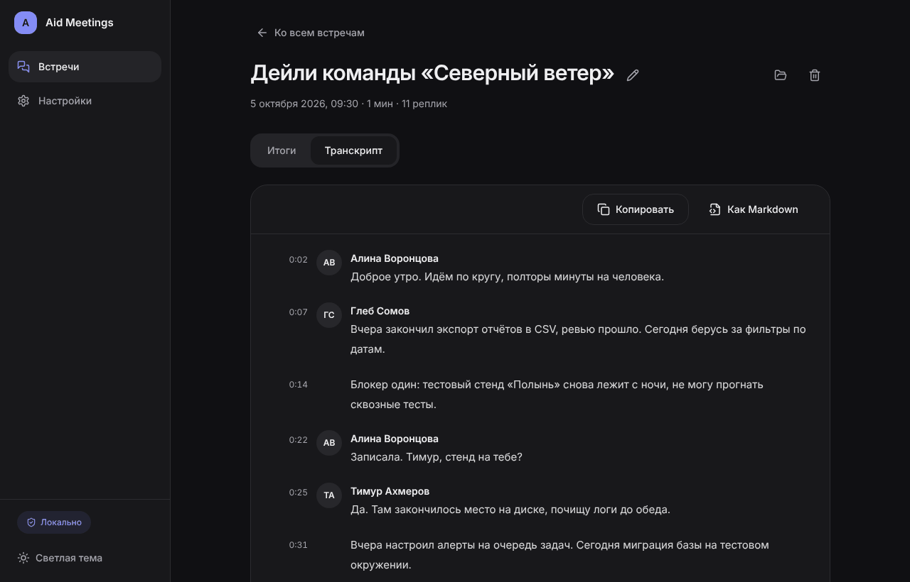

**Нет итогов (кнопка «Сделать итоги») и итоги готовятся**
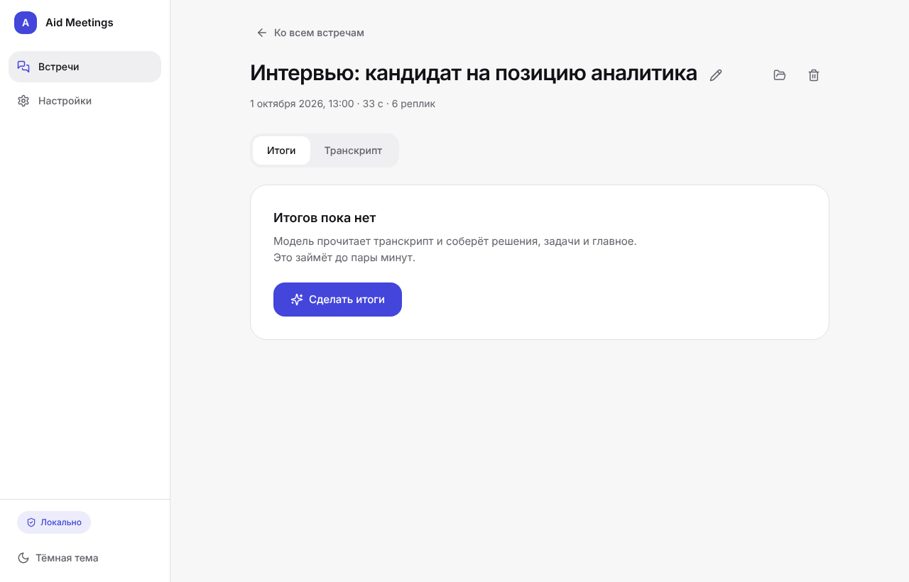 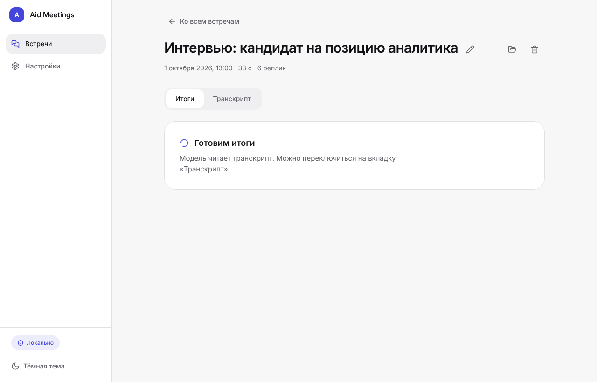

**Нет итогов, тёмная; итоги упали с ошибкой**
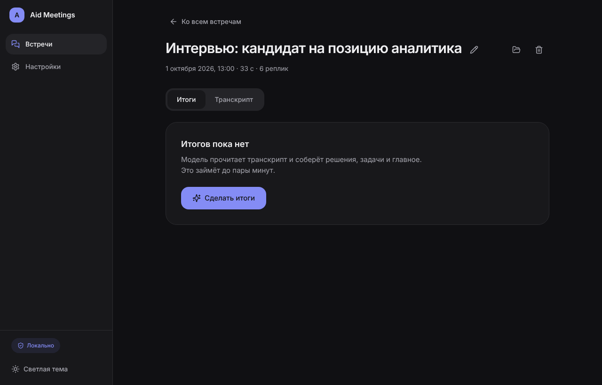 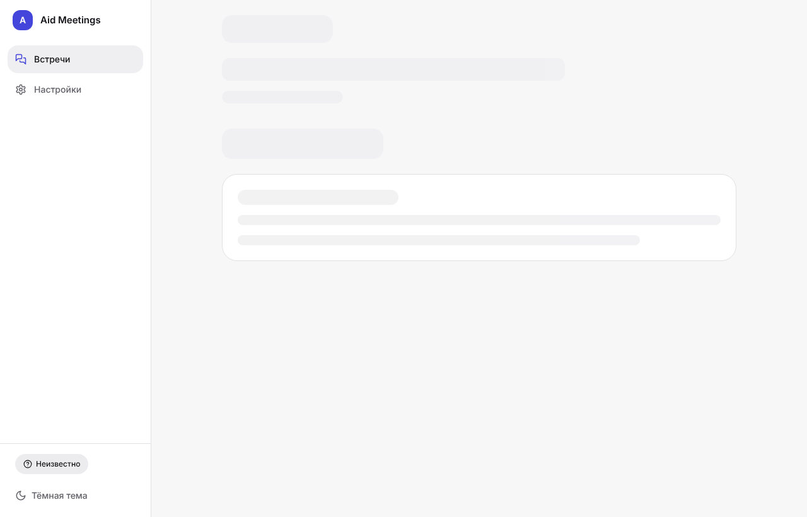

**`?mock=error`: «Встреча», светлая и тёмная**
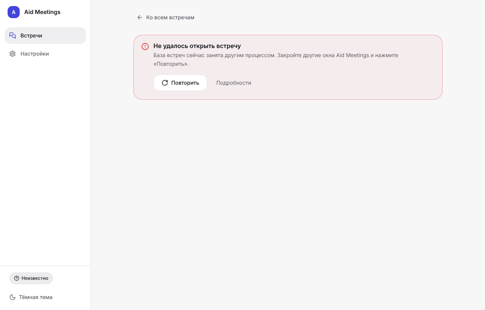 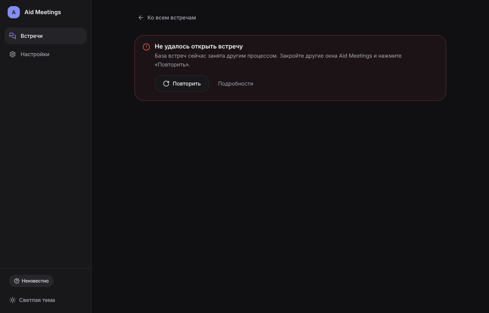

**`?mock=empty`: главная, светлая и тёмная**
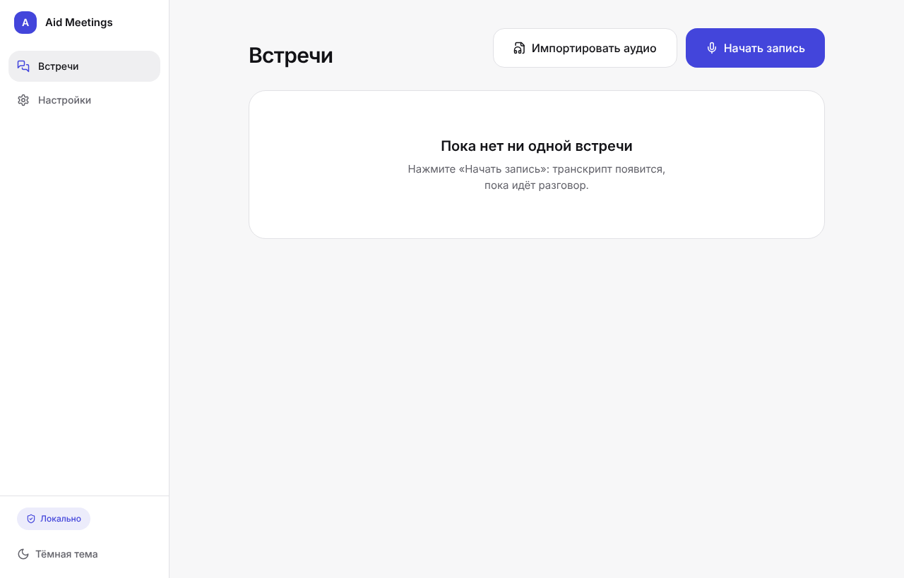 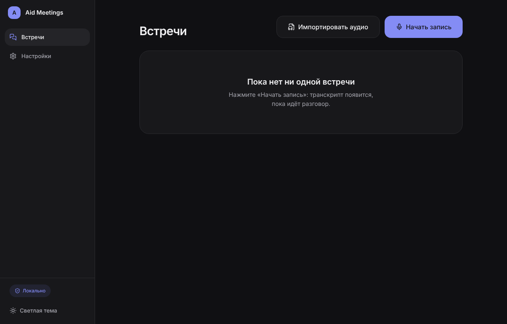

**Главная `?mock=full` и `?mock=error`**
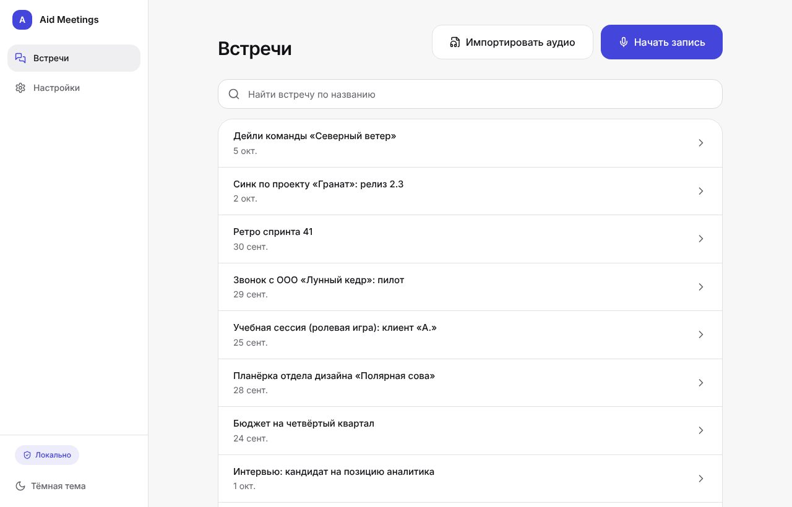 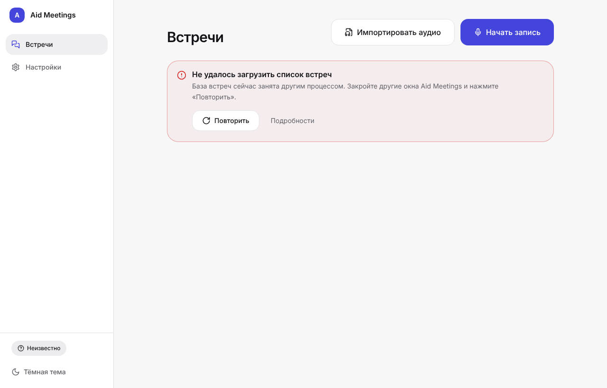

**Запись `?mock=recording`, тёмная**
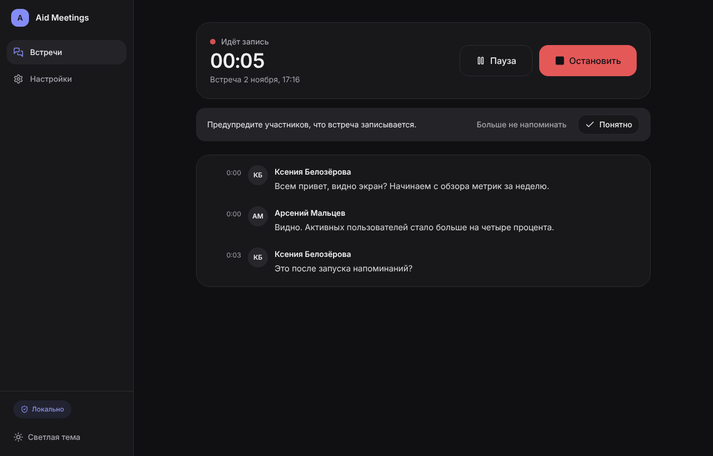

## Additional Notes
**Что не удалось или осталось:**
- Скриншот состояния загрузки (Skeleton) не снят: заглушки отвечают мгновенно, а подмена `invoke` в браузере ломает установку заглушек. Само состояние есть в коде (`LoadingState` и `SummaryPanel` в `MeetingDetails.tsx`).
- Настройки в aid пока оригинальные и на английском, на токенах aid. Отдельный экран настроек на shadcn: следующий шаг.
- Уведомление «Recording Started» на скриншоте записи: оригинальный toast на английском, не из aid-слоя.
- Отдельного поля спикера в данных ядра нет: спикер берётся из префикса «Имя: » в тексте реплики. Реплика вида «Итог: …» тоже будет прочитана как спикер «Итог».
- Витрину компонентов `/aid-kit` удалил (там было «стекло»). Если она нужна для кейса, её стоит собрать заново на новых токенах.
- `pnpm build` скачивает Inter из Google Fonts через next/font. Одна сборка из пяти упала на сетевом сбое прокси, повтор прошёл.
- Live-реплики в заглушке приходят с нулевым временем, поэтому первые строки на экране записи показывают 0:00. Это данные заглушки, интерфейс берёт `audio_start_time`.
- `pnpm tauri:dev` и сборку Rust не запускал по правилам проекта: проверено только в браузере на заглушках.

---
_Generated by [Claude Code](https://claude.ai/code/session_01JzvomxkVSAKv3jjRMmSK11)_
