# #5 Дизайн-ревью и прогон флоу: настройки, тосты, пустые записи, экран встречи

- Статус: слит, 2026-11-06
- Ветка: `claude/design-review-flow` → `aid`
- Автор: katanana23
- Исходная ссылка: https://github.com/katanana23/shade/pull/5

## Описание

## Description

Дизайн-ревью и прогон флоу на заглушках, затем исправления; продукт переименован в **ShadeNotes**. Вольта в облачной сессии нет, поэтому отчёт здесь.

Оригинальные файлы интерфейса не менялись. Правки сделаны в:
- `src/aid`, `public/brand`;
- переходниках `app/layout.tsx`, `app/page.tsx`, `app/meeting-details/page.tsx`, `app/settings/page.tsx`;
- `next.config.js`, `tailwind.config.js`;
- заглушках `src/dev/mock-tauri` (по разрешению в задаче);
- `CLAUDE.md`, `PRODUCT.md`, `DESIGN.md` и документации.

В `src-tauri` семь отдельных коммитов по явным просьбам Айдына:
- фон окна (`e17931d`);
- ShadeNotes (`cf382ab`);
- заголовок Overlay (`514e731`);
- положение кнопок окна (`9bee5e6`);
- доступ к папке записей для корзины (`5fbe1ed`);
- полоса окна, имя в Dock и иконка приложения (`08a5123`);
- окно стартует скрытым, право на показ окна (`c9450b4`).

Новое сверху. Более позднее заменяет решения предыдущих там, где они расходятся.

> ⚠️ **Коммиты в `frontend/src-tauri` пересоберут Rust при следующем `pnpm tauri:dev` или сборке.** `08a5123` впервые меняет `Cargo.toml`: добавлен `[[bin]] ShadeNotes`. Если сборка на нём остановится, откатить этот коммит и написать мне.

---

## Восемнадцатый круг: белое окно при запуске

Интерфейс в `decceb3`, ядро в `c9450b4`.

**Что видно:** при запуске сначала открывается пустое светло-серое окно (`#F7F7F8`), в тёмной теме оно слепит, и висит, пока грузится страница.

**Почему:** окно создаёт ядро сразу при старте и красит его цветом `backgroundColor` из `tauri.conf.json`, ещё до того, как WebView получил страницу. Этот цвет один на обе темы, поэтому интерфейс на этот момент повлиять не мог.

**Что сделано:**
- **Окно стартует скрытым:** `"visible": false` у главного окна и право `core:window:allow-show` (`c9450b4`, отдельный коммит в `src-tauri`).
- **Показ из интерфейса** (`src/aid/lib/window-boot.ts`, подключён в `app/layout.tsx`):
  - скрипт в `<head>` ставит окну фон темы (тёмная `#000`, светлая `#FFF`);
  - скрипт сразу после разметки заставки показывает окно; окно появляется уже с маскотом и тремя точками в цвет темы, до загрузки скриптов страницы;
  - страховки: повторный показ через 3 с и вызов из эффекта layout через API Tauri. Если окно всё же не появится, его можно открыть из меню в трее.
- **Оригинальный интерфейс** (`NEXT_PUBLIC_UI=original`) тоже показывает окно: скрипт подключён для обоих.

**Долгая загрузка** в `pnpm tauri:dev` идёт от сервера разработки Next: он компилирует страницу при первом запросе. В это время теперь видна иконка в Dock, а не белое окно. В собранном приложении страница лежит в файлах и открывается почти сразу.

### Проверки восемнадцатого круга

- `npx tsc --noEmit`: без ошибок.
- `pnpm build` и `NEXT_PUBLIC_UI=original pnpm build`: успешно, скрипт показа есть в `out/index.html` в обоих вариантах.
- В Chromium с подставным `__TAURI_INTERNALS__`, в обеих темах: сначала `set_background_color` с цветом темы, затем `show`, когда заставка уже в разметке. С заблокированными скриптами страницы окно тоже показывается. Аргументы команд сверены с `@tauri-apps/api` 2.11 и ядром Tauri 2.11.
- `?mock=full`: список встреч на месте, ошибок в консоли нет.
- Rust не запускался.

### Проверить только в настоящем приложении

- При запуске нет белого окна: окно появляется сразу с заставкой в цвет темы, затем интерфейс. Проверить в обеих темах.
- Если окно не появилось совсем, открыть его из меню в трее и прислать журнал консоли.

---

## Семнадцатый круг: иконки 24 px без подложек

Код в `751ffd4`, скриншоты в `7c27566`. Заменяет подложки у иконок из тринадцатого круга.

- **Кнопки с текстом** («Копировать», «Сделать итоги», «Сделать заново», переключатель темы и другие): иконка 24 px, подложка убрана (`.aid-btn` в `globals.css`).
- **Сайдбар:** «Встречи», «Настройки» и «Идёт запись» с иконкой 24 px без плитки 28 px. Активный пункт по-прежнему выделен фоном строки.
- **Главные круглые кнопки-иконки 56 px:** папка, удаление и «Импортировать аудио» тоже 24 px.
- **Не менялись:** шеврон «Назад» 16 px (по прежней просьбе), микрофон 28 px в кнопке записи, мелкие иконки (16 и 20 px) в строках списка, итогах и плашке «Локально».
- **Правило** обновлено в `CLAUDE.md` и `DESIGN.md`.

### Проверки семнадцатого круга

- `npx tsc --noEmit`: без ошибок.
- `pnpm build`: успешно.
- `NEXT_PUBLIC_UI=original pnpm build`: успешно.
- В Chromium замерено: у иконок сайдбара и кнопок встречи ширина 24 px, фон прозрачный, в обеих темах.
- Rust не запускался.

### Скриншоты семнадцатого круга

Файлы в `docs/screenshots/aid-meeting/design-review-17/`.

| Экран | Светлая | Тёмная |
|---|---|---|
| Главная | 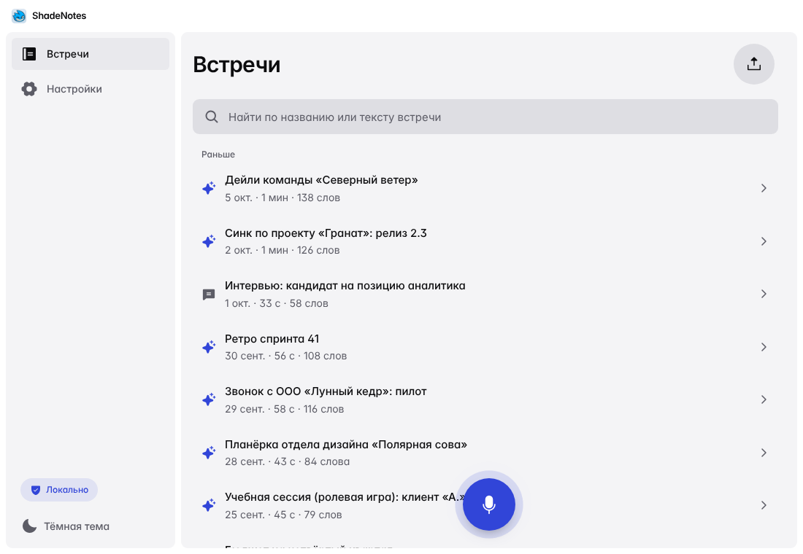 | 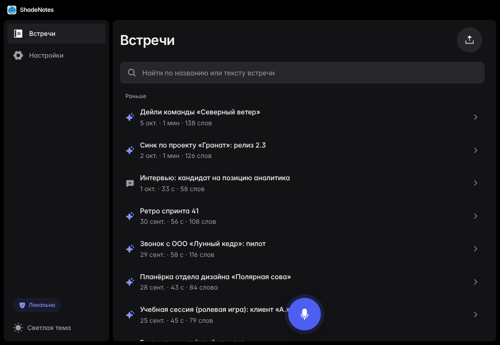 |
| Встреча | 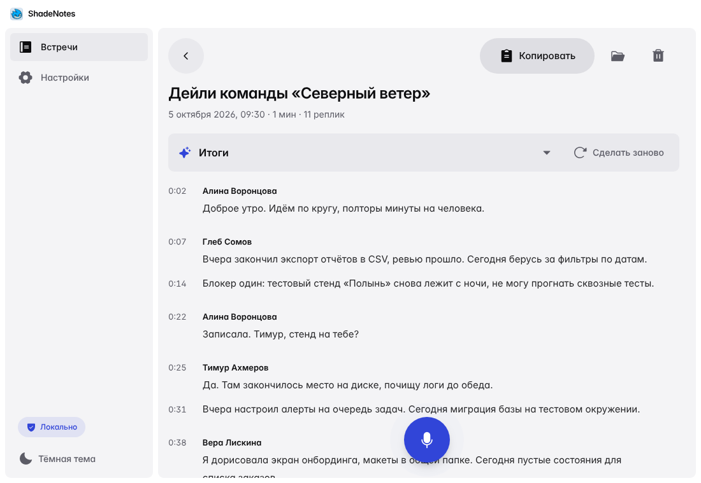 | 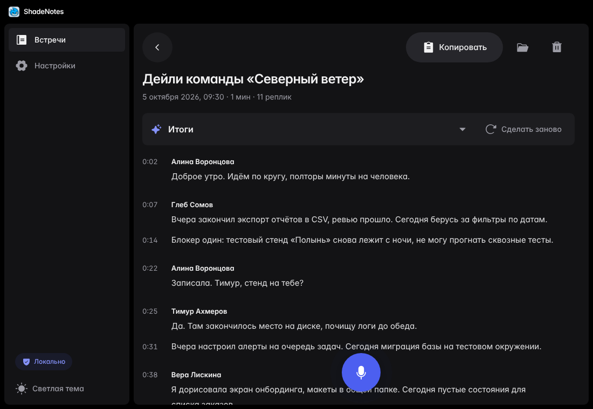 |

---

## Шестнадцатый круг: запуск приложения

Код в `40f9c22`, скриншоты в `21c8ba3`.

### 1. Кнопки окна наезжают на знак при запуске

**Что видно:** первые секунды после открытия кнопки окна macOS лежат поверх знака и названия ShadeNotes. Подпись темы при этом перепутана, а приватность показывает «Неизвестно».

**Почему:**
- окно сначала получает готовую разметку (HTML), а скрипты интерфейса догружаются следом; в `pnpm tauri:dev` это секунды;
- отступ за кнопками окна ставил скрипт интерфейса, поэтому до его загрузки отступа не было;
- тема и приватность в это время тоже ещё не прочитаны.

**Что сделано:**
- класс отступа `aid-titlebar-overlay` ставит маленький скрипт в `<head>` (`src/aid/lib/theme.ts`), до первой отрисовки, вместе с тёмной темой. `TitleBar` повторяет это на всякий случай.
- **Заставка запуска** (`src/aid/components/LaunchScreen.tsx`): маскот мягко «дышит», под ним название и три точки. Фон по теме. Заставка уже есть в разметке, закрывает полусобранный интерфейс и плавно уходит, когда интерфейс ожил, но не раньше чем через 450 мс, чтобы не мигать. При «Уменьшить движение» без анимации.
- **Скелетоны списка встреч** идут волной, строка за строкой.
- **Приватность в сайдбаре** ждёт скелетоном вместо «Неизвестно».

**Проверено в Chromium:**
- с отключёнными скриптами интерфейса видна заставка в цвете темы;
- в обычной загрузке заставка уходит через 0,45–0,8 с;
- в эмуляции «Tauri на Mac» класс отступа стоит сразу после разметки, отступ полосы 88 px.

### 2. Белый экран до разметки

Решено в восемнадцатом круге: окно стартует скрытым и показывается уже с заставкой.

### Проверки шестнадцатого круга

- `npx tsc --noEmit`: без ошибок.
- `pnpm build`: успешно.
- `NEXT_PUBLIC_UI=original pnpm build`: успешно.
- Rust не запускался.

### Скриншоты шестнадцатого круга

Файлы в `docs/screenshots/aid-meeting/design-review-16/`.

| Экран | Светлая | Тёмная |
|---|---|---|
| Заставка запуска | 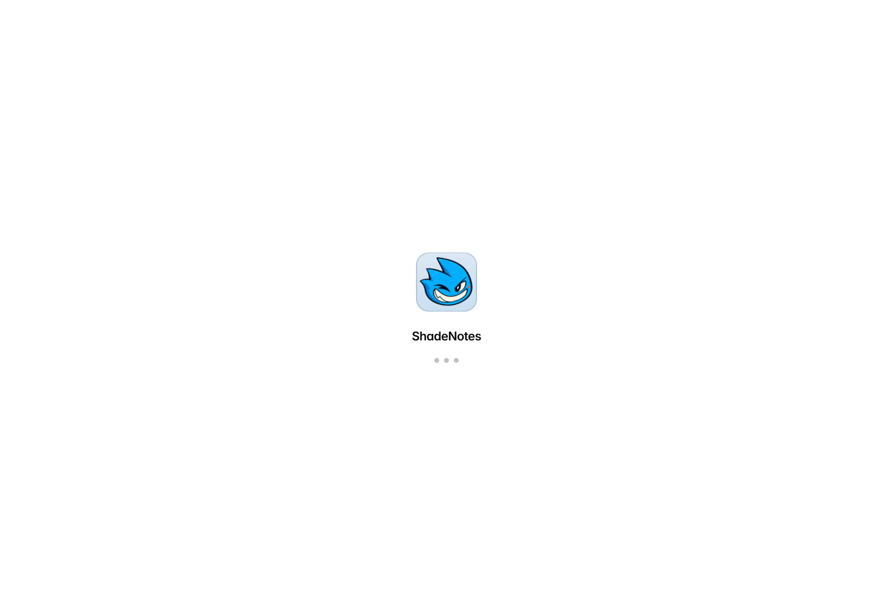 | 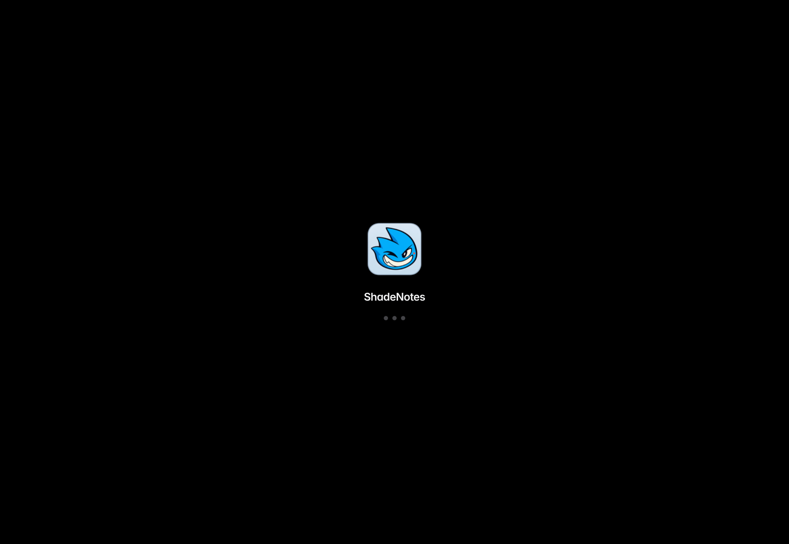 |

### Проверить только в настоящем приложении

- При запуске видна заставка, затем интерфейс; кнопки окна не лежат на знаке ни в один момент.

---

## Пятнадцатый круг: зависший переход, экран «Завершаем запись», подсказки

Код в `4d4386c`, скриншоты в `ec8ae7a`.

### 1. Бесконечная загрузка при переходе к встрече

**Что видно:** клик по встрече показывает спиннер в строке, но страница встречи не открывается, подсветка строки залипает.

**Почему:**
- клик доходит, это видно по спиннеру;
- переход внутри приложения (Next router) в окне Tauri на macOS зависает;
- в десятом круге я отключил запасной переход в режиме разработки (`pnpm tauri:dev`): он перезагружал страницу посреди компиляции;
- без запасного пути переход ждал бесконечно.

**Что сделано (`src/aid/lib/open-meeting.ts`):**
- **Обычная загрузка страницы,** если адрес не сменился:
  - в разработке через 8 с, страница встречи к этому времени уже скомпилирована заранее;
  - в собранном приложении через 1,5 с, явно файл `meeting-details.html`.
- **Если не помогло и это:** спиннер в строке снимается, подсветка тоже, и появляется уведомление «Встреча не открылась» с кнопкой «Скопировать журнал». В журнале адрес, протокол и последние записи `window.__aidNavLog`.

**Проверено в Chromium:** при заглушённом `history.pushState` (переход внутри приложения «завис») встреча открылась обычной загрузкой через 8,2 с в обеих темах.

### 2. Экран «Завершаем запись»

- **Затухающая волна:** семь полос звука медленно «успокаиваются».
- **Три шага с отметками:** «Запись остановлена» ✓ → «Дописываем реплики» (спиннер, текущий шаг на подложке) → «Сохраняем встречу».
- **Когда встреча сохранена,** полосы сменяются кобальтовой галочкой с мягким появлением.
- **Анимация:** только `transform` и `opacity`; при «Уменьшить движение» полосы стоят.

### 3. Подсказки и типографика

- **Подсказки** в цвете всплывающих панелей темы: в тёмной тёмные, в светлой светлые, с тонкой обводкой и тенью. Раньше в тёмной теме подсказка была белой.
- **Подсказка «Локально»:** сеткой «иконка + текст» — щит, волна у транскрипции, искра у итогов. Каждая строка целиком, все начинаются с одной линии.
- **Без лесенки во всём интерфейсе** (`globals.css`):
  - заголовки, подсказки и короткие тексты статусов переносятся ровными строками (`text-wrap: balance`);
  - абзацы без одиноких слов в последней строке (`pretty`).
- **Правило** записано в `CLAUDE.md`.

### Проверки пятнадцатого круга

- `npx tsc --noEmit`: без ошибок.
- `pnpm build`: успешно.
- `NEXT_PUBLIC_UI=original pnpm build`: успешно.
- Детектор Impeccable по `src/aid`: 0 находок.
- Rust не запускался.

### Скриншоты пятнадцатого круга

Файлы в `docs/screenshots/aid-meeting/design-review-15/`.

| Экран | Светлая | Тёмная |
|---|---|---|
| «Завершаем запись» | 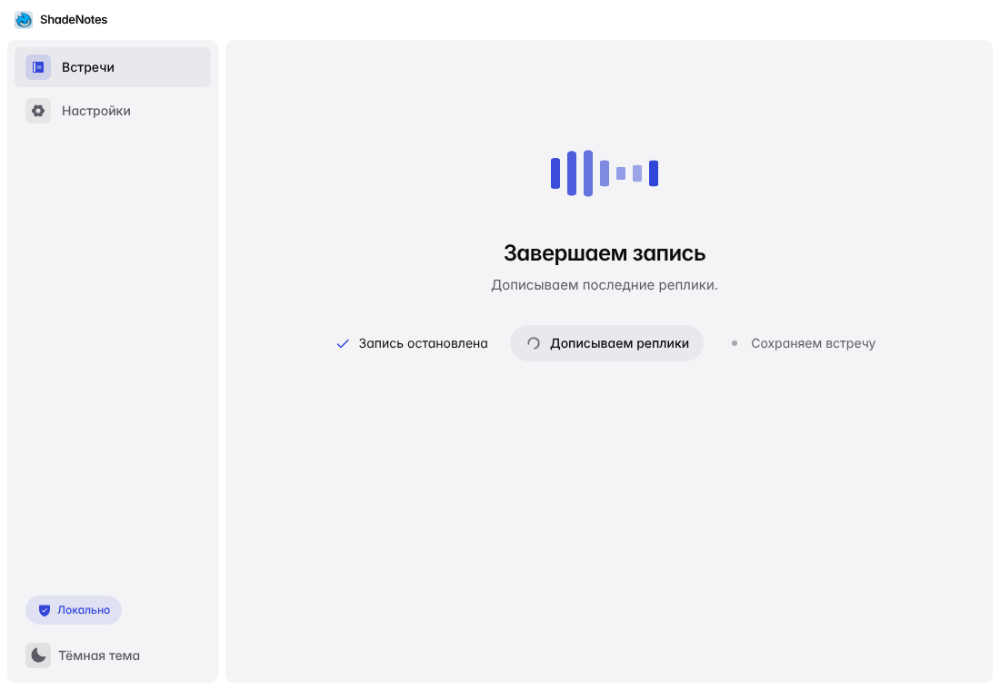 | 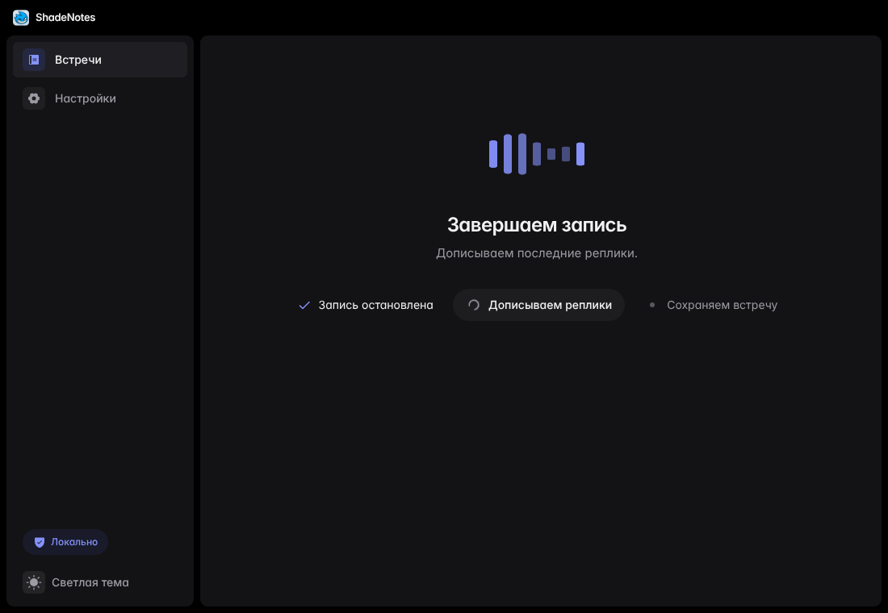 |
| Подсказка «Локально» | 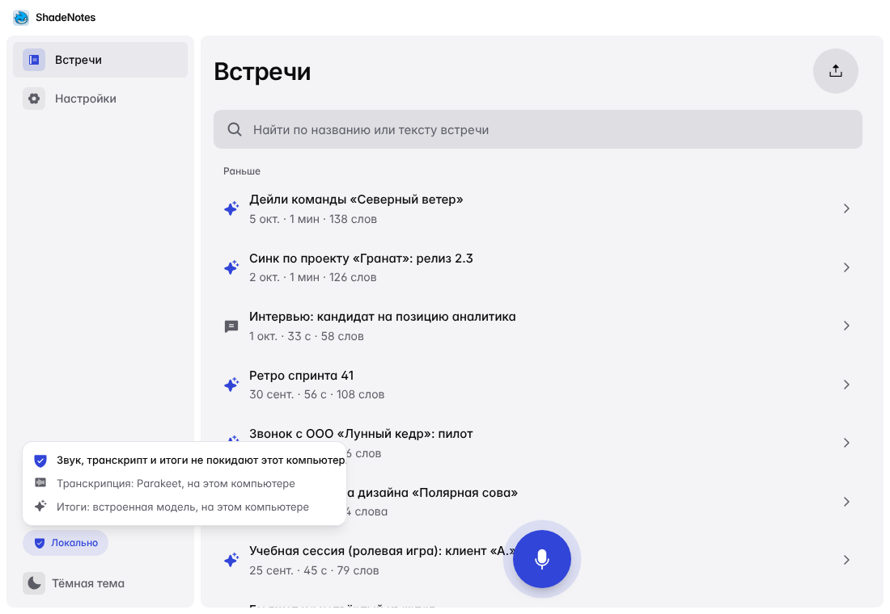 | 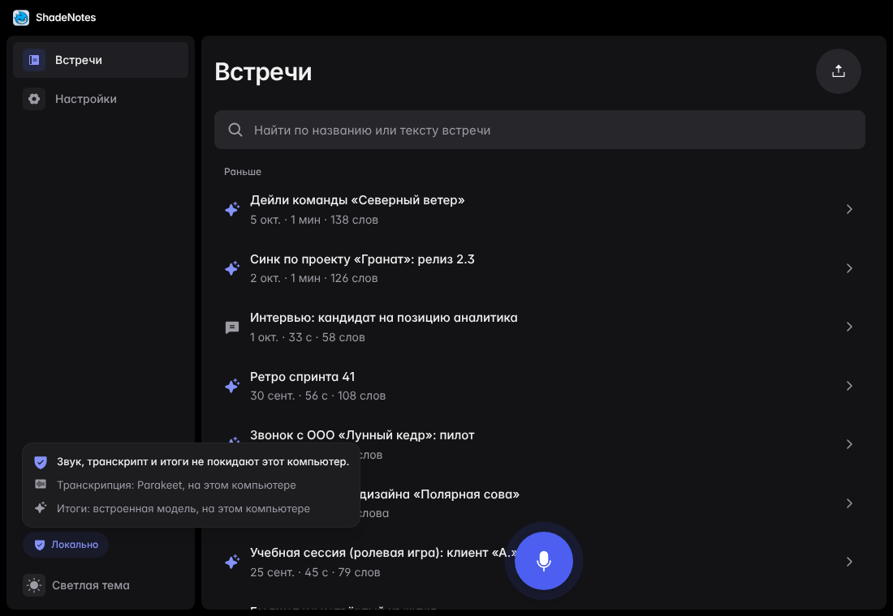 |
| Встреча после запасного перехода | 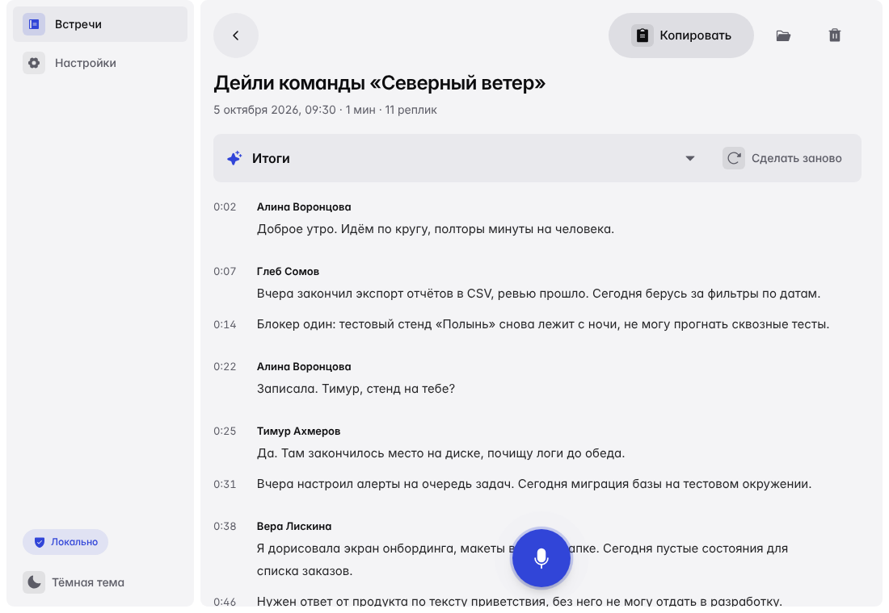 | 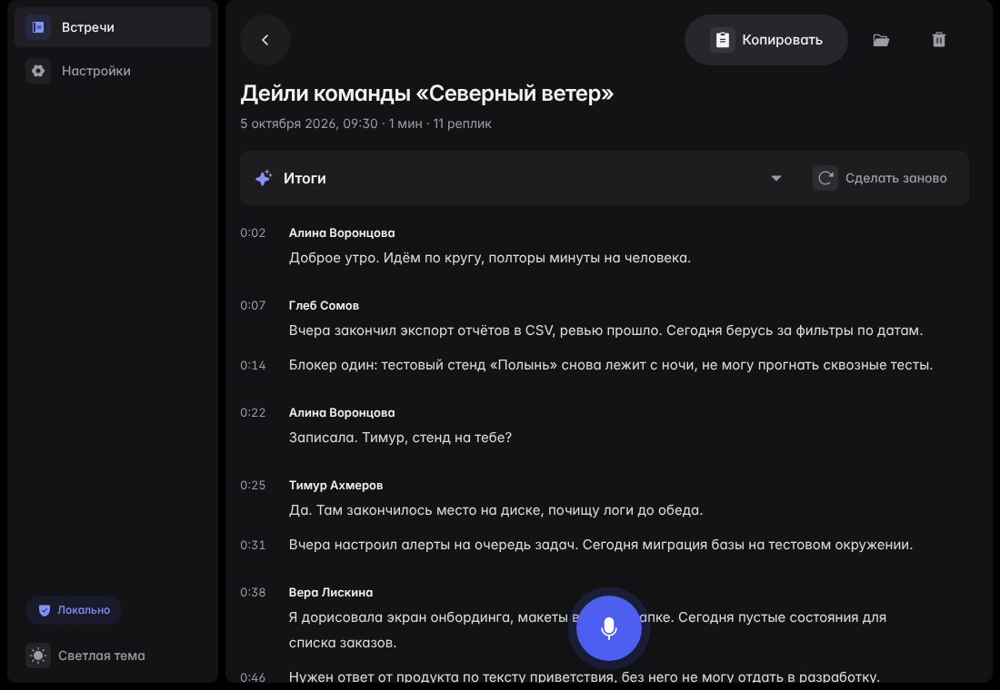 |

### Проверить только в настоящем приложении

- **Клик по встрече** открывает её; в худшем случае примерно через 8 с в `pnpm tauri:dev`. Если через ~16 с появится «Встреча не открылась», нажать «Скопировать журнал» и прислать текст.
- **«Завершаем запись»:** полосы и шаги после «Остановить».
- **Подсказка «Локально»** в тёмной теме.

---

## Откат четырнадцатого круга

Четырнадцатый круг из параллельной сессии (визуальная система «по референсу плеера») не подошёл и откачен обратным коммитом `925f8e1`. Откачены `258be26`, `b6e5e6a`, `6774053`, `a93bd1b`. Файлы после отката совпадают с концом тринадцатого круга (`1c473bc`).

## Тринадцатый круг

Интерфейс в `5e24f5c`, ядро в `08a5123`, скриншоты в `1c473bc`.

1. **Полоса окна** 44 px (`TitleBar`): кнопки окна, знак и название; `trafficLightPosition` x 18, y 22.
2. **Шрифт SF Pro** через `-apple-system`, Inter запасной.
3. **Логотип и Dock:**
   - маскот в интерфейсе и иконка приложения (`tauri icon`);
   - имя ShadeNotes в Dock: `[[bin]]` в `Cargo.toml` и `mainBinaryName`.
4. **Иконки на подложках** в кнопках с текстом и в сайдбаре; у «Встреч» иконка `Notebook` (подложки убраны в семнадцатом круге).
5. **Экран записи:** «Речь слышна, а текста нет» с моделью и языком распознавания.
6. **«Пара фраз»** короче 30 с не сохраняется и в корзину не идёт.
7. **Окно «Импорт аудио»** в бенто на хуках оригинала.

## Двенадцатый — десятый круги

- **Двенадцатый:**
  - запись без текста со звуком без промежуточных экранов;
  - правая часть одной серой плиткой;
  - лупа контуром, «Пульс разговора»;
  - «Скопировано» на кнопке и ⌘⇧C.
- **Одиннадцатый:**
  - итоги из заглушек не показываются;
  - радиусы по замеру окна (17 / 9 / 6);
  - «Назад» 56 px, переименование кликом по названию.
- **Десятый:**
  - уровень звука перед удалением (−40 и −55 dBFS);
  - корзина на 7 дней;
  - прогрев маршрутов, печатная машинка в транскрипте.

## Девятый — первый круги и переименование

- **Девятый:** попап «Тишина» с крестиком.
- **Восьмой:** находки Impeccable critique (Impeccable в `dbfaf72`, файлы и хуки описаны [в комментарии](https://github.com/katanana23/meetily/pull/5#issuecomment-6604592312)), поиск по тексту, группы дат, честный хоткей.
- **Седьмой:** клик в WebKit (временный журнал `nav-debug.ts`), иконки без подложек, переименование.
- **Шестой:** заголовок окна Overlay (`514e731`), главные действия 56 px.
- **ShadeNotes:**
  - что поменялось: `productName`, заголовок окна, видимое имя;
  - что осталось прежним: `identifier`, папки данных, ключи `localStorage`;
  - после установки удалить старый `Aid Meetings.app`.
- **Пятый — первый:**
  - пустые записи не в списке, бенто, Cmd+Shift+R, итоги без пустых разделов;
  - фон окна (`e17931d`), свой экран настроек, тосты на русском.

Скриншоты в `docs/screenshots/aid-meeting/design-review*/` и `rename-shadenotes/`.

## Related Issue

Нет: задача из сессии.

## Type of Change
- [x] Bug fix
- [x] New feature
- [x] Documentation update
- [x] Performance improvement
- [ ] Code refactoring
- [ ] Other (please describe)

## Testing
- [ ] Unit tests added/updated
- [x] Manual testing performed: Playwright (Chromium) и WebKitGTK через WebDriver на заглушках, обе темы. Проверены:
  - показ скрытого окна с фоном темы (подставной `__TAURI_INTERNALS__`);
  - размер и фон иконок в сайдбаре и кнопках;
  - заставка запуска до загрузки скриптов и её уход;
  - класс отступа за кнопками окна в эмуляции «Tauri на Mac»;
  - запасной переход при зависшем переходе внутри приложения;
  - экран «Завершаем запись» с шагами;
  - подсказка «Локально»;
  - детектор Impeccable.
- [x] All tests pass: `npx tsc --noEmit`, `pnpm build`, `NEXT_PUBLIC_UI=original pnpm build`. ESLint не запускался: в репозитории нет `@eslint/eslintrc`. Rust и `pnpm tauri:dev` не запускались (по CLAUDE.md)

## Documentation
- [x] Documentation updated: `docs/case/mock.md`, `CLAUDE.md`, `README.md`, `docs/FORK.md`, `docs/isolation.md`, `PRODUCT.md`, `DESIGN.md`
- [ ] No documentation needed

## Checklist
- [x] Code follows project style
- [x] Self-reviewed the code
- [x] Added comments for complex code
- [x] Updated README if needed
- [x] Branch is up to date with `aid`
- [x] No merge conflicts

## Screenshots (if applicable)

См. разделы скриншотов выше.

## Additional Notes

- Ветка `claude/design-review-flow`. Не сливать.
- ⚠️ Семь коммитов в `frontend/src-tauri` пересоберут Rust; `08a5123` меняет `Cargo.toml` (`[[bin]] ShadeNotes`). После установки удалить старый `Aid Meetings.app`.
- Окно стартует скрытым (`c9450b4`): если после сборки окно не появляется, открыть его из трея и написать мне; откат этого коммита возвращает прежнее поведение.
- ВРЕМЕННО: журнал кликов `src/aid/lib/nav-debug.ts`, убрать после проверки на Mac (теперь его можно скопировать из уведомления «Встреча не открылась»).
- Ключи `sessionStorage` Aid: `aid.recordingOutcome`, `aid.stayAfterSave`.
- Ключ `localStorage` `aid.recordingMarks.v1` (формат не менялся); существующие ключи, `identifier` и папки данных не менялись.
- Ошибки ядра, которые я не трогал:
  - поиск `api_search_transcripts` на кириллице;
  - `api_delete_meeting` удаляет только запись в базе, файлы остаются.
- Файлов-самоотчётов, резервных копий и реальных данных нет; фикстуры вымышленные. Логотип прислан Айдыном.

🤖 Generated with [Claude Code](https://claude.com/claude-code)

https://claude.ai/code/session_01Jzvomz8RZpQaHRX9cwmBu3

## Обсуждение

**vercel[bot], 2026-11-02T17:34**

[vc]: #Nt5n7SGVgFlQBWEOzfsWleTmG6H4hEVnTdmK4PDt7VI=:eyJpc01vbm9yZXBvIjp0cnVlLCJ0eXBlIjoiZ2l0aHViIiwicHJvamVjdHMiOlt7Im5hbWUiOiJtZWV0aWx5IiwicHJvamVjdElkIjoicHJqX3lEek5SV21QVVVHNW0yTTdZN3N3dDJTY1BwRWciLCJsaXZlRmVlZGJhY2siOnsicmVzb2x2ZWQiOjAsInVucmVzb2x2ZWQiOjAsInRvdGFsIjowLCJsaW5rIjoibWVldGlseS1naXQtY2xhdWRlLWRlc2lnbi1yZXZpZXctZmxvdy1haWR4bzIzLTMxMTgudmVyY2VsLmFwcCJ9LCJpbnNwZWN0b3JVcmwiOiJodHRwczovL3ZlcmNlbC5jb20vYWlkeG8yMy0zMTE4L21lZXRpbHkvNzdzMTZuVE1mVUFTbXJuVmFWVkwxd0M2TE42SiIsInByZXZpZXdVcmwiOiJtZWV0aWx5LWdpdC1jbGF1ZGUtZGVzaWduLXJldmlldy1mbG93LWFpZHhvMjMtMzExOC52ZXJjZWwuYXBwIiwibmV4dENvbW1pdFN0YXR1cyI6IkRFUExPWUVEIiwicm9vdERpcmVjdG9yeSI6ImZyb250ZW5kIn1dfQ==
The latest updates on your projects. Learn more about [Vercel for GitHub](https://vercel.link/github-learn-more).

| Project | Deployment | Actions | Updated |
| :--- | :----- | :------ | :------ |
| <a href="https://vercel.com/aidxo23-3118/meetily"></a> [meetily](https://vercel.com/aidxo23-3118/meetily) |  [Ready](https://vercel.com/aidxo23-3118/meetily/77s16nTMfUASmrnVaVVL1wC6LN6J) | [Preview](https://meetily-git-claude-design-review-flow-aidxo23-3118.vercel.app) | <relative-time datetime="2026-11-06T06:35:08.880Z">Nov 6, 2026 6:35am UTC</relative-time> |

**katanana23, 2026-11-03T10:59**

Проверка **Vercel** на `5eed77d` красная: «Deployment has failed», сборка остановилась примерно через 36 секунд после старта.

Что проверено:
- тот же коммит из чистой копии (`git archive`) собирается без ошибок: `pnpm install --frozen-lockfile`, затем `next build`, в том числе с `CI=1 VERCEL=1`, Node 22; типы и статическая выгрузка проходят;
- `npx tsc --noEmit`, `pnpm build` и `NEXT_PUBLIC_UI=original pnpm build` в рабочей копии тоже проходят;
- предыдущий коммит ветки `e17931d` Vercel развернул успешно.

Причину по коду найти не удалось, а лог деплоя (`npx vercel inspect dpl_HCJFfX8oLhoFA4EUHLwEdFtGcfZb --logs`) и перезапуск доступны только с доступом к проекту Vercel, которого у меня нет. Нужно открыть лог по ссылке в статусе или нажать Redeploy. Если там ошибка в коде PR, исправлю. PR продолжаю отслеживать.

---
_Generated by [Claude Code](https://claude.ai/code)_

**katanana23, 2026-11-03T11:14**

Дополнение к комментарию про Vercel: на текущем коммите `87b08b0` (тот же код пятого круга плюс переименование в ShadeNotes) деплой прошёл, статус зелёный. Сбой на `5eed77d` в коде не воспроизвёлся, смотреть его лог и нажимать Redeploy больше не нужно.

---
_Generated by [Claude Code](https://claude.ai/code)_

**katanana23, 2026-11-03T12:51**

Проверка **Vercel** на `553c5fb` (седьмой круг) красная: «Deployment has failed», сборка остановилась примерно через 40 секунд после старта.

- Тот же коммит из чистой копии (`git archive`) собирается без ошибок: `pnpm install --frozen-lockfile`, затем `next build` с `CI=1 VERCEL=1`. В рабочей копии также проходят `npx tsc --noEmit`, `pnpm build` и `NEXT_PUBLIC_UI=original pnpm build`.
- Похоже на сбой на `5eed77d`, который на следующем коммите прошёл без изменений в коде. Оба упавших коммита добавляют около 40 PNG-скриншотов (1,3–1,5 МБ) в `docs/`. Это совпадение, а не доказанная причина: корень проекта Vercel `frontend`, `docs/` в сборку не входит.

Лог деплоя (`npx vercel inspect dpl_7a7DCpgf6E8BpCqLXCYE4oUiNxPg --logs`) и перезапуск доступны только с доступом к проекту Vercel, которого у меня нет. Нужно открыть лог по ссылке в статусе или нажать Redeploy. Если причина в коде PR, исправлю. PR продолжаю отслеживать.

---
_Generated by [Claude Code](https://claude.ai/code)_

**katanana23, 2026-11-03T13:05**

## Impeccable: что установлено и итог critique

### Установка (коммиты `dbfaf72`, `1b301d5`)

`npx impeccable install -y --providers=claude --scope=project` не смог скачать набор: хост `impeccable.style` закрыт сетевой политикой облачного окружения. Поэтому те же файлы проектной установки для Claude Code взяты из исходников `pbakaus/impeccable` той же версии (npm 4.8.0, движок 0.1.18).

**Файлы**
- `.claude/skills/impeccable/`: навык (`SKILL.md`, 41 справочный файл, `scripts/` с лаунчером `impeccable`, контрольные суммы движка, скрипты live-режима), 2,3 МБ.
- `.claude/agents/impeccable-asset-producer.md`, `impeccable-documenter.md`, `impeccable-finish-reviewer.md`, `impeccable-manual-edit-applier.md`.
- `.claude/settings.json`: хуки (ниже).
- `PRODUCT.md` (`init`), `DESIGN.md` и `.impeccable/design.json` (`document`): заполнены по CLAUDE.md и решениям ревью.
- `.gitignore`: движок (`scripts/bin/`), локальный `config.json`, `.claude/settings.local.json` и служебные файлы `**/.impeccable/live/*` не попадают в git.

**Хуки** (`.claude/settings.json`; каждый запускает `.claude/skills/impeccable/scripts/impeccable hook`, если файл существует)

| Событие | Когда | Таймаут | Что делает |
|---|---|---|---|
| `SessionStart` | начало сессии Claude Code | 5 с | «Preparing build session»: готовит детектор |
| `PostToolUse` (`Edit\|Write`) | после каждой правки файла | 5 с | «Checking UI changes»: быстрые проверки правленого UI-файла |
| `Stop` | конец хода агента | 30 с | «Design deep pass»: полный проход всех правил |

Движок при первом запуске скачивается с GitHub Releases в `~/.impeccable/bin/0.1.18/` и сверяется с `engine-checksums.txt`. Выключить хук: `/impeccable hooks off`.

### Итог critique (главная, встреча, запись)

Две независимые оценки: дизайн-ревью без вывода детектора и детектор по коду и по отрисованным экранам в обеих темах.

- **Эвристики Нильсена: 23/40, «приемлемо».** Сильные стороны: капсула записи, честные тексты про данные, типографика транскрипта. Слабые: эффективность (только хоткей в окне, нет поиска по тексту) и контроль (автоудаление по таймеру).
- **Детектор: 3 правила, нарушений DESIGN.md нет.**
  - `radial-halo`: ложное срабатывание, это задуманное стекло кнопки записи.
  - `bounce-easing`: перелёт на 1% за 0,22 с, мелочь.
  - `straggler`: одно слово в последней строке реплики; по сути ложное, но лечится одной строкой.
- **Главные находки:**
  - (P1) автоудаление по 10-секундному таймеру без паузы;
  - (P1) хоткей работает только в окне, хотя подсказка выглядит как глобальная;
  - (P1) нет поиска по тексту встреч;
  - (P2) плавающая кнопка записи закрывает текст на странице встречи, шапка встречи перегружена;
  - (P2) композиция главной: пустая плитка импорта, нет групп по датам.

Полный отчёт с тем, с чем я согласен и с чем нет, отправлен Айдыну в сессию. Код по итогам critique не менялся: правки только после его «ок».

---
_Generated by [Claude Code](https://claude.ai/code)_

