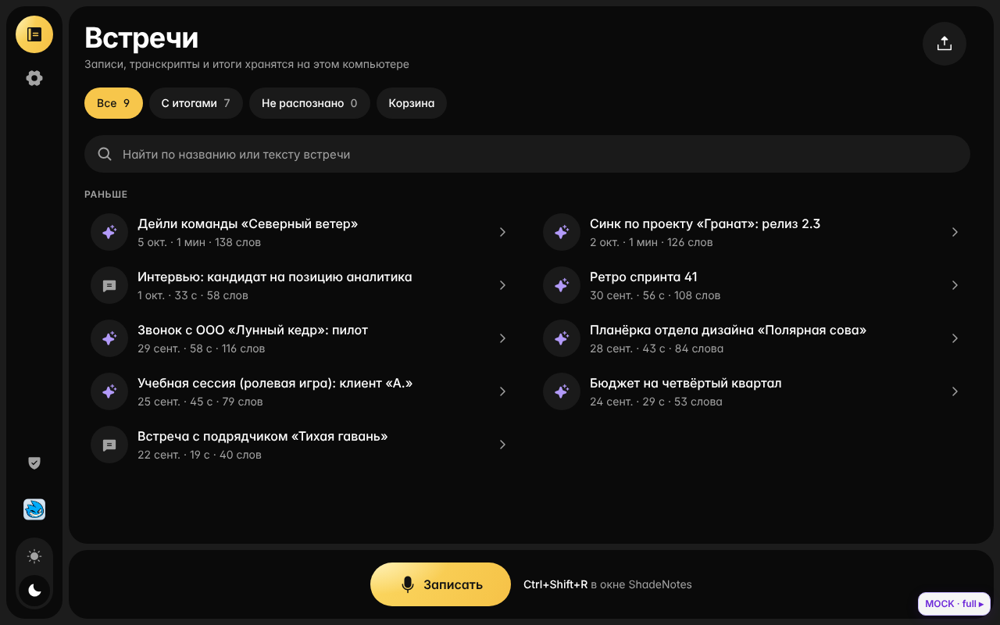
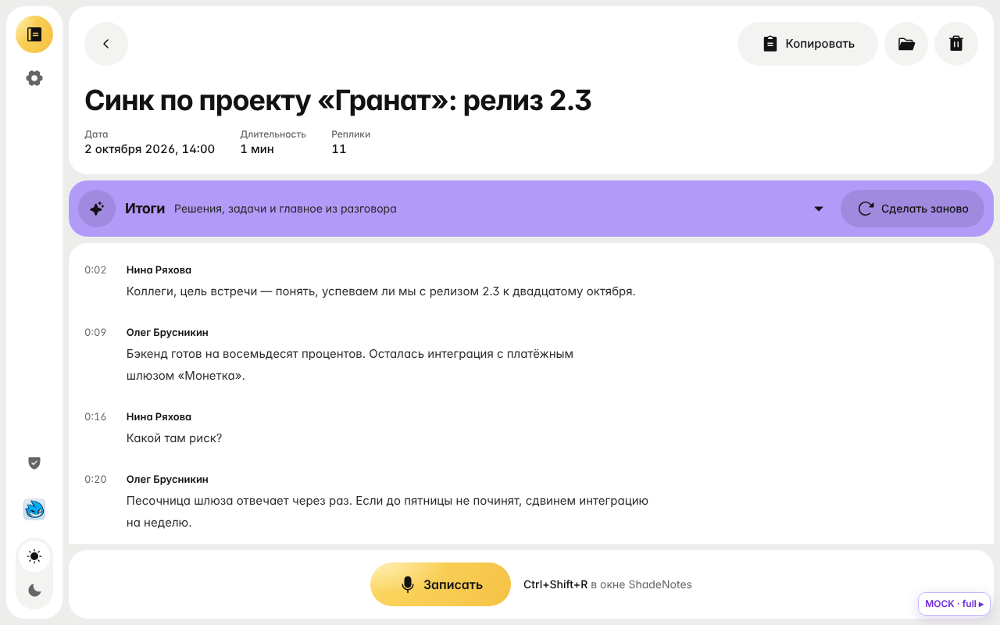
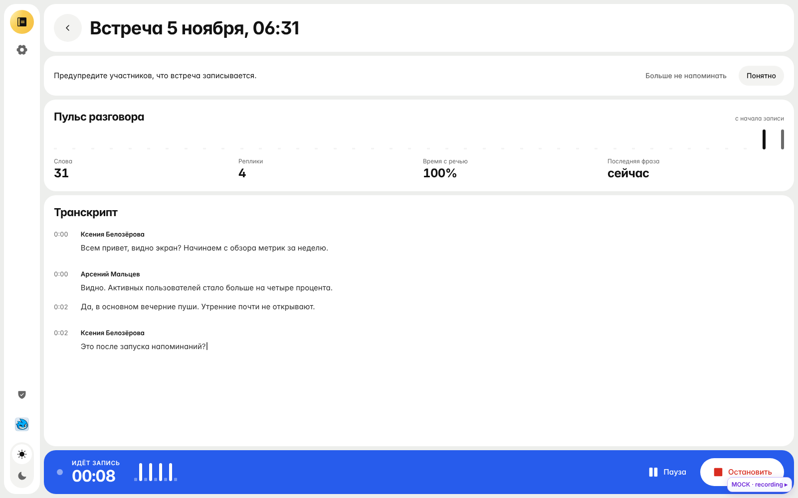
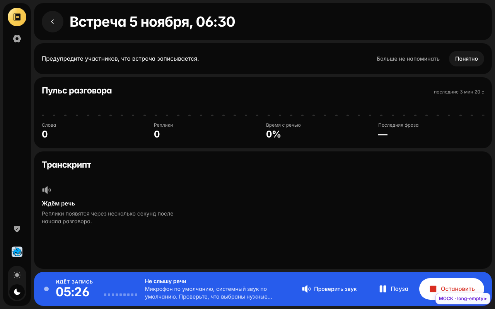
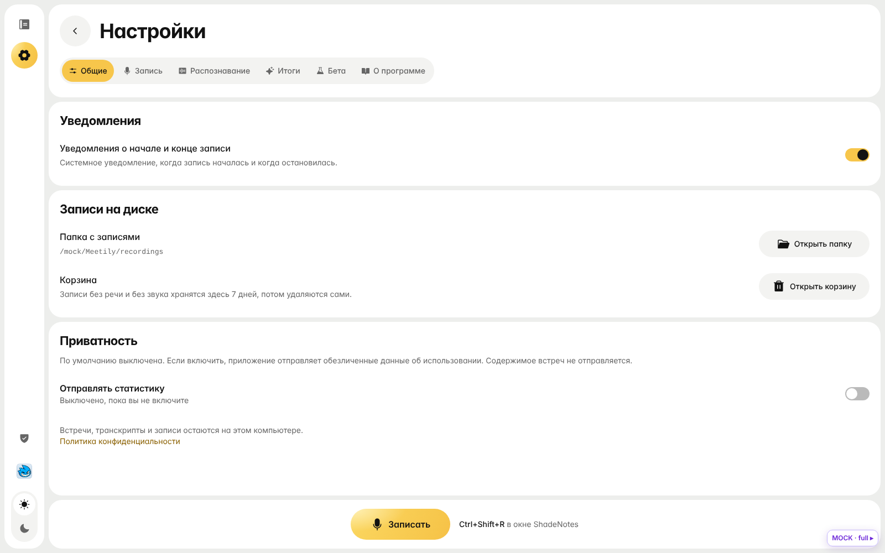
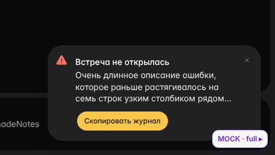

# #6 Визуальная система: бенто с ролями цвета

- Статус: слит, 2026-11-05
- Ветка: `claude/visual-bento` → `claude/design-review-flow`
- Автор: katanana23
- Исходная ссылка: https://github.com/katanana23/shade/pull/6

## Описание

## Description

Визуальная система ShadeNotes «бенто с ролями цвета». Окно разложено на нейтральные плитки, цвет появляется только с ролью. Работа только во внешнем виде и раскладке слоя `frontend/src/aid`. Логика записи, сохранения, корзины и списка не менялась. Изменён только способ открытия встречи, по отзыву, см. второй круг. Оригинальные файлы, `src-tauri` и заглушки `mock-tauri` не тронуты.

**Второй круг по отзыву из окна Tauri**
- Встреча теперь открывается прямо на главной: адрес меняется на `/?id=…` через `history.pushState`. Перехода между страницами больше нет. Раньше переход на `/meeting-details` в окне Tauri на macOS зависал, и встреча не открывалась. Переходы оригинала тоже открывают встречу на месте: после записи, после импорта и по ссылкам. Их переводит `in-place-router.tsx`, это подмена маршрутизатора Next в контексте, файлы оригинала не менялись. Перезагрузка-страховка и уведомление «Встреча не открылась» больше не нужны, они удалены.
- Синий и жёлтый поменялись ролями. Главное действие и выбор теперь Mikado, у кнопок и выбранного пункта сайдбара градиент (`.aid-primary-fill`): светлый блик слева сверху, переход в янтарь справа, при наведении градиент сдвигается. Идущая запись теперь Risd. «Остановить» на синей плитке стала белой с красным текстом, потому что красный на синем сливается (1,2:1).
- Уведомления. Кнопка действия теперь под текстом, а не сбоку столбиком. Заголовок в одну строку, описание не длиннее трёх строк. Длинные подсказки сокращены.
- Окно при запуске красится в цвета палитры (`#1C1C1C` и `#ECEEEB`) вместо старых чёрного и белого из `window-boot.ts`.

**Токены** (`globals.css`, `tailwind.config.js`, `DESIGN.md`, `.impeccable/design.json`, `CLAUDE.md`)
- Тёмная тема наоборот светлой: окно серое `#1C1C1C`, плитки чёрные `#0A0A0A`, вложенный `#1A1A1A`, текст `#FFFFFF` и `#A3A3A3`. Так в обеих темах окно серое, а плитки контрастнее его. Светлая: `#ECEEEB`, `#FFFFFF`, `#F4F4F2`, текст `#111111` и `#666666`.
- Роли: Mikado `#F6C74D` главное действие и выбор (с градиентом), Risd `#255BEC` идёт запись, Indigo `#B49DF8` итоги и ИИ, Giants `#EA6E38` «Не распознано» и предупреждения. Красный только «Остановить» и удаление.
- Геометрия: 8 px между плитками и от края окна, 20 px внутри плитки, радиус плитки 24, вложенного 16, таблетки. Контролы 48 px, главные действия 56 px.
- Кобальт `#3044D8` и монохромная красная кнопка записи удалены. Новое правило в `CLAUDE.md` и `DESIGN.md`: не больше двух цветных плиток на экране.

**Каркас**
- Сайдбар 72 px отдельной плиткой, только иконки Phosphor fill с подсказками. Выбранный раздел Mikado. Пока идёт запись, а человек не на главной, ниже кнопка Risd. Внизу приватность, знак ShadeNotes и переключатель темы таблеткой.
- Кнопки окна macOS теперь стоят в верхней части сайдбара: место 36 px появляется только в Tauri на macOS. Полоса `TitleBar` удалена, плавающих кнопок нет.
- Плитка записи внизу колонки во всю ширину контента. В покое кнопка Mikado «Записать» 56 px и подсказка ⌘⇧R. Во время записи вся плитка Risd: таймер 32/36, полосы речи, «Не слышу речи» внутри плитки, «Пауза» и «Остановить». Итог «Не распознано» после стопа показывается в той же плитке на Giants.

**Экраны**
- Главная. «Встречи» 36/40 и серая подпись. Чипы-фильтры: Все, С итогами, Не распознано, Корзина. Строки без вложенных карточек, с круглой миниатюрой состояния 48 px. От 1100 px ширины списка строки идут в две колонки, для этого используется container query, то есть правило по ширине самого списка, а не окна. «Не распознано» переехало из раздела внизу списка в чип со всеми прежними действиями.
- Встреча. Плитка-шапка: «Назад», действия таблетками, «Сделать итоги» Indigo, название 36/40, мета подписью и значением. Итоги свёрнуты в сиреневую полосу-заголовок. Раскрытый текст стоит на нейтральной плитке под ней. Транскрипт отдельной плиткой, колонка до 760 px. Встреча без текста показывает плитку Giants «Речь не распознана» с действиями.
- Экран записи: шапка-плитка, напоминание о согласии, «Пульс разговора», транскрипт. Последняя нейтральная плитка тянется до плитки записи.
- Настройки: шапка с вкладками, разделы плитками с заголовком 22/28, управление справа в колонке 200 px. Блок приватности оригинала сведён к строкам плитки через CSS-мост.

**Отступления от задачи**
- На Giants текст `#111`, а не белый. Белый на Giants даёт 3,09:1 и не проходит AA. Решение записано в `docs/case/decisions.md`.
- Радиус плитки 24 больше радиуса окна macOS 17. Угол плитки у края окна поэтому мягче угла окна, так задано в задаче.
- Решения семнадцатого круга из базовой ветки сохранены при ребейзе: иконки 24 px без подложек, заставка запуска, скелетон приватности, волна скелетонов.

## Related Issue

Нет. Задача из чата, база PR #5.

## Type of Change

- [x] Новая функциональность интерфейса (визуальная система)
- [x] Исправление ошибки: встреча не открывалась в окне Tauri
- [x] Документация

## Testing

| Проверка | Результат |
| --- | --- |
| `npx tsc --noEmit` | без ошибок |
| `pnpm build` | успешно, без предупреждений |
| `NEXT_PUBLIC_UI=original pnpm build` | успешно |
| Детектор Impeccable (`impeccable detect --json frontend/src/aid`) | 0 находок |
| Консоль браузера на четырёх экранах, обе темы, 1280 и 1600 | 0 ошибок |
| Открытие встречи, «Назад», история браузера вперёд и назад | на месте, 0 запросов к `/meeting-details` |
| Встреча после остановки записи (заглушка `recording`) | открывается на месте |

Контраст WCAG:

| Пара | Контраст |
| --- | --- |
| Белый на Risd (плитка записи) | 5,49 |
| Приглушённый `#E3E9FD` на Risd | 4,53 |
| `#111` на Mikado | 11,81 |
| `#111` на градиенте, светлый край и янтарь | 16,7 и 8,9 |
| Янтарный текст `#8A6000` на белой плитке и на вложенном | 5,59 и 5,08 |
| Mikado-текст на чёрной плитке | 12,4 |
| `#111` на Indigo | 8,20 |
| `#111` на Giants | 6,10 |
| Белый на Giants, отклонено | 3,09 |
| Приглушённый `#262626` на Giants | 4,9 |
| `#666` на плитке и на вложенном, светлая | 5,74 и 5,21 |
| `#A3A3A3` на плитке и на вложенном, тёмная | 7,85 и 6,7 |
| Красный текст «Остановить» на белой таблетке, белый на красном «Удалить» | 4,8 |

**Критика Impeccable.** Две независимые проверки. Первая смотрела дизайн по скриншотам. Оценки: главная 8, встреча 7, запись 6, настройки 6. Исправлено по её замечаниям:
- Под последней плиткой оставался пустой фон окна. Теперь последняя нейтральная плитка тянется до плитки записи.
- Полосы «Пульса разговора» расплывались в капли. Теперь они 6 px, а подпись «с начала записи» показывается, пока окно не набрано.
- Раскрытые итоги заливали экран сиреневым. Теперь Indigo только у полосы-заголовка, текст на нейтральной плитке.
- Убраны дубль «Идёт запись» в шапке и рамки с иконкой в круге у приватности. Кнопки настроек идут на всю колонку, подсказка «Не слышу речи» стала 14 px.
- Точка записи на Mikado стала тёмной, потому что красный только у «Остановить» и удаления.

Вторая проверка: детектор и замеры в Chromium, 4 экрана, обе темы, 1280 и 1600. Блокеров P0 и P1 нет.
- Горизонтальной прокрутки нет ни в одной из 16 комбинаций, ошибок в консоли нет.
- Текст на цветных плитках проходит AA: на Indigo от 6,4, на Mikado 11,7, белый на «Остановить» 4,83.
- Одновременно видна не больше одной цветной плитки. При обходе главной с клавиатуры у всех элементов видно кольцо фокуса. Чипы-фильтры переключают содержимое без ошибок.

Исправлено по её замечаниям:
- Счётчик в выбранном чипе был белым на 80% с контрастом 4,1. Теперь он без прозрачности.
- «Переименовать» и «Удалить» в строке были 36 px. Теперь 40 px.
- Переключатель приватности из оригинала был 36×20 с тенью. Через мост он приведён к переключателю Aid 44×24.

## Documentation

`CLAUDE.md` (раздел «Стек интерфейса»), `DESIGN.md`, `.impeccable/design.json`, `PRODUCT.md`, `docs/case/decisions.md`.

## Checklist

- [x] Ветка от `claude/design-review-flow`, перед каждым коммитом fetch и rebase
- [x] Оригинальные файлы, `src-tauri`, команды и события Tauri, ключи хранилищ не менялись
- [x] Без резервных копий и файлов-самоотчётов
- [ ] Не проверено в настоящем окне Tauri на macOS: `tauri:dev` не запускался

## Screenshots (if applicable)

Все снимки в `docs/screenshots/aid-meeting/visual-bento/`:
- после: Chromium, 4 экрана × 2 темы × 1280 и 1600;
- `before/`: то же до изменений;
- `webkit/` и `webkit-before/`: WebKitGTK, сняты до второго круга (ещё синее главное действие);
- `state-*`: `state-toast-dark` уведомление с длинным текстом, `state-after-stop-dark` встреча после записи, фильтры, «Не распознано», корзина, итоги раскрыты, «Не слышу речи», тихая встреча.

| Главная, тёмная | Встреча, светлая |
| --- | --- |
|  |  |
| Запись, светлая, 1600 | «Не слышу речи», тёмная |
|  |  |
| Настройки, светлая, 1600 | Уведомление с длинным текстом |
|  |  |

## Additional Notes

**Что не удалось**
- `npx playwright install webkit` заблокирован прокси: загрузка с cdn.playwright.dev запрещена. Снимки WebKit сняты через системный WebKitGTK (WebKitWebDriver и MiniBrowser). Это движок того же семейства, что WKWebView на macOS, но не он сам. В WebKitGTK окно браузера съедает 38 px высоты, поэтому снимки ниже.
- Окно теперь стартует скрытым (правка базовой ветки), и `window-boot.ts` красит его в цвет темы до показа. Поэтому `backgroundColor` в `tauri.conf.json` больше не виден, его я не менял.
- Открытие встречи на месте проверено в Chromium на заглушках. В настоящем окне Tauri на macOS я его не запускал, но перехода между страницами, который там зависал, больше нет.
- Распознавание путает язык: на русскую речь пишет английский текст. Это не интерфейс. Parakeet сам определяет язык и на русской речи ошибается, выбрать язык в нём нельзя. Помогает модель Whisper с русским языком: Настройки, вкладка «Распознавание».
- Сочетание на снимках «Ctrl+Shift+R», потому что снимали на Linux. На macOS показывается ⌘⇧R.
- У тихой встречи с автоматическим названием в мете остаётся одна строка «Реплики 0»: дата уже в названии, длительности нет в данных.

Сливать не нужно, PR в `claude/design-review-flow`.

🤖 Generated with [Claude Code](https://claude.com/claude-code)

https://claude.ai/code/session_01JzvomxkVSAKv3jjRMmSK11

## Обсуждение

**vercel[bot], 2026-11-04T13:06**

[vc]: #dy5arrjr+lW3KL5SPcgXxY0+bx+IBiq5IkVgItfQlq8=:eyJpc01vbm9yZXBvIjp0cnVlLCJ0eXBlIjoiZ2l0aHViIiwicHJvamVjdHMiOlt7Im5hbWUiOiJtZWV0aWx5IiwicHJvamVjdElkIjoicHJqX3lEek5SV21QVVVHNW0yTTdZN3N3dDJTY1BwRWciLCJsaXZlRmVlZGJhY2siOnsicmVzb2x2ZWQiOjAsInVucmVzb2x2ZWQiOjAsInRvdGFsIjowLCJsaW5rIjoibWVldGlseS1naXQtY2xhdWRlLXZpc3VhbC1iZW50by1haWR4bzIzLTMxMTgudmVyY2VsLmFwcCJ9LCJpbnNwZWN0b3JVcmwiOiJodHRwczovL3ZlcmNlbC5jb20vYWlkeG8yMy0zMTE4L21lZXRpbHkvQktVeVNnM0Q3ajRxUXJ2MU45UGJ1QW1kUm5CdiIsInByZXZpZXdVcmwiOiJtZWV0aWx5LWdpdC1jbGF1ZGUtdmlzdWFsLWJlbnRvLWFpZHhvMjMtMzExOC52ZXJjZWwuYXBwIiwibmV4dENvbW1pdFN0YXR1cyI6IkRFUExPWUVEIiwicm9vdERpcmVjdG9yeSI6ImZyb250ZW5kIn1dfQ==
The latest updates on your projects. Learn more about [Vercel for GitHub](https://vercel.link/github-learn-more).

| Project | Deployment | Actions | Updated |
| :--- | :----- | :------ | :------ |
| <a href="https://vercel.com/aidxo23-3118/meetily"></a> [meetily](https://vercel.com/aidxo23-3118/meetily) |  [Ready](https://vercel.com/aidxo23-3118/meetily/BKUySg3D7j4qQrv1N9PbuAmdRnBv) | [Preview](https://meetily-git-claude-visual-bento-aidxo23-3118.vercel.app) | <relative-time datetime="2026-11-05T06:32:49.537Z">Nov 5, 2026 6:32am UTC</relative-time> |

