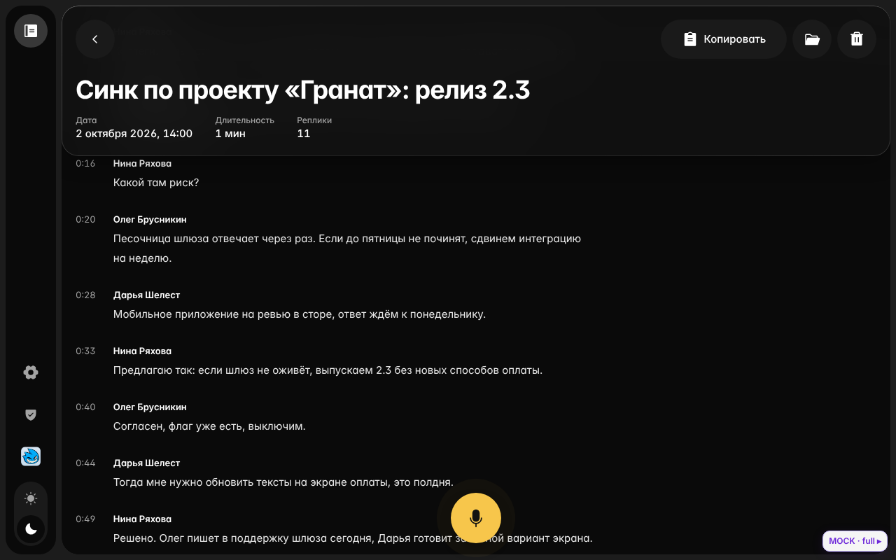
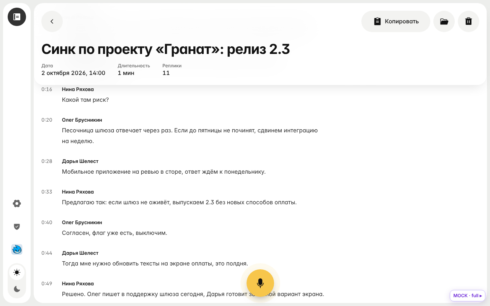
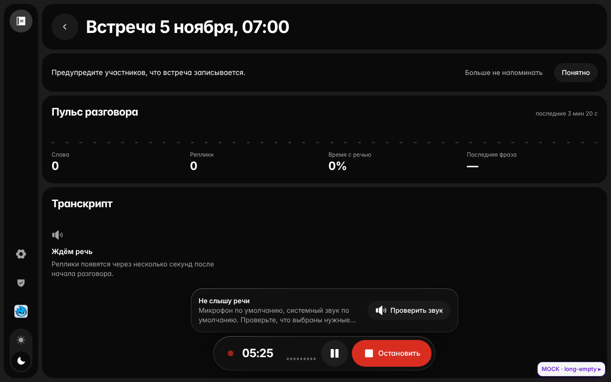
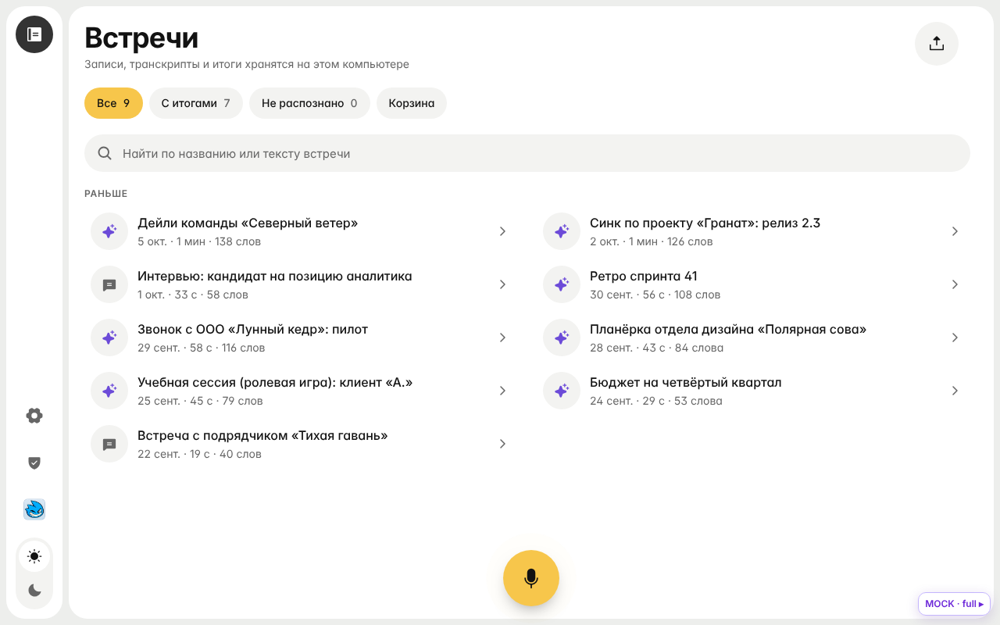
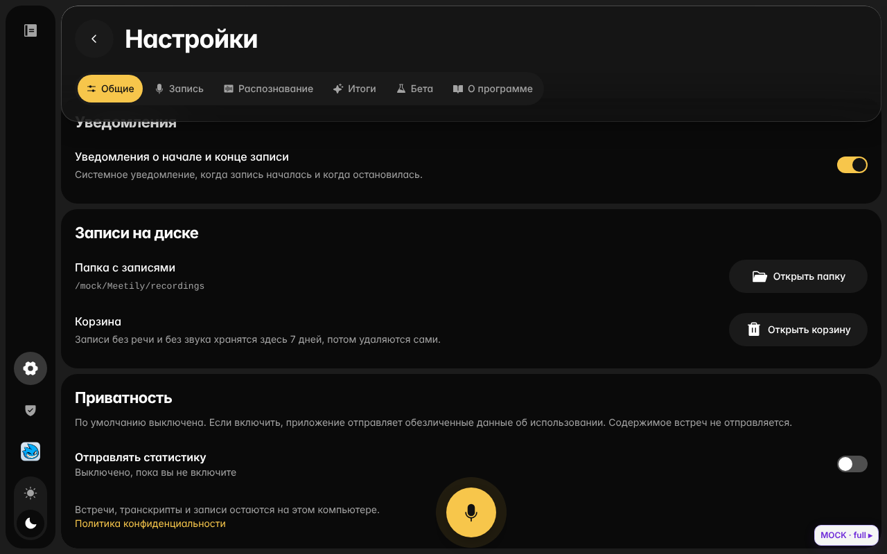
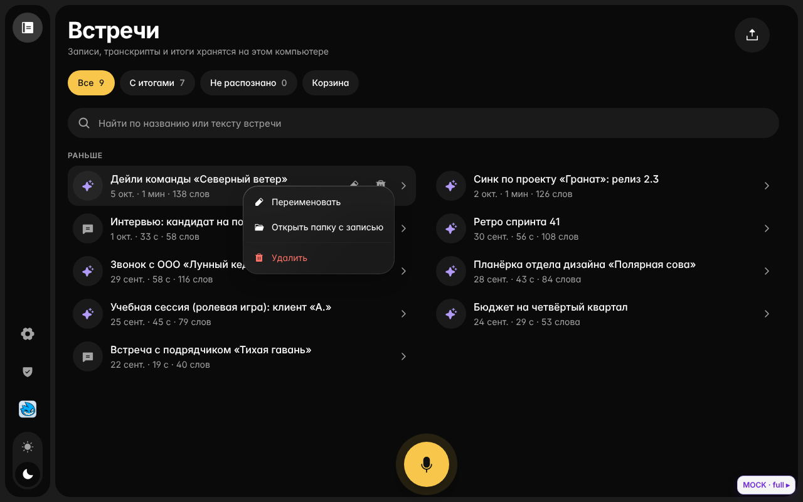

# #7 Стекло поверх контента, плавающая запись, жёлтый без градиента

- Статус: слит, 2026-11-05
- Ветка: `claude/tender-ride-8496pu` → `claude/design-review-flow`
- Автор: katanana23
- Исходная ссылка: https://github.com/katanana23/shade/pull/7

## Описание

## Description

Третий круг по визуалу ShadeNotes, по отзыву на превью `claude/design-review-flow`. Меняется только слой `frontend/src/aid`, `app/layout.tsx` (тонкий переходник) и `tailwind.config.js`. Логика записи, сохранения и списка не менялась. Оригинальные файлы, `src-tauri` и `mock-tauri` не тронуты.

**Жёлтый без градиента.** Главное действие и выбор: сплошной Mikado `#F6C74D`, текст `#111`. Класс `.aid-primary-fill` удалён.

**Стекло.** Добавлен класс `.aid-glass` в духе Liquid Glass из macOS 26: полупрозрачный тон, размытие 32 px с насыщенностью и светлый блик по кромке. Стекло стоит только у того, что лежит поверх контента:
- шапка страницы при прокрутке;
- капсула записи;
- меню, подсказки и диалоги: класс `.aid-glass-pop`, появляются из размытия, под диалогом размытое затемнение;
- уведомления.

Если в системе включено «Уменьшить прозрачность» (`prefers-reduced-transparency`), стекло становится сплошным. Без анимаций при `prefers-reduced-motion`.

**Края плиток при прокрутке.** Шапка страницы теперь липкая и лежит поверх контента. В покое это обычная плитка, при прокрутке стекло, и плитки проходят под ней размытыми. Область прокрутки обрезана маской по радиусу плитки (`.aid-round-clip`), поэтому у краёв окна плитки уходят под скругление, а не обрываются плоской линией. Маска нужна потому, что полоса прокрутки живёт в правом поле окна: обычный `overflow` с `border-radius` развёл бы правые углы с краем плиток.

**Запись.** Снова плавает внизу по центру поверх контента, как было до бенто, но в стекле:
- в покое круглая кнопка Mikado 72 px с микрофоном и двумя мягкими волнами, ⌘⇧R в подсказке;
- во время записи стеклянная капсула: красная точка с кольцом на речь, таймер, полосы речи, круглая «Пауза» 56 px и красная «Остановить»;
- «Не слышу речи» стеклянной карточкой над капсулой;
- после стопа итог карточкой на том же месте («Не распознано» на Giants).

Смена состояний появляется из размытия. У контента снизу запас `--dock-space` 112 px, последние строки не закрываются.

**Сайдбар.** Выбранный раздел теперь тёмно-серая таблетка с белой иконкой (`bg-nav-active`), а не жёлтая. «Настройки» перенесены вниз, над приватностью. Пока идёт запись, а человек не на главной, под «Встречами» кнопка с красной точкой.

**Роли цвета.** Синий Risd больше не используется: запись без цвета роли. Красный только «Остановить», точка записи и удаление. Правила обновлены в `CLAUDE.md`, `DESIGN.md` и `.impeccable/design.json`.

## Related Issue

Нет. Задача из чата, база `claude/design-review-flow` после слияния PR #6.

## Type of Change

- [x] Изменение интерфейса (визуальная система)
- [ ] Исправление ошибки в логике
- [x] Документация

## Testing

| Проверка | Результат |
| --- | --- |
| `npx tsc --noEmit` | без ошибок |
| `pnpm build` | успешно |
| `NEXT_PUBLIC_UI=original pnpm build` | успешно |
| Консоль браузера: главная, встреча, запись, настройки, обе темы | 0 ошибок |
| Липкая шапка при прокрутке колесом | остаётся на месте, становится стеклом |

Контраст: `#111` на Mikado 11,8:1, белая иконка на выбранном разделе (`#333` и `#383838`) больше 12:1, белый на красном «Остановить» 4,8:1.

## Documentation

`CLAUDE.md` (раздел «Стек интерфейса»), `DESIGN.md`, `.impeccable/design.json`.

## Checklist

- [x] Ветка от свежего `claude/design-review-flow`
- [x] Оригинальные файлы, `src-tauri`, команды и события Tauri, ключи хранилищ не менялись
- [x] Без резервных копий и файлов-самоотчётов
- [ ] Не проверено в настоящем окне Tauri на macOS: `tauri:dev` не запускался

## Screenshots (if applicable)

Все снимки в `docs/screenshots/aid-meeting/glass/`, Chromium 1280×800, обе темы.

| Встреча при прокрутке, тёмная | Встреча при прокрутке, светлая |
| --- | --- |
|  |  |
| Запись и «Не слышу речи» | Главная, кнопка записи |
|  |  |
| Настройки при прокрутке | Меню в стекле |
|  |  |

## Additional Notes

**Что не удалось или требует проверки**
- Настоящего преломления, как у Liquid Glass, в вебе нет: SVG-фильтр смещения в `backdrop-filter` WebKit не поддерживает. Стекло собрано из размытия, насыщенности и блика по кромке.
- В окне Tauri на macOS не проверял. `backdrop-filter` в WKWebView поддерживается, но производительность размытия на длинном транскрипте стоит посмотреть вживую.
- Снимки WebKit в этом круге не переснимались.

Сливать не нужно, PR в `claude/design-review-flow`.

---
_Generated by [Claude Code](https://claude.ai/code/session_01JzvomxkVSAKv3jjRMmSK11)_

## Обсуждение

**vercel[bot], 2026-11-05T07:01**

[vc]: #LkBCQwcHluFKNtBefbN/Fue89WMjXwn3kIRN9IuCMMg=:eyJpc01vbm9yZXBvIjp0cnVlLCJ0eXBlIjoiZ2l0aHViIiwicHJvamVjdHMiOlt7Im5hbWUiOiJtZWV0aWx5IiwicHJvamVjdElkIjoicHJqX3lEek5SV21QVVVHNW0yTTdZN3N3dDJTY1BwRWciLCJpbnNwZWN0b3JVcmwiOiJodHRwczovL3ZlcmNlbC5jb20vYWlkeG8yMy0zMTE4L21lZXRpbHkvOUhtM0NybTNVRlYyYzRra1o1cTVodHpHOWJ6UCIsInByZXZpZXdVcmwiOiJtZWV0aWx5LWdpdC1jbGF1ZGUtdGVuZGVyLXJpZGUtODQ5NnB1LWFpZHhvMjMtMzExOC52ZXJjZWwuYXBwIiwibmV4dENvbW1pdFN0YXR1cyI6IkRFUExPWUVEIiwibGl2ZUZlZWRiYWNrIjp7InJlc29sdmVkIjowLCJ1bnJlc29sdmVkIjowLCJ0b3RhbCI6MCwibGluayI6Im1lZXRpbHktZ2l0LWNsYXVkZS10ZW5kZXItcmlkZS04NDk2cHUtYWlkeG8yMy0zMTE4LnZlcmNlbC5hcHAifSwicm9vdERpcmVjdG9yeSI6ImZyb250ZW5kIn1dfQ==
The latest updates on your projects. Learn more about [Vercel for GitHub](https://vercel.link/github-learn-more).

| Project | Deployment | Actions | Updated |
| :--- | :----- | :------ | :------ |
| <a href="https://vercel.com/aidxo23-3118/meetily"></a> [meetily](https://vercel.com/aidxo23-3118/meetily) |  [Ready](https://vercel.com/aidxo23-3118/meetily/9Hm3Crm3UFV2c4kkZ5q5htzG9bzP) | [Preview](https://meetily-git-claude-tender-ride-8496pu-aidxo23-3118.vercel.app) | <relative-time datetime="2026-11-05T07:03:10.622Z">Nov 5, 2026 7:03am UTC</relative-time> |

