# #17 Первый запуск ShadeNotes: минималистичный, с живым показом работы

- Статус: слит, 2026-11-07
- Ветка: `claude/onboarding` → `aid`
- Автор: katanana23
- Исходная ссылка: https://github.com/katanana23/shade/pull/17

## Описание

## Description

Свой первый запуск ShadeNotes вместо перекрашенного мастера Meetily: до трёх коротких шагов, около минуты, без перезагрузки страницы в конце. Минималистично: одна плитка до 600 px по центру на фоне окна, сверху точки шага, подложка кнопок окна на месте. Наглядность дают живые показы вместо текста. Каждый шаг помещается в окно по умолчанию 1100 × 700 без прокрутки (проверено замером).

Точек шага три, пока модель распознавания качается (показ, доступ, «Почти готово»), и две, если она уже скачана или на Windows и Linux (нет шага доступа).

**Шаг 1. Показ и «Начать»** (`HelloStep`)
- Обложка с живым показом работы, цикл 6 с:
  1. лаймовая кнопка «Записать» появляется и нажимается, на её месте капсула с таймером;
  2. над капсулой по очереди появляются три реплики (разговор вымышленный);
  3. их сменяют итоги на мягком тоне Indigo;
  4. итоговый кадр стоит 1,7 с и плавно гаснет перед повтором.
- Под обложкой логотип, одна строка «Нажмите «Записать», остальное сделает ShadeNotes» и «Начать».
- **Загрузка моделей стартует уже на этом шаге**, как только `OnboardingContext` прочитал модели с диска (чтобы уже скачанная модель не пошла качаться заново), запасной старт через 4 с.

**Шаг 2. «Доступ к звуку»** (`AccessStep`, только macOS)
- Обложка с показом запроса macOS (цикл 5,6 с): стилизованное окно «ShadeNotes просит доступ к микрофону», указатель подходит сбоку по кривой и нажимает «Разрешить» (кнопка сжимается), затем «Доступ есть» стоит около 2 с и плавно уходит.
  - Микрофон разрешён: показ стоит на «Доступ есть».
  - Отказ или «Проверим при первой записи»: показ стоит на окне запроса без указателя, «Доступ есть» не показывается.
- Подсказка «Нажмите «Разрешить», когда macOS спросит.», две карточки «Микрофон» и «Звук с компьютера» («Нужен для созвонов в Zoom и Meet»), у каждой одна кнопка и свой статус. Обязателен только микрофон.
- При отказе «Открыть настройки», при возврате фокуса доступ перепроверяется сам.
- Внизу «Продолжить» и тихая «Позже». На Windows и Linux шаг пропускается.

**Шаг 3. «Почти готово»** (`ReadyStep`)
- Прогресс модели распознавания. «Открыть ShadeNotes» активна, как только она скачана. Модель для итогов докачивается в фоне.
- Если модель распознавания уже скачана (обычно к концу шага доступа), шаг пропускается.
- Ошибка загрузки: «Загрузка прервалась. Проверьте интернет и повторите.» и «Повторить».

**Контраст текста на цвете (APCA)**

APCA (модель восприятия контраста, учитывает размер и насыщенность шрифта) точнее WCAG 2 для тёмного текста на среднесветлом цвете. Замеры на обоих шагах, обе темы:
- Лайм с текстом `#111`: Lc 96 (WCAG 16:1). Без изменений.
- Насыщенный Indigo `#B49DF8` с текстом `#111`: Lc 57 (WCAG 7,9:1, формально проходит). Для текста 15 px нужно не меньше 75, утолщением шрифта это не добрать.
- **Итоги в показе теперь на мягком тоне Indigo** (`.aid-role-indigo-soft`: 60 % роли с белым), текст 15 px 500 вместо 13 px 400: Lc 75 (WCAG 11,5:1).
- **Правило в `CLAUDE.md`**: текст на цвете проверять по APCA. До 16 px не ниже Lc 75, крупный полужирный (от 18 px 600) не ниже 60. На насыщенных Indigo и Giants только знаки и крупные заголовки, плотный текст на мягком тоне роли. Текст на цвете не приглушать и не делать тоньше 500.
- Тем же замером вне онбординга найдено: плитка итогов на странице встречи (насыщенный Indigo) даёт Lc 53–57 у «Итоги», подзаголовка, «Свернуть» и «Сделать заново». Это вне этого PR, правка предложена отдельно.

**Пропорции обложек**
- Обе обложки 8:3: высота пропорциональна ширине вместо фиксированных 256 и 176 px.
- Чтобы шаг доступа по-прежнему помещался в 1100 × 700, капсула и кнопка «Записать» в показе стали 48 px (как контролы приложения), карточки доступа 72 px (кнопка 48 и по 12 сверху и снизу).

**Вёрстка**
- **Текст кирпичиком.**
  - Заголовки: `text-wrap: balance`, колонка около 30 символов.
  - Описания и подписи: `pretty`, до 52 символов.
  - Неразрывные пробелы: «сделает ShadeNotes», «к микрофону», «в Zoom и Meet», «к четвергу» и другие предлоги в итогах показа.
  - В окне запроса строки ровные: «ShadeNotes просит / доступ к микрофону».
- **Одна шкала отступов** (8 / 12 / 16 / 20 / 24 / 32).
  - Внутри плитки 20 px, как у всех плиток приложения (`--tile-pad`): при переходе в главную плотность не меняется.
  - «Заголовок + описание» 8 px. Между обложкой, заголовком, списком и кнопкой 24–32 px.
  - У карточек с кнопкой-таблеткой справа правый отступ на 4 px меньше: таблетка оптически уже прямоугольника.
- **Обложки.**
  - Внутренний отступ как у плитки (20 px).
  - Содержимое около двух третей высоты и стоит чуть выше геометрического центра.
  - Реплики и капсула собраны в одну группу без пустой середины.
  - Окно запроса крупнее (300 px, текст 15 px), без рамки и тени системного окна, на подложке обложки.
  - Указатель стрелкой подходит снизу справа к краю «Разрешить» и надпись не закрывает.
- **Анимации.**
  - Появление ease-out по 300 мс на элемент, реплики через 150 мс.
  - Указатель идёт по кривой: сдвиг по горизонтали и по вертикали с разными кривыми замедления.
  - Перед повтором затухание, а не резкий сброс.
- **Неактивная «Продолжить» и «Открыть ShadeNotes»** нейтральные приглушённые, лайм только у активной. Во время сохранения кнопка остаётся лаймовой со спиннером: это ожидание, а не запрет.

**Общее**
- Смена шагов: размытие и сдвиг за 0,2 с, следующий приходит за 0,3 с. Анимируются только `transform`, `opacity` и `filter`. При `prefers-reduced-motion` анимаций 0. Показ записи стоит на итоговом кадре (капсула и итоги), показ запроса на окне без указателя.
- Полоски в капсуле показа украшение, а не уровень звука: его ядро во время записи не отдаёт. Показ запроса иллюстрация, а не статус: настоящий статус в карточке «Микрофон».
- Индикатор ожидания (`Spinner`) у каждой кнопки, которая ждёт ядро. У каждого вызова ядра предел 8 с (`lib/onboarding.ts`), после него «Продолжить всё равно».
- Каждый шаг и каждый вызов ядра пишется в консоль строкой `[aid] onboarding` со временем ответа.
- В конце нет `window.location.reload()`. Завершение идёт через `completeOnboarding()`, затем `onComplete` из layout. Провайдеры монтируются заново через `key`, чтобы прочитать сохранённые настройки, как раньше делала перезагрузка. Экран растворяется (0,26 с), приложение проявляется на том же фоне окна (`.aid-app-enter`). Заставка `LaunchScreen` лежит вне этого дерева и второй раз не появляется (проверено в Chromium и WebKit).
- Пока ядро не ответило, нужен ли первый запуск, приложение не рисуется: раньше на мгновение мелькал список встреч.

**Файлы**
- `src/aid/components/onboarding/`:
  - `AidOnboarding.tsx`: шаги, загрузка, завершение;
  - `HelloStep.tsx`, `AccessStep.tsx`, `ReadyStep.tsx`: три шага;
  - `useAccessChecks.ts`: запрос доступа, «Открыть настройки», перепроверка;
  - `ui.ts`: общие классы заголовка, описания и главной кнопки.
- `src/aid/lib/onboarding.ts`: предел времени, журнал, `open_system_settings` с `preferencePane`.
- `src/aid/styles/globals.css`: анимации шагов и показов (`.aid-ob-*`), мягкий тон `.aid-role-indigo-soft`.
- `app/layout.tsx` (переходник): при `NEXT_PUBLIC_UI=aid` новый первый запуск, для `original` мастер оригинала.
- Оригинальные `components/onboarding/*` и `OnboardingContext` не менялись. Команды и события ядра те же, с теми же аргументами.
- Из `LegacyBridge.tsx` убраны подписи шагов мастера, из `globals.css` фон мастера, из `legacy-i18n.ts` его строки. Правило, скрывающее тосты загрузки, пока открыт первый запуск, осталось.
- Промежуточные варианты (эскизы, витрина с плитками-подписями, путь из плиток-задач) удалены вместе с их CSS.

**Попутно: «Открыть настройки»** в `SoundCheck.tsx` и `Home.tsx` вызывала `open_system_settings` без обязательного `preferencePane` и молча не срабатывала. Теперь открывается раздел «Микрофон».

## Почему «Готово» на экране разрешений не нажималось

Это выводы из кода оригинала. На настоящем Mac я их не проверял: облачная среда на Linux, macOS там нет (см. ниже).

1. **«Готово» ждала оба доступа.** Кнопка была выключена (`disabled={!allPermissionsGranted}`), пока не разрешены и микрофон, и звук с компьютера. Если проверка звука с компьютера отвечала «нет», кнопка не включалась никогда, оставалась только ссылка «Позже».
2. **«Открыть настройки» не работала.** `PermissionsStep` вызывал `invoke('open_system_settings')` без обязательного аргумента `preferencePane`. Команда ядра (`src-tauri/src/utils.rs`) отклоняла вызов, дальше вызывался `alert()`, который в окне Tauri ничего не показывает. Выйти из «Доступ закрыт» было нельзя.
3. **Общий флаг ожидания.** `isPending` был один на обе карточки: одна зависшая проверка выключала обе кнопки.
4. **Завершение без индикатора и предела времени.** `handleFinish` ждал `completeOnboarding()`: три вызова ядра подряд, один из них `builtin_ai_is_model_ready` с `refresh: true`, который пересканирует папку моделей, пока модель итогов ещё качается. Ошибка уходила только в консоль. Затем шёл `window.location.reload()`, а перезагрузка в окне Tauri на macOS у нас уже зависала (поэтому встречи и настройки открываются на месте).

Гипотезу о перезагрузке подтвердит или опровергнет проверка на Mac по чек-листу ниже: в новом флоу перезагрузки нет совсем, а у каждого ожидания есть предел.

## Ограничение: перепроверка микрофона

В ядре нет команды, которая только узнаёт состояние доступа, не запрашивая его. `trigger_microphone_permission` открывает поток звука и отвечает, удалось ли это. По комментарию в ядре (`audio/devices/discovery.rs`) при запрете macOS иногда всё равно даёт открыть поток, только без звука. Поэтому:
- По первому нажатию «Разрешить»: «да» показывается как «Доступ есть», «нет» как «Доступ закрыт» с кнопкой «Открыть настройки».
- После возврата из Системных настроек:
  - ответ изменился на «да»: «Доступ есть»;
  - ответ не изменился: нейтрально «Проверим при первой записи», без зелёного статуса. macOS часто применяет разрешение микрофона только после перезапуска приложения.

  Продолжить можно в обоих случаях. Настоящая проверка будет при первой записи: её уже делает ядро (`verify_microphone_access`).
- В контекст оригинала (`setPermissionStatus`) уходят только определённые ответы: «есть» и «закрыт».

## «Продолжить всё равно» в конце

Если `complete_onboarding` не ответил за 8 с, под кнопкой появляются «Сохранение настроек затянулось. Если не сохранятся, этот экран покажется при следующем запуске.» и «Продолжить всё равно».
- Если ответ придёт позже, пока человек ещё на экране, приложение откроется само.
- Если человек нажал «Продолжить всё равно», приложение открывается сразу, а в консоли строка `[aid] onboarding продолжили без сохранения…`. Сам вызов продолжается в ядре. Если он так и не сохранится, при следующем запуске человек снова увидит первый шаг. Модели уже скачаны и не качаются заново, а «Почти готово» пропускается, так что повтор займёт несколько секунд.
- Если вызов упал с ошибкой, будут «Не удалось сохранить настройки» и кнопки «Повторить» и «Продолжить всё равно».

## Чек-лист на Mac (ярлык на ветке `claude/onboarding`)

Для чистого первого запуска сбросьте онбординг. Самый простой способ: удалить `onboarding-status.json` в папке данных приложения (`~/Library/Application Support/io.github.katanana23.aid-meetings/`). Для пункта 3 сбросьте и доступ:

```bash
tccutil reset Microphone io.github.katanana23.aid-meetings
```

1. Запустить. Видно: заставка, затем плитка с живым показом записи и «Начать», кнопки окна в подложке слева сверху. Всё помещается в окно без прокрутки. Окно тянется за пустое место.
2. «Начать». Видно: плавный переход на «Доступ к звуку», в обложке показ запроса, указатель нажимает «Разрешить».
3. «Разрешить» у микрофона. Видно: системное окно macOS, после ответа «Доступ есть» (показ стоит на «Доступ есть») или «Доступ закрыт» (показ стоит на окне запроса). Важно: меняется ли статус до ответа в системном окне (тогда ядро отвечает раньше человека, напишите мне).
4. Если «Доступ закрыт»: «Открыть настройки». Открывается раздел «Микрофон». Включить ShadeNotes и вернуться в окно. Видно: статус сам сменился на «Доступ есть» или «Проверим при первой записи», «Продолжить» стала лаймовой.
5. «Продолжить», затем «Почти готово» с процентами (или сразу приложение, если модель уже скачана). Видно: экран растворяется в приложение за долю секунды, без белой вспышки, без второй заставки и без зависания.
6. Закрыть и открыть приложение. Видно: первого запуска нет, сразу список встреч. Если что-то пошло не так, пришлите строки `[aid] onboarding` из консоли (Safari → Разработка → ShadeNotes).

## Type of Change

- [x] Bug fix
- [x] New feature
- [ ] Breaking change
- [x] Documentation update

## Testing

- [x] `npx tsc --noEmit`: без ошибок.
- [x] `pnpm build` и `NEXT_PUBLIC_UI=original pnpm build`: обе с кодом 0.
- [x] Контраст по APCA на обоих шагах в обеих темах: весь текст на цветном фоне не ниже Lc 75 (итоги 75, лайм 96).
- [x] Chromium на заглушках (`?mock=onboarding`) в окне 1100 × 700, обе темы, сценарии (повторены после правки контраста и пропорций):
  - обычный путь через все три шага;
  - отказ: «Продолжить» выключена; «Открыть настройки» с `{ preferencePane: 'Privacy_Microphone' }`; возврат фокуса с прежним ответом даёт «Проверим при первой записи», и «Продолжить» включается;
  - `complete_onboarding` не отвечает: «Продолжить всё равно» через 8,3 с, затем приложение;
  - ошибка загрузки: «Повторить» снова запускает загрузку.

  Ошибок в консоли нет, кроме ожидаемой строки об ошибке загрузки из `OnboardingContext`.
- [x] При отказе показ запроса в состоянии `still`: окно видно, указатель и «Доступ есть» скрыты (проверено по вычисленной прозрачности).
- [x] Загрузка модели стартует на первом шаге: строка журнала до нажатия «Начать».
- [x] Все три шага помещаются в 1100 × 700: высота прокрутки не больше высоты окна.
- [x] После завершения та же страница, без перезагрузки: метка в `window` сохранилась, загрузок страницы 1, `LaunchScreen` не появляется.
- [x] Путь Windows (подменённая платформа): шага доступа нет, две точки, приложение открывается.
- [x] `prefers-reduced-motion`: 0 анимаций на шагах.
- [x] WebKit (WebKitGTK): шаги и вход в приложение в обеих темах, рисует как Chromium, без перезагрузки и без повторной заставки.
- [x] Детектор Impeccable по `src/aid`: замечаний нет.
- [ ] Не проверено в настоящем Tauri на macOS: эта сессия работает в облачном контейнере на Linux. Чек-лист выше.

## Documentation

- [x] `CLAUDE.md`: раздел о первом запуске и правило контраста по APCA.
- [x] `docs/case/mock.md`: сценарий `onboarding` под новый флоу.

## Checklist

- [x] `frontend/src-tauri` не менялся.
- [x] Команды и события Tauri, их аргументы, форматы данных и ключи `localStorage` не менялись.
- [x] Оригинальные файлы онбординга и `OnboardingContext` не тронуты; `app/layout.tsx` тонкий переходник.
- [x] `mock-tauri` не менялся: отказы и задержки подставлялись в тестах обёрткой вызовов.
- [x] Иконки Phosphor fill без подложек (галочка `Check` bold), ожидание только `Spinner`.

## Screenshots

Показы (сверху светлая тема, снизу тёмная): запись и запрос доступа.

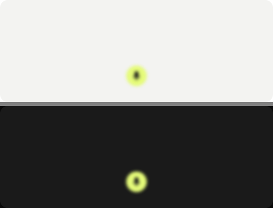 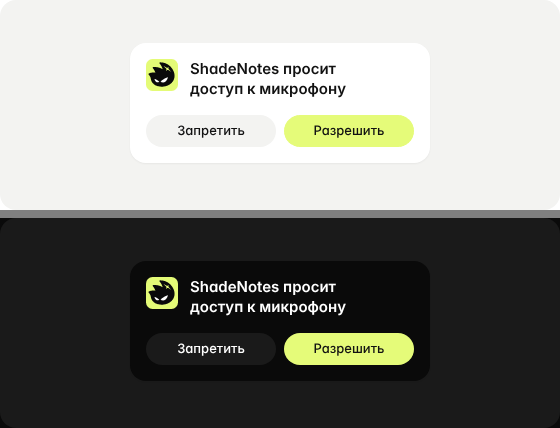

Флоу: показ записи, «Начать», показ запроса и доступ, «Почти готово».

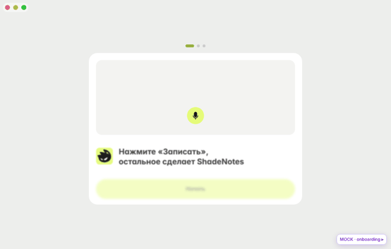

| | Светлая | Тёмная |
|---|---|---|
| Шаг 1: показ и «Начать» | 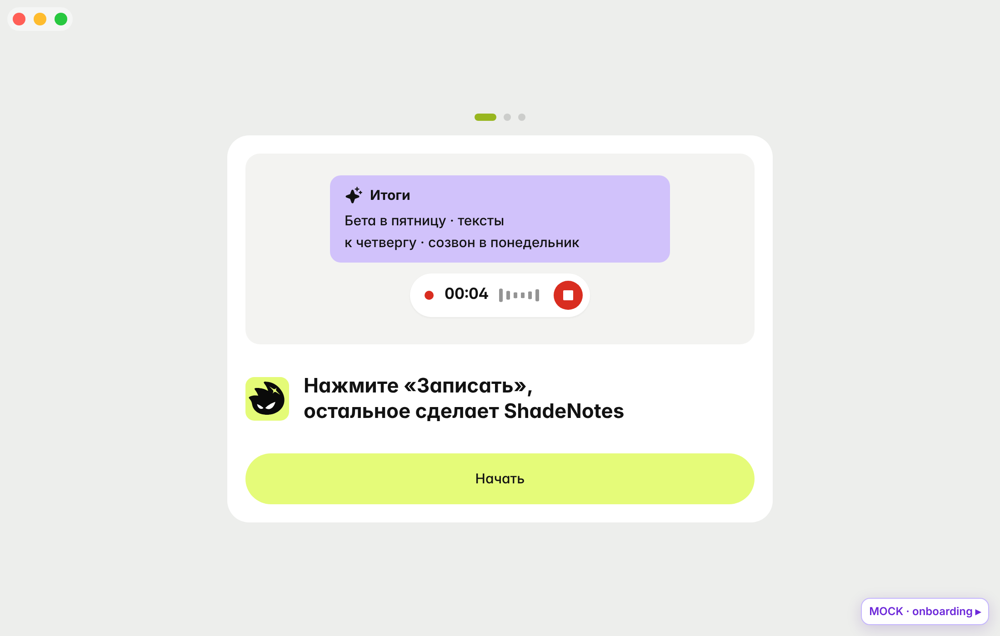 | 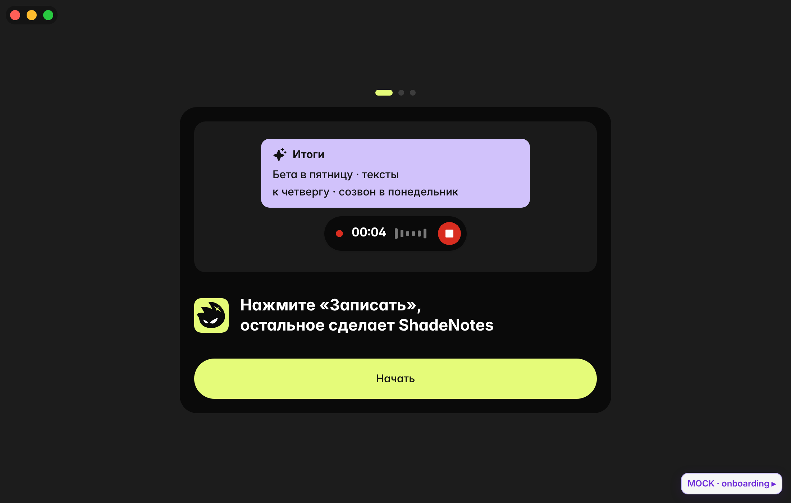 |
| Шаг 2: доступ к звуку | 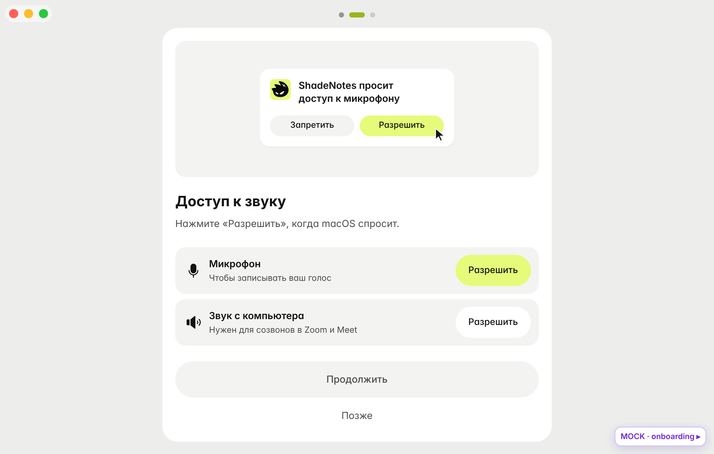 | 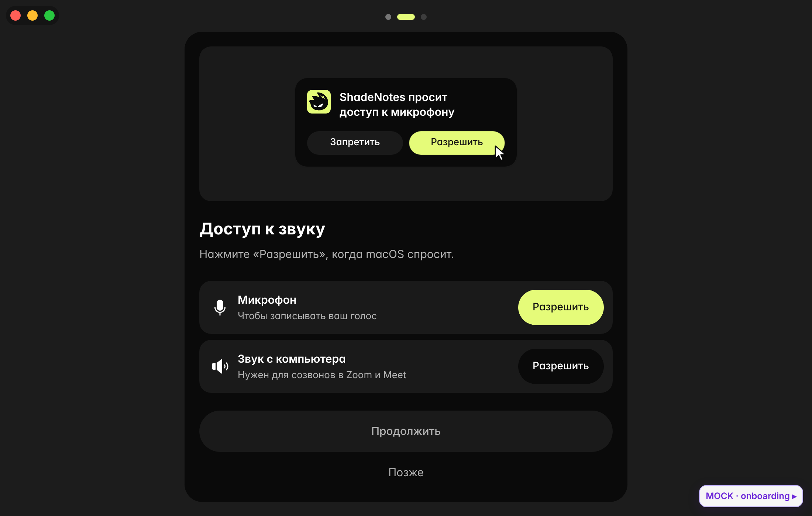 |
| Микрофон разрешён | 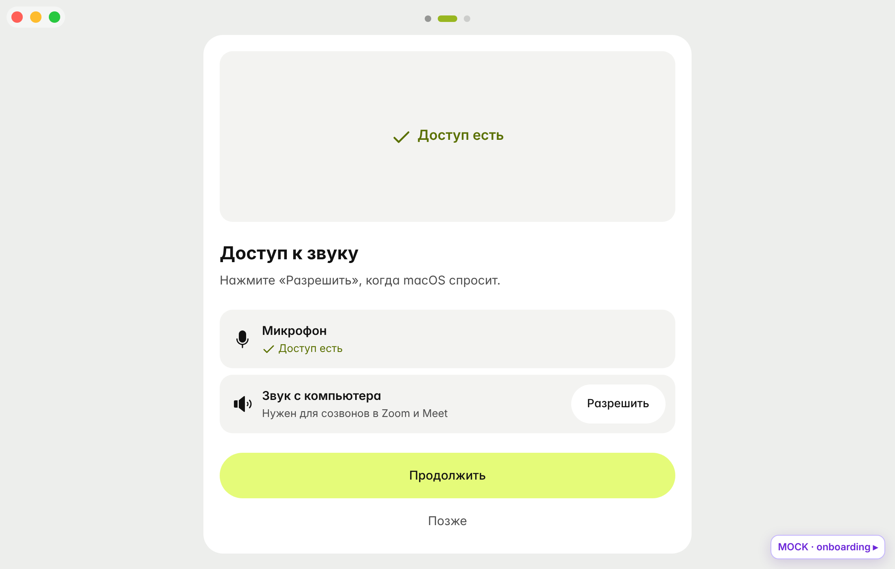 |  |
| Шаг 3: почти готово | 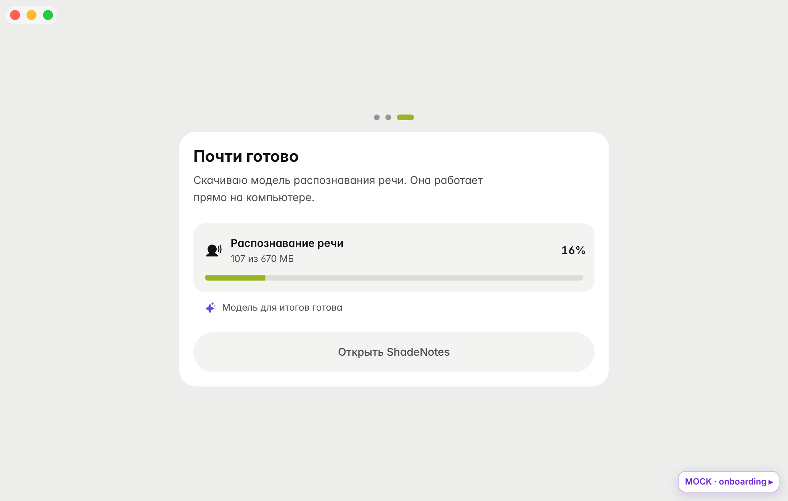 | 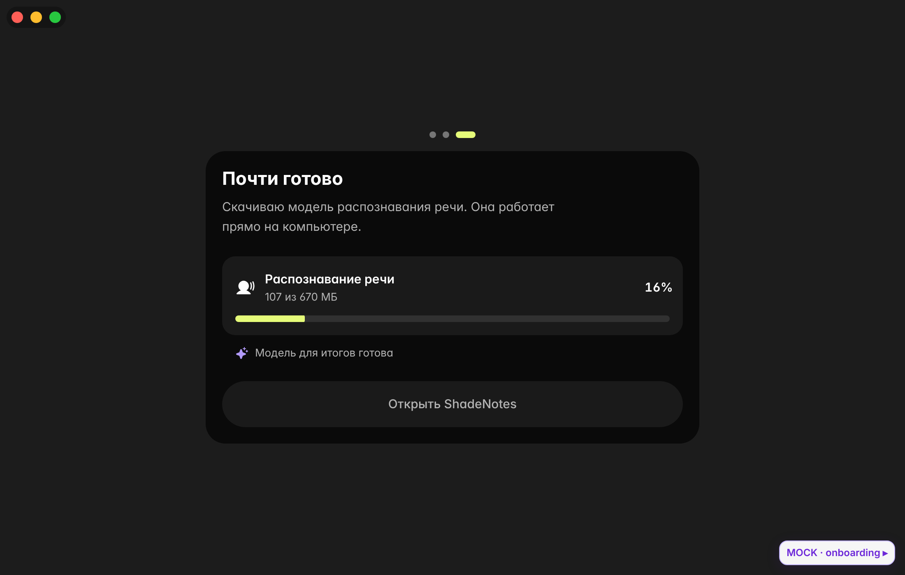 |
| Доступ закрыт | 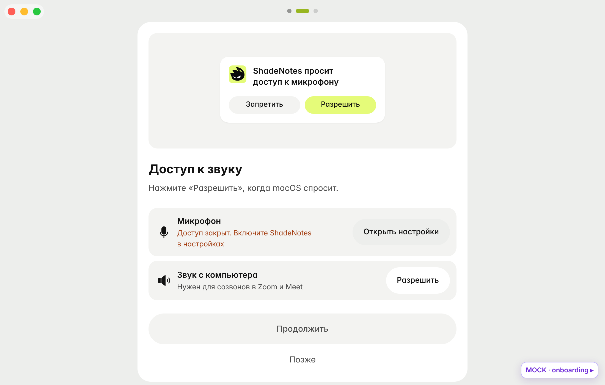 | 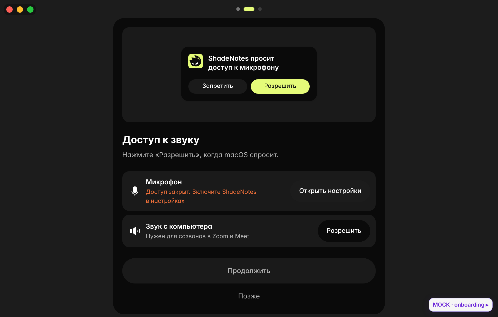 |
| После настроек: «Проверим при первой записи» | 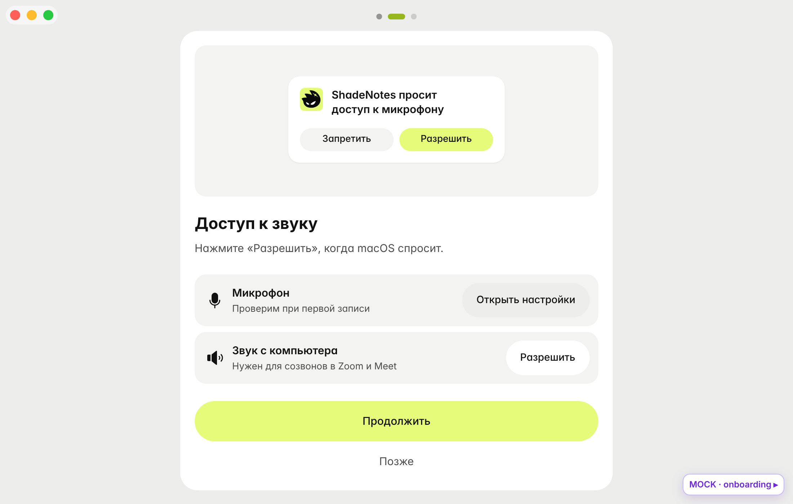 | 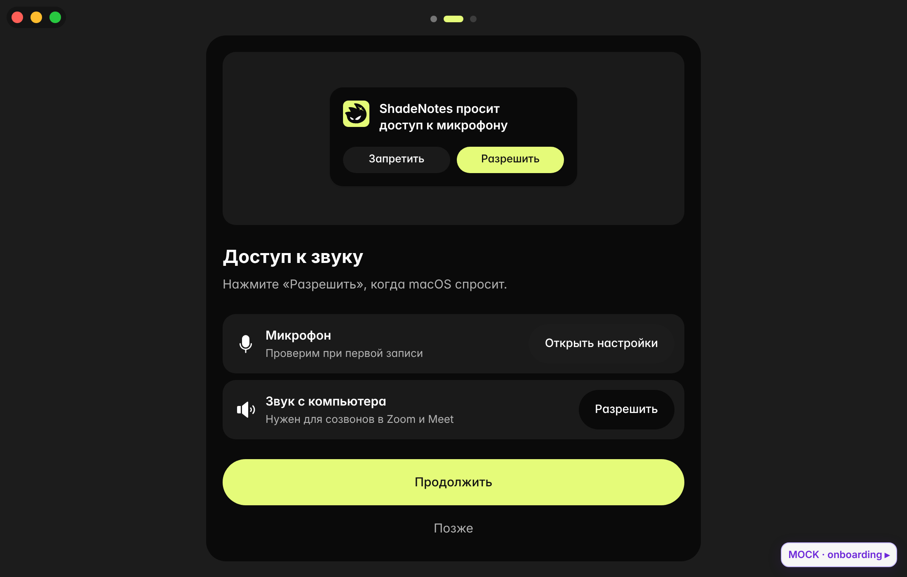 |
| Сохранение затянулось | 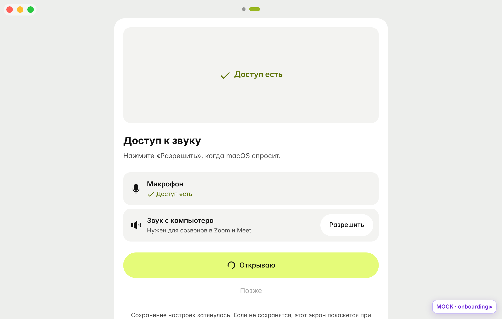 | 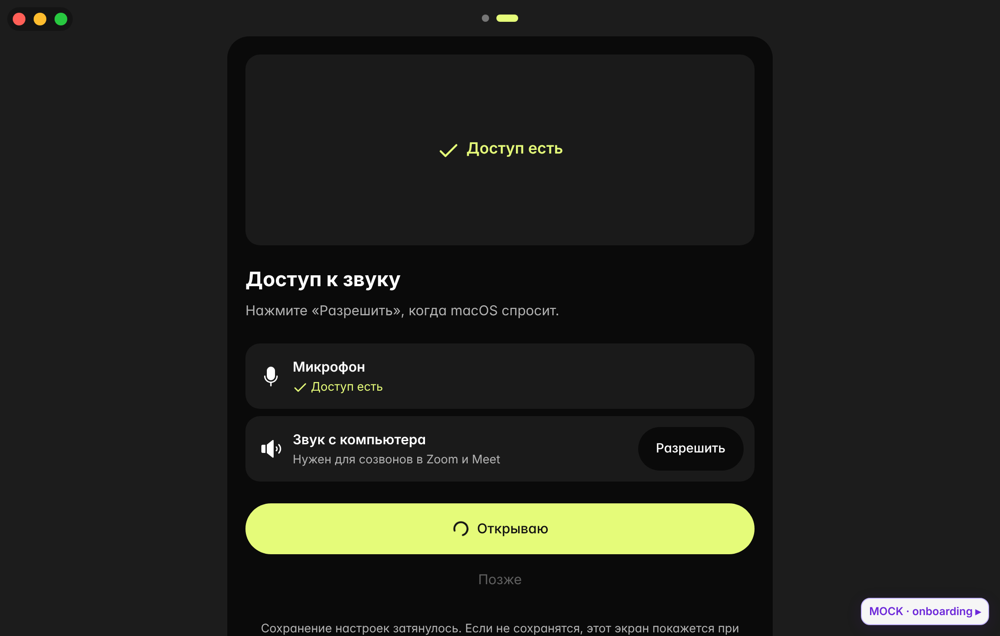 |
| Ошибка загрузки | 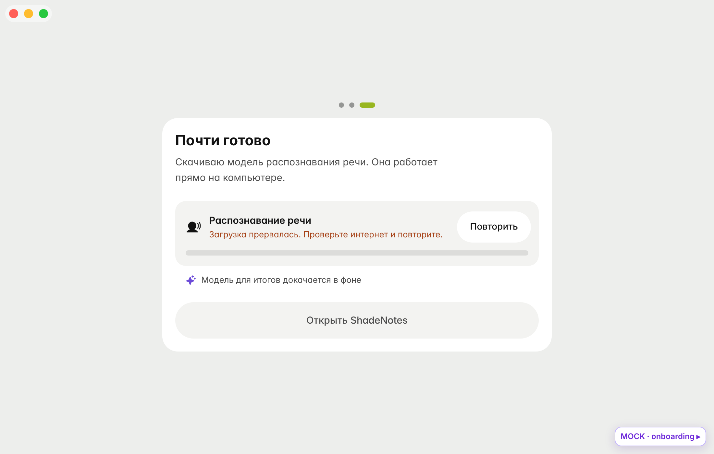 | 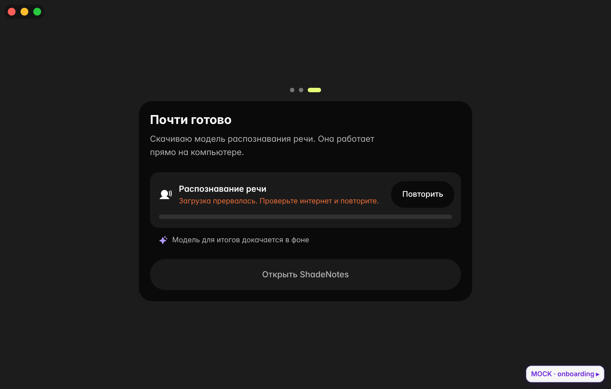 |

WebKit: `docs/screenshots/aid-meeting/onboarding/webkit/`.

## Additional Notes

- Не сливать: PR в `aid`.

🤖 Generated with [Claude Code](https://claude.com/claude-code)

https://claude.ai/code/session_01JzvomxkVSAKv3jjRMmSK11

## Обсуждение

**vercel[bot], 2026-11-06T14:35**

[vc]: #AP6+3LnM6JmwTk37gENPmHKxzRBzGmuWybB2WsCsZcA=:eyJpc01vbm9yZXBvIjp0cnVlLCJ0eXBlIjoiZ2l0aHViIiwicHJvamVjdHMiOlt7Im5hbWUiOiJtZWV0aWx5IiwicHJvamVjdElkIjoicHJqX3lEek5SV21QVVVHNW0yTTdZN3N3dDJTY1BwRWciLCJsaXZlRmVlZGJhY2siOnsicmVzb2x2ZWQiOjAsInVucmVzb2x2ZWQiOjAsInRvdGFsIjowLCJsaW5rIjoibWVldGlseS1naXQtY2xhdWRlLW9uYm9hcmRpbmctYWlkeG8yMy0zMTE4LnZlcmNlbC5hcHAifSwiaW5zcGVjdG9yVXJsIjoiaHR0cHM6Ly92ZXJjZWwuY29tL2FpZHhvMjMtMzExOC9tZWV0aWx5LzRHNGloZFhNQ0h4cDNtV0hqbXQ2UFVzYnlpTjkiLCJwcmV2aWV3VXJsIjoibWVldGlseS1naXQtY2xhdWRlLW9uYm9hcmRpbmctYWlkeG8yMy0zMTE4LnZlcmNlbC5hcHAiLCJuZXh0Q29tbWl0U3RhdHVzIjoiREVQTE9ZRUQiLCJyb290RGlyZWN0b3J5IjoiZnJvbnRlbmQifV19
The latest updates on your projects. Learn more about [Vercel for GitHub](https://vercel.link/github-learn-more).

| Project | Deployment | Actions | Updated |
| :--- | :----- | :------ | :------ |
| <a href="https://vercel.com/aidxo23-3118/meetily"><sup></sup></a> [meetily](https://vercel.com/aidxo23-3118/meetily) |  [Ready](https://vercel.com/aidxo23-3118/meetily/4G4ihdXMCHxp3mWHjmt6PUsbyiN9) | [Preview](https://meetily-git-claude-onboarding-aidxo23-3118.vercel.app) | <relative-time datetime="2026-11-07T03:56:37.127Z">Nov 7, 2026 3:56am UTC</relative-time> |


