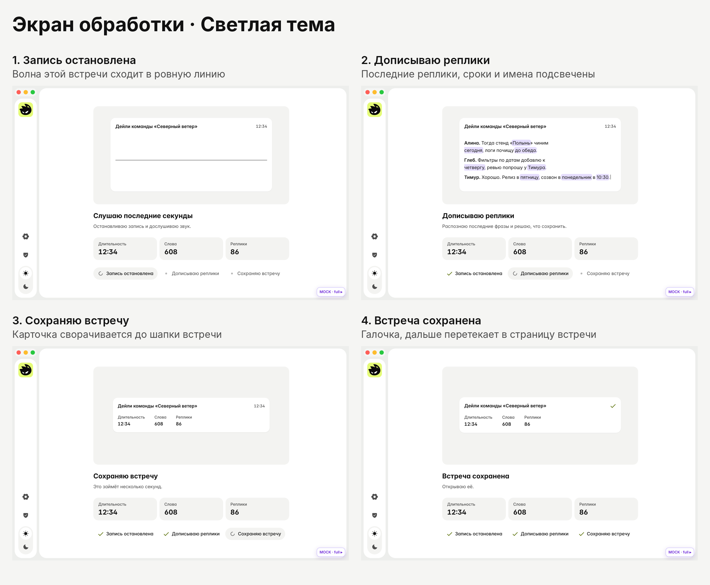
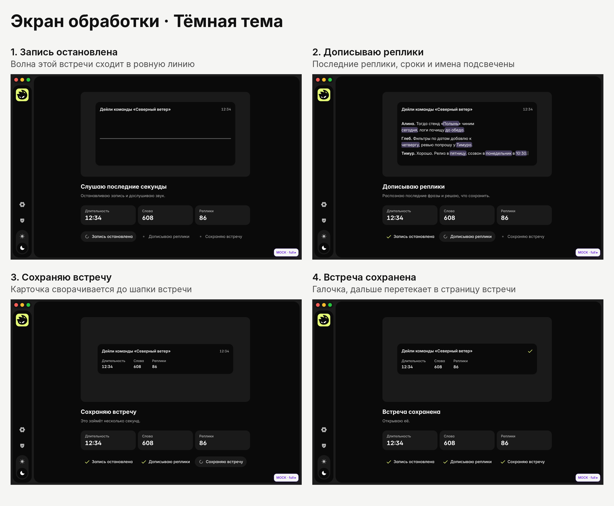
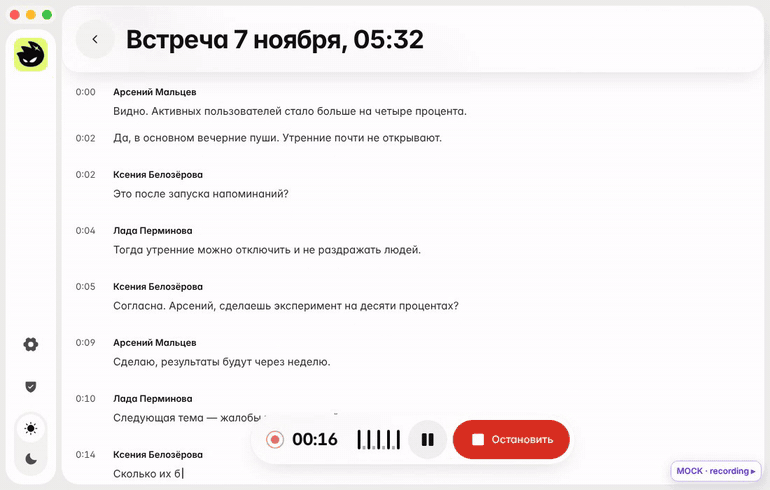
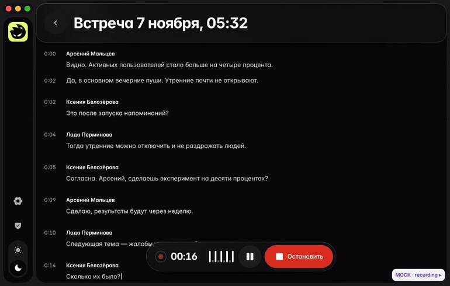
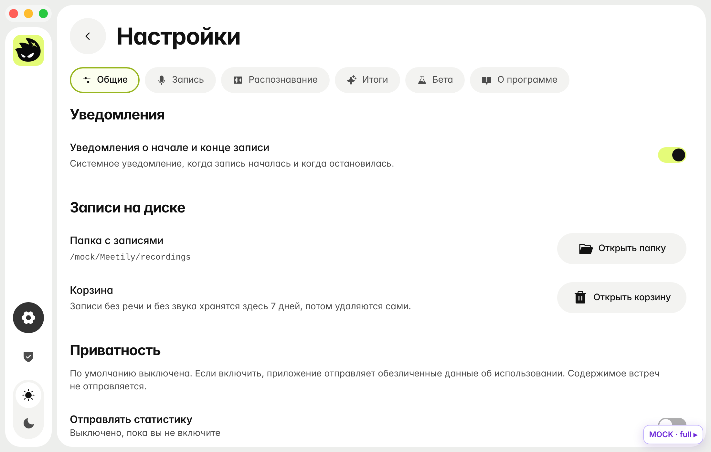
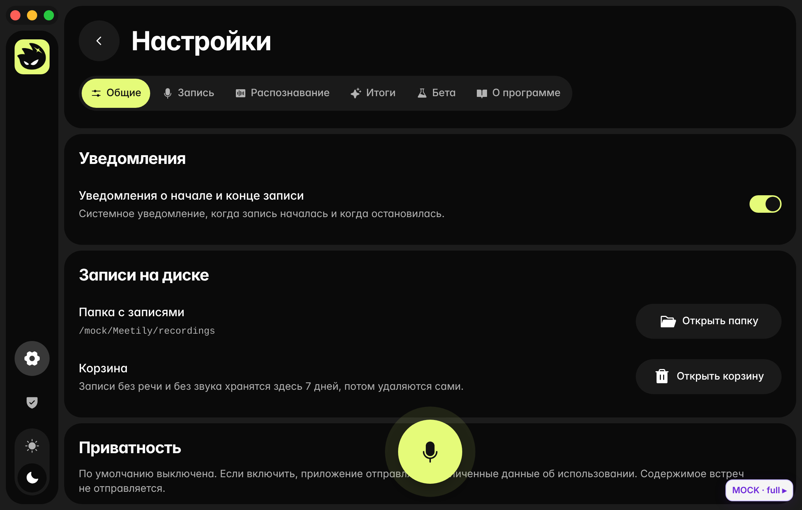
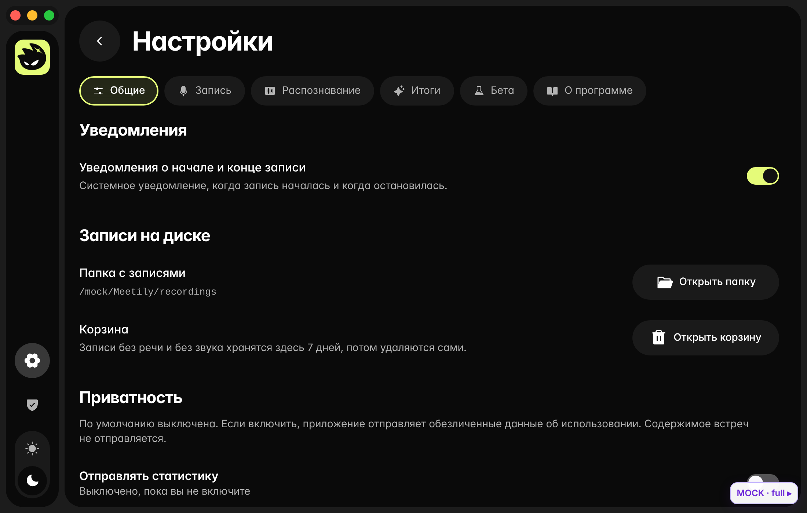
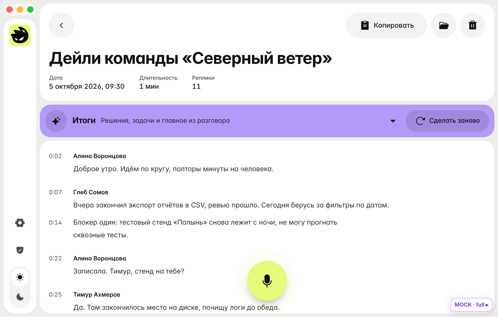
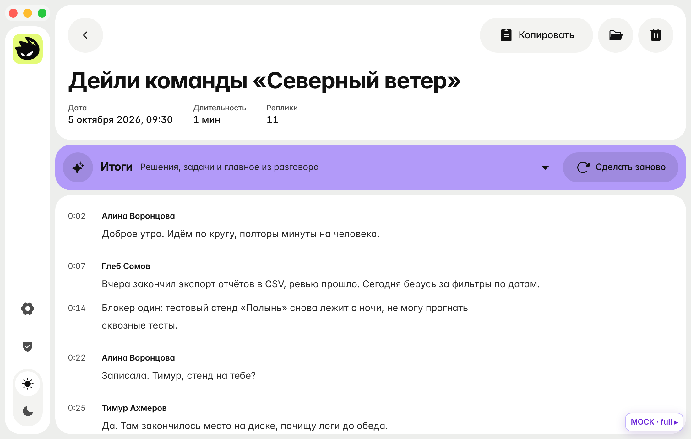

# #18 Настройки как главная; экран обработки после «Остановить»

- Статус: слит, 2026-11-07
- Ветка: `claude/settings-finish` → `aid`
- Автор: katanana23
- Исходная ссылка: https://github.com/katanana23/shade/pull/18

## Описание

## Description

Две задачи, отдельными коммитами. Логика записи, доступов и уведомлений не менялась: её параллельно чинит другая сессия (PR #19), здесь только внешний вид.

### Задача 1. Настройки как главная (`ec6c512`)

1. **Шапка как на главной.** Настройки на общем `Page` в раскладке главной (tile): одна плитка, плоская липкая шапка (`.aid-head-flat`), при прокрутке стекло и мягкое затухание под ней (`.aid-edge-fade`). Раньше шапка была отдельной плиткой с рамкой, и контент обрывался о её край. Разделы теперь открытыми группами внутри плитки (заголовок 22/28, 32 px между группами), как строки списка на главной.
2. **Вкладки как фильтры главной.**
   - Отдельные таблетки 40 px на вложенной поверхности, без общей подложки.
   - Выбранная: `.aid-chip-on` (рамка 2 px акцентом, лёгкое стекло, без лаймовой заливки), текст font-medium. Невыбранные: обычный вес, цвет `muted`.
   - Ширина каждой вкладки считается по полужирному варианту, поэтому при выборе соседи не сдвигаются.
3. **Кнопка записи.** Круглая кнопка в покое теперь только на списке встреч. На настройках она закрывала строку «Отправлять статистику», на странице встречи последние реплики транскрипта.
   - Новый `IdleRecordButton` в `RecordDock` смотрит адрес (`?view=settings`, `?id=…`, `/settings`, `/meeting-details`).
   - Капсула идущей записи и итог после неё показываются на всех экранах. Сочетание ⌘⇧R работает везде.
   - Пока кнопки нет, у прокрутки обычный нижний отступ вместо запаса под неё (`data-dock-off`).

### Задача 2. Экран обработки после «Остановить» (`a4d3e64`, `0ac683f`, вариант C)

Главное на экране обложка 2:1, карточка в ней около 70 % площади, по оптическому центру. Обложка показывает настоящий процесс, а не ролик по кругу.

**Сцены по реальным шагам.** Сцену выбирает статус записи оригинала (`useRecordingState`), таймер её не переключает:

| Статус ядра | Сцена | Что на обложке |
|---|---|---|
| `STOPPING` | «Запись остановлена» | Волна этой встречи (по сигналам детектора речи) сходит в сплошную линию, линия спокойно дышит |
| `PROCESSING_TRANSCRIPTS` | «Дописываю реплики» | Последние 2–3 настоящие реплики без галлюцинаций (`isHallucination`: «Thank you.» и подобные отброшены), сроки, даты и имена по очереди подсвечиваются тоном Indigo, мягкий курсор. Без реплик нейтральная линия |
| `SAVING` | «Сохраняю встречу» | Карточка сворачивается до названия и фактов |
| `COMPLETED` | «Встреча сохранена» | Галочка, карточка перетекает в шапку страницы встречи |

- **Длительность сцен и потолок задержки (`0ac683f`).** Статусы на быстрой машине пролетают за доли секунды, и сцены мелькали бы, поэтому у сцен есть минимумы 1,4 / 1,6 / 1,0 с. Но показ отстаёт от настоящих шагов не больше чем на 3 с за весь путь (`DELAY_CAP_MS`, `sceneDwell`):
  - обработка закончилась мгновенно: минимумы сжимаются пропорционально, 1,05 / 1,2 / 0,75 с, «Встреча сохранена» ровно через 3 с;
  - шаг сам шёл долго: следующая сцена держит свой минимум из оставшегося запаса, а не мелькает. На заглушках «Дописываю реплики» шла 3,5 с, «Сохраняю» затем держится 1 с, «Сохранено» отстаёт от настоящего сохранения на 1 с;
  - если шаг идёт дольше минимума, сцена стоит и дышит, без выдуманных процентов.
- **Открыть встречу сразу (`0ac683f`).** Когда встреча сохранена, обложка становится кнопкой «Открыть встречу»: клик по ней или Enter открывают встречу, не дожидаясь перехода оригинала через 2 с. В подсказке «Открываю её. Нажмите Enter, чтобы не ждать.»
  - Адрес тот же, что у оригинала (`/meeting-details?id=…&source=recording`), карточка так же перетекает в шапку встречи.
  - Повторный переход оригинала к той же встрече не добавляет запись в историю (`in-place-router.tsx` сравнивает id встречи).
  - Главная показывает встречу, если её открыли, пока статус ещё «Сохранено» (`Home.tsx`), а капсула «Открываю встречу» поверх уже открытой встречи не показывается (`RecordDock`, одно условие).
  - Enter не перехватывается, если фокус в поле или на другой кнопке.
- **Переход во встречу без вспышки.** Карточка и шапка встречи получают общее имя `view-transition-name`, браузер плавно переводит одну в другую (View Transitions API, `morphToMeeting` в `lib/in-place-router.tsx`). Без поддержки API и при «уменьшить движение» обычное проявление страницы.
- **Факты** (длительность, слова, реплики) считаются вверх за 500 мс с замедлением в конце. **Без иконок**: залитые часы и облачко в 16 px читаются сплошными плашками, а линейные иконки по правилам проекта нельзя.
- **Шаги в одну строку.** Текущий на тон-подложке со спиннером, готовые с лаймовой галочкой. Лаймовой обводки во всю ширину больше нет: главный акцент обложка.
- Сетка 8 px, внутри плитки 20 px, заголовки `balance`, цветных плиток не больше двух. При «уменьшить движение» стоит статичный кадр текущей сцены, сцены идут за статусом без задержки.
- Для разработки просмотр сцен на вымышленных данных: `?mock=full&finish=stopped|transcribing|saving|saved|discarded` (`FinishingPreview.tsx`, в сборку не попадает).

## Type of Change

- [ ] Bug fix
- [x] New feature
- [ ] Breaking change
- [x] Documentation update

## Testing

- [x] `npx tsc --noEmit`: без ошибок.
- [x] `pnpm build` и `NEXT_PUBLIC_UI=original pnpm build`: обе с кодом 0.
- [x] Детектор impeccable по `frontend/src/aid`: 0 замечаний.
- [x] Настройки на заглушках (`?mock=full&view=settings`), 1100 × 700, обе темы: верх, прокрутка до низа на «Общих» и «Записи», встреча без кнопки записи.
- [x] Путь на заглушках (`?mock=recording`) без нажатий: сцены на 0 / 1,0 / 4,5 / 5,5 с, встреча на 6,5 с, одна новая запись в истории, без ошибок на странице.
- [x] Путь с Enter, как только встреча сохранена: встреча открылась на 4,6 с вместо 6,5, капсулы «Открываю встречу» нет, через 3 с одна новая запись в истории.
- [ ] **Не проверено в настоящем Tauri.** На macOS View Transitions есть в WebKit с macOS 15 (Safari 18); на более старых системах будет обычное проявление. Стоит пройти на Mac: запись 20–30 с с речью, «Остановить», сцены по порядку, карточка перетекает в шапку встречи без белого кадра; второй раз нажать Enter на «Встреча сохранена».

## Documentation

- [x] `CLAUDE.md`: настройки как главная, где показывается кнопка записи, экран обработки (потолок задержки, открытие по клику и Enter).
- [x] `docs/case/mock.md`: просмотр сцен обработки.

## Checklist

- [x] `frontend/src-tauri` не менялся.
- [x] Логика записи, доступов и уведомлений не менялась, команды и события Tauri те же. Экран обработки только читает статус оригинала; ранний переход идёт тем же адресом, что у оригинала.
- [x] Оригинальные файлы интерфейса и `src/dev/mock-tauri` не тронуты.

## Screenshots

### Экран обработки

Сцены слева направо: «Запись остановлена», «Дописываю реплики», «Сохраняю встречу», «Встреча сохранена».

Светлая тема:



Тёмная тема:



Весь путь от «Остановить» до открытой встречи (записан до потолка 3 с, вид сцен тот же):

| Светлая | Тёмная |
|---|---|
|  |  |

### Настройки

Настройки «Общие», верх:

| | Было | Стало |
|---|---|---|
| Светлая | [](``../../../docs/screenshots/shade-meeting/settings/before-light-settings-general-top.png``) |  |
| Тёмная |  |  |

Прокрутка до низа («Отправлять статистику» больше не под кнопкой записи):

| | Было | Стало |
|---|---|---|
| Светлая | [](```../../../docs/screenshots/shade-meeting/settings/before-light-settings-general-bottom.png```) | [](````../../../docs/screenshots/shade-meeting/settings/after-light-settings-general-bottom.png````) |
| Тёмная | [](`````../../../docs/screenshots/shade-meeting/settings/before-dark-settings-general-bottom.png`````) | [](``````../../../docs/screenshots/shade-meeting/settings/after-dark-settings-general-bottom.png``````) |

Вкладка «Запись», низ, и страница встречи без кнопки записи:

| | Было | Стало |
|---|---|---|
| «Запись» | [](```````../../../docs/screenshots/shade-meeting/settings/before-light-settings-recording-bottom.png```````) | [](````````../../../docs/screenshots/shade-meeting/settings/after-light-settings-recording-bottom.png````````) |
| Встреча |  |  |

## Additional Notes

- Не сливать: PR в `aid`.
- **Пересечение с PR #19** (логика записи): этот PR трогает `RecordDock.tsx` (`IdleRecordButton` и одно условие показа капсулы) и `pages/Recording.tsx` (ветка экрана обработки). `aid` сюда не подтянут: после слияния #19 подтяну и решу конфликты, сохранив логику #19.
- Следующим отдельным PR после слияния этого: контраст плитки итогов Indigo на странице встречи (сейчас Lc 53–57 по APCA при правиле 75) и экран записи (пульс без пустой пунктирной линии, цифры только когда они что-то значат).

🤖 Generated with [Claude Code](https://claude.com/claude-code)

https://claude.ai/code/session_01JzvomxkVSAKv3jjRMmSK11

## Обсуждение

**vercel[bot], 2026-11-07T04:54**

[vc]: #gWXxXYHu/pFLap/rCujHy2SObunS64SVQq8W3giD2S8=:eyJpc01vbm9yZXBvIjp0cnVlLCJ0eXBlIjoiZ2l0aHViIiwicHJvamVjdHMiOlt7Im5hbWUiOiJtZWV0aWx5IiwicHJvamVjdElkIjoicHJqX3lEek5SV21QVVVHNW0yTTdZN3N3dDJTY1BwRWciLCJsaXZlRmVlZGJhY2siOnsicmVzb2x2ZWQiOjAsInVucmVzb2x2ZWQiOjAsInRvdGFsIjowLCJsaW5rIjoibWVldGlseS1naXQtY2xhdWRlLXNldHRpbmdzLWZpbmlzaC1haWR4bzIzLTMxMTgudmVyY2VsLmFwcCJ9LCJpbnNwZWN0b3JVcmwiOiJodHRwczovL3ZlcmNlbC5jb20vYWlkeG8yMy0zMTE4L21lZXRpbHkvNzFVdE1RQ1RZdzYxZWhDcFd6UzF1clZhc3k5RyIsInByZXZpZXdVcmwiOiJtZWV0aWx5LWdpdC1jbGF1ZGUtc2V0dGluZ3MtZmluaXNoLWFpZHhvMjMtMzExOC52ZXJjZWwuYXBwIiwibmV4dENvbW1pdFN0YXR1cyI6IkRFUExPWUVEIiwicm9vdERpcmVjdG9yeSI6ImZyb250ZW5kIn1dfQ==
The latest updates on your projects. Learn more about [Vercel for GitHub](https://vercel.link/github-learn-more).

| Project | Deployment | Actions | Updated |
| :--- | :----- | :------ | :------ |
| <a href="https://vercel.com/aidxo23-3118/meetily"><sup></sup></a> [meetily](https://vercel.com/aidxo23-3118/meetily) |  [Ready](https://vercel.com/aidxo23-3118/meetily/71UtMQCTYw61ehCpWzS1urVasy9G) | [Preview](https://meetily-git-claude-settings-finish-aidxo23-3118.vercel.app) | <relative-time datetime="2026-11-07T11:50:00.432Z">Nov 7, 2026 11:50am UTC</relative-time> |


