# #24 Три слоя против пустых записей: правила, проверка моделью, корзина 30 дней

- Статус: слит, 2026-11-14
- Ветка: `claude/smart-discard` → `aid`
- Автор: katanana23
- Исходная ссылка: https://github.com/katanana23/shade/pull/24

## Описание

## Что сделано

Добавлены три слоя против пустых записей. Пороги и сроки собраны в одном месте: `frontend/src/aid/lib/discard-policy.ts` (`EMPTY_MAX_WORDS` 2, `CHECK_MAX_WORDS` 15, `COUNTING_RUN` 3, `MODEL_CHECK_TIMEOUT_MS` 20 с, `TRASH_TTL_DAYS` 30). Правила работают только для новой записи при «Остановить». Встречи, которые уже лежат в базе, и импорт аудио они не трогают.

### 1. Правила (`lib/content-rules.ts`, чистая функция)
Считаются уникальные значимые слова. Значимые слова (те, что несут содержание) получаются из реплик после такой чистки:
- убираются галлюцинации Whisper на тишине (`isHallucination`, `HALLUCINATIONS`);
- убираются междометия и заполнители («э», «ну», «да», «ага», «угу», «um», «okay»);
- вырезаются проверочные фразы («раз-раз», «проверка (связи)», «алло», «слышно меня», «вы меня слышите», «тест», «testing»);
- убирается счёт: от 3 числительных подряд, в том числе через границу реплик;
- убирается реплика из одного повторённого слова.

Числа и даты вне счёта считаются значимыми: «15 декабря в 10 утра».

Что происходит дальше:
- 0-2 значимых слова: встреча не создаётся, карточка «Пустая запись - не сохранена» уходит сама через 3 с. Две карточки с диагнозом остались: «Речи не было» с «Проверить звук» (слов нет, детектор молчал, запись от 10 с) и «Речь не распознана» (детектор слышал речь, нет модели или сбой распознавания). Иначе пропала бы подсказка про сломанный микрофон;
- 3-15: встреча сохраняется и уходит на проверку моделью, в списке стоит как обычно;
- больше 15: обычное сохранение без проверки.

Тесты (`pnpm test`, это `bun test src/aid`) покрывают примеры из задания:
- «Раз, два… десять, а?» → 0;
- «Алло, слышно меня? Проверка» → 0;
- «Обсудили бюджет на декабрь, Маша готовит смету до пятницы» → 9, проверка моделью;
- обычная встреча → больше 15.

### 2. Проверка моделью (`lib/content-check.ts`)
Вопрос да/нет к модели итогов из настроек оригинала (`configService.getModelConfig`, команда `api_get_model_config`). Запрос идёт параллельно с сохранением, интерфейс ничего не ждёт. При ответе «нет» встреча переносится в корзину (`trashMeeting`), а «Встреча сохранена» на месте сменяется карточкой «Мало содержания» / «Запись в корзине» с кнопкой «Вернуть». Если в это время уже идёт новая запись, вместо карточки появляется тост. Если модель недоступна, ответила ошибкой, ответила не «да» и не «нет» или молчит дольше 20 с (`Promise.race` с таймером), встреча остаётся в списке. Перед переносом проверяется, что папка записи у встречи та же: так в корзину не попадёт другая встреча.

### 3. Корзина 30 дней
- срок 30 дней берётся из `discard-policy.ts`; тексты подставляют срок из константы (`tDays`, `{days}` в `strings.ts`);
- у строки в корзине подпись «Удалится через N дн.»; если файл записи не удалось перенести, подпись «Файл записи остался в папке · удалится через N дн.»;
- кнопка «Очистить корзину» с подтверждением уже была, оставлена как есть;
- насовсем удаляется вместе с файлами; срок проверяется при запуске и, новое, раз в 6 часов: приложение может неделями жить в трее.

### Ядро: подключён плагин fs (`b36912d`, отдельный коммит, по разрешению)
Проверка в окне приложения показала, что ядро не подключает плагин файловой системы: в `lib.rs` не было `.plugin(tauri_plugin_fs::init())`, хотя зависимость в `Cargo.toml` есть, а права `fs:*` и область `$VIDEO/aid-meetings-recordings/**` описаны в `tauri.conf.json`. Все вызовы `@tauri-apps/plugin-fs` из интерфейса падали с «plugin fs not found». Так было в `aid` с #21:
- удалённая встреча попадала в корзину только в кеше, папка записи оставалась на месте («Файл записи остался в папке»);
- «Удалить насовсем», «Очистить корзину» и срок 30 дней стирали строку базы, а папка с `audio.mp4` оставалась на диске;
- длительность встречи не читалась из `audio.mp4`, бралась запасным путём.

Теперь добавлена одна строка рядом с другими плагинами, права не менялись. Проверено в окне с пересобранным ядром:
- удаление встречи переносит папку в «Корзина ShadeNotes» с меткой `trashed.json`, в строке «Удалится через 30 дн.»;
- «Восстановить» возвращает папку на место и снимает метку;
- `open`/`fstat` читают `audio.mp4`, `mkdir`/`remove` создают и стирают папку внутри корзины (проверено на временной пустой папке, настоящие встречи насовсем не удалялись).

### Ядро: выбранная папка записей в области fs (`a7754f1`, отдельный коммит, по разрешению)
Статичная область в `tauri.conf.json` знает только папку записей по умолчанию. Теперь ядро расширяет область само (`allow_recordings_in_fs_scope` и `allow_folder_in_fs_scope` в `audio/recording_preferences.rs`, вызов в `setup` после базы):
- при запуске: папка записей из настроек и папки, где уже лежат записи встреч (родитель `folder_path` из базы: корзина лежит рядом с записью, а папку записей могли сменить после старых встреч);
- при смене папки в настройках (`set_recording_preferences`): новая папка сразу.

Проверено в окне с пересобранным ядром на тестовой папке `~/sn-fs-test` вне области по умолчанию:
- до смены папки: «forbidden path»;
- после смены: `exists`, создание «Корзина ShadeNotes» внутри и перенос папки встречи туда и обратно работают; соседние папки (например, «Рабочий стол») по-прежнему закрыты;
- после перезапуска журнал ядра: `fs scope: allowed recordings folder` для папки из базы встреч и для папки из настроек, доступ есть.

Настройки записи после проверки возвращены как были, тестовая папка удалена.

### Правка после ревью: та ли встреча уходит в корзину (`d6a289f`)
- `reviewSaved` (`recording-outcome.tsx`) раньше пропускал сверку, если папка записи или `folder_path` встречи пустые: в корзину могла уйти чужая встреча, открытая за время ожидания ответа модели;
- теперь переносим в корзину, только когда оба пути известны и равны (`folderMismatch` в `content-check.ts`); иначе встреча остаётся в списке, причина пишется в журнал (`[aid] Проверка моделью: …, оставляю встречу в списке`);
- тесты: папка неизвестна (пустая или нет с любой стороны), папка другая, обе равны.

- `CLAUDE.md`: разделы «Итог записи» и «После Остановить», упоминания старой карточки;
- `docs/case/mock.md`: новые сценарии и параметры.

## Сценарии заглушек
| Адрес | Исход |
|---|---|
| `/?mock=counting` | счёт → «Пустая запись - не сохранена» |
| `/?mock=mic-check` | «Алло, слышно меня? Проверка» → «Пустая запись» |
| `/?mock=repeat-five`, `words-3`, `silence-5s`, `silence-hallucination` | «Пустая запись» |
| `/?mock=silence-15s` | «Речи не было» и «Проверить звук» |
| `/?mock=recognition-failed` | «Речь не распознана» |
| `/?mock=budget-9&check=empty` (или `words-12`) | 9 слов → сохранена → «Мало содержания» → в корзине, «Вернуть» |
| `&check=content` / `unavailable` / `timeout` | встреча остаётся (`timeout` ждёт 20 с) |
| `/?mock=words-20` | больше 15 слов, без проверки |
| `/?mock=full&finish=discarded`, `&notice=low-content` | карточки без записи |

В mock-tauri изменён только `scenarios.ts`: добавлены три сценария `counting`, `mic-check`, `budget-9` и поправлены описания. Исход проверки моделью на заглушках задаёт параметр `?check=`: это код в `src/aid`, работает только в разработке.

## Проверки
- `npx tsc --noEmit`: чисто
- `pnpm check:contrast`: всё проходит
- `pnpm test`: 23 теста, 0 ошибок (после правки `d6a289f`: 26 тестов, 0 ошибок; `tsc`, контраст и сборка снова чисто)
- `pnpm build`: чисто
- в окне приложения: см. раздел ниже
- в браузере на заглушках весь путь `budget-9&check=empty`: сохранена → в корзине → «Вернуть» → снова в списке; `counting` → «Пустая запись». Скриншоты: Playwright, 1100 × 700 @2x

## Проверка в окне приложения (WebKit)
Окно собранного в разработке ShadeNotes, dev-сервер 3118 подменён сервером этой ветки, для проверки корзины ядро пересобрано с плагином fs. Данные настоящие, тестовой была только встреча «13 ноября, 20:22»: удалена в корзину и восстановлена, в списке снова 33 встречи, корзина пуста.

- «Пустая запись - не сохранена» и «Мало содержания» / «Запись в корзине» / «Вернуть» (превью `?notice=empty`, `?notice=low-content`): стекло, размытие и крестик в WebKit как в Chromium;
- удаление встречи: диалог и тост говорят про 30 дней;
- корзина: подпись «удалится через 30 дн.» (снимок уже с плагином fs), «Восстановить» возвращает встречу, «Очистить корзину» открывает подтверждение (отменено, насовсем ничего не удалялось);
- слой 2 на этой машине: в настройках итогов `builtin-ai` (qwen3.5:4b), значит проверка моделью отвечает «недоступна» и встреча остаётся в списке, как описано ниже.

| | |
|---|---|
| Пустая запись, тёмная | 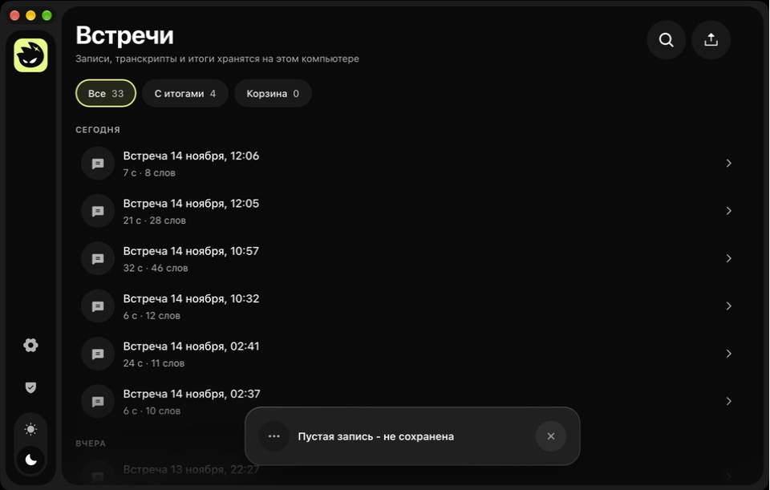 |
| «Мало содержания», светлая | 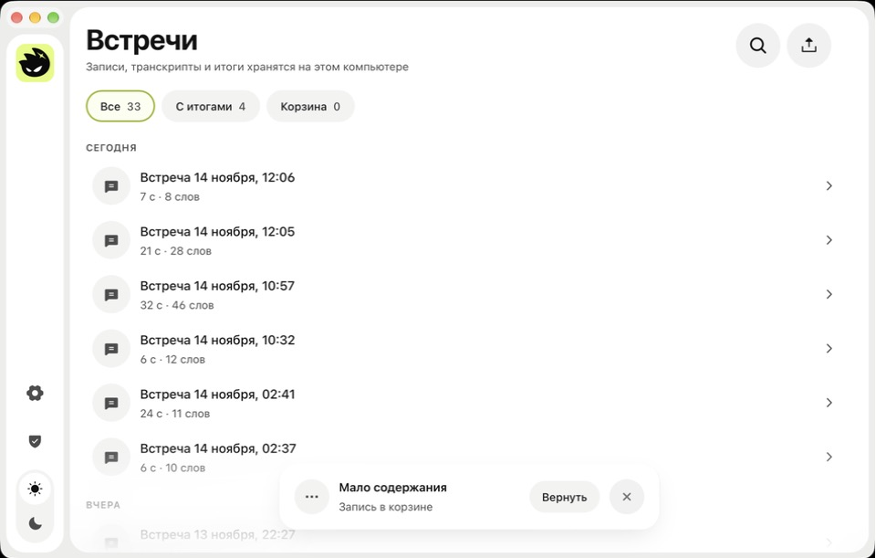 |
| Корзина, тёмная | 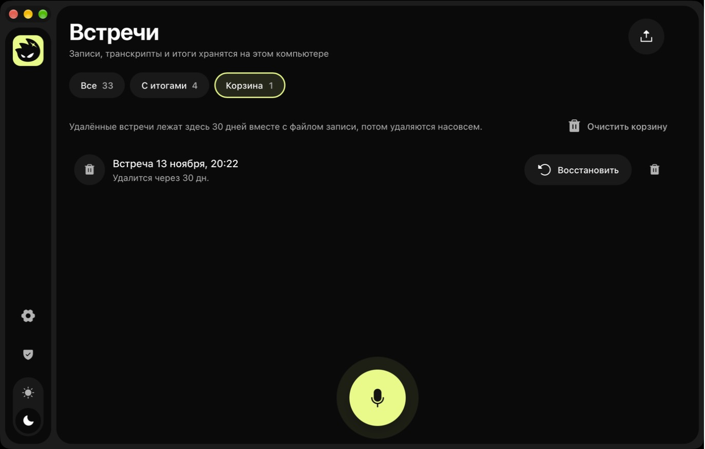 |
| «Очистить корзину» | 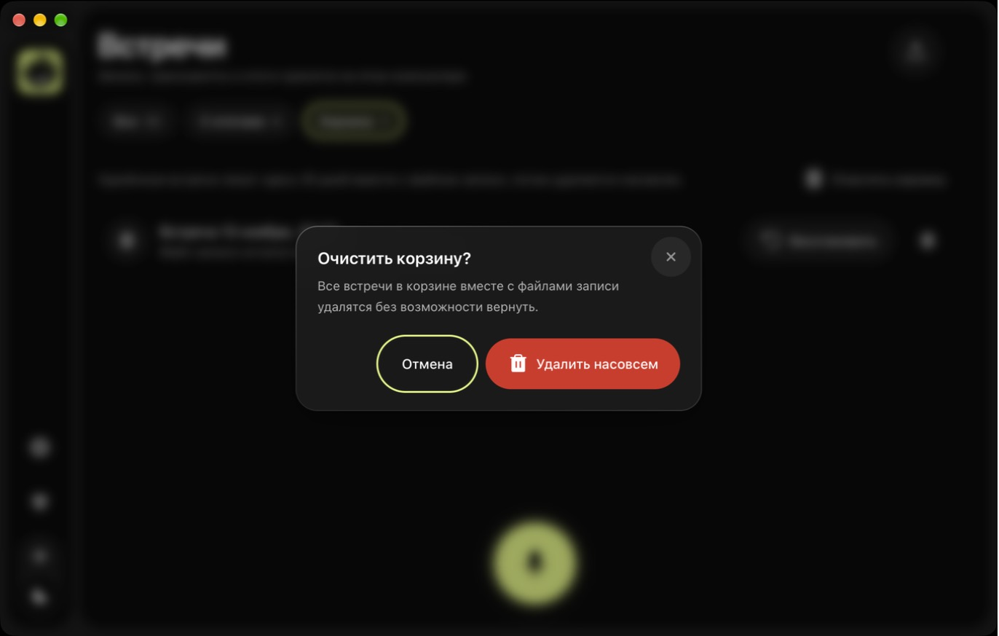 |

## Скриншоты (заглушки, Chromium)
| | Светлая | Тёмная |
|---|---|---|
| Пустая запись | 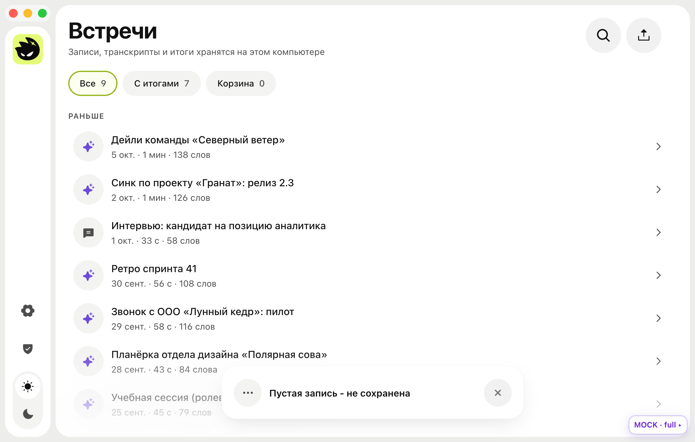 | 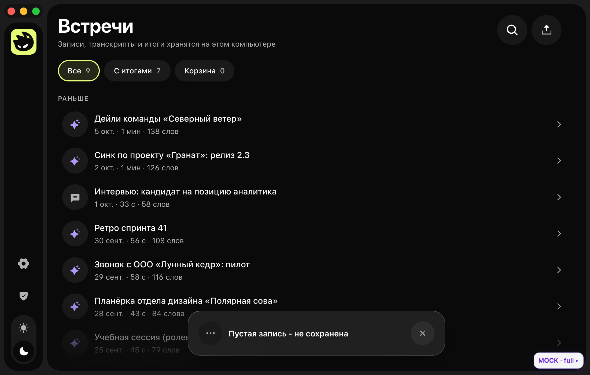 |
| После стопа: строка и «Дописываю реплики» | 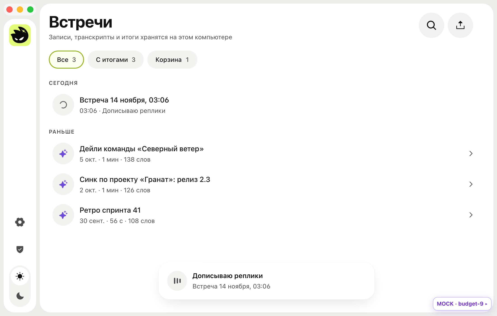 | 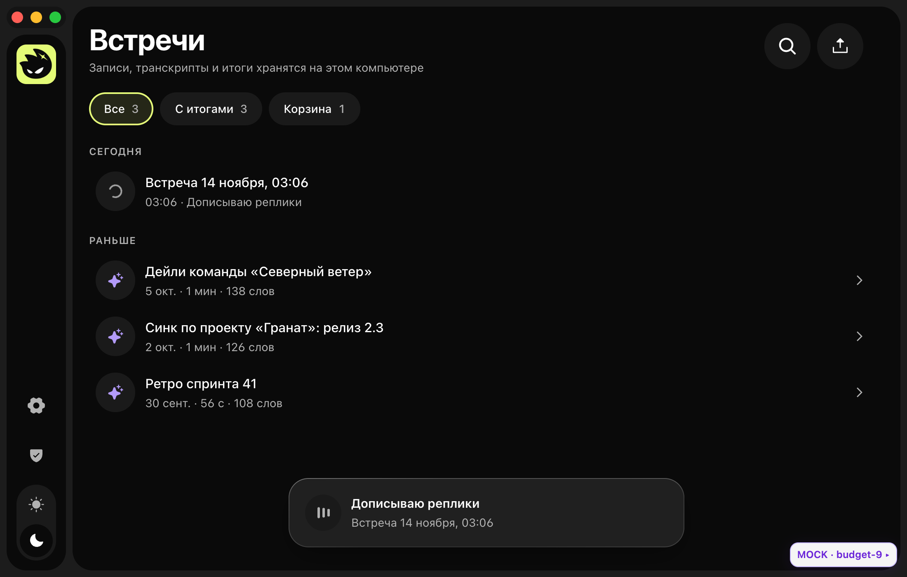 |
| Проверка моделью: «Мало содержания» | 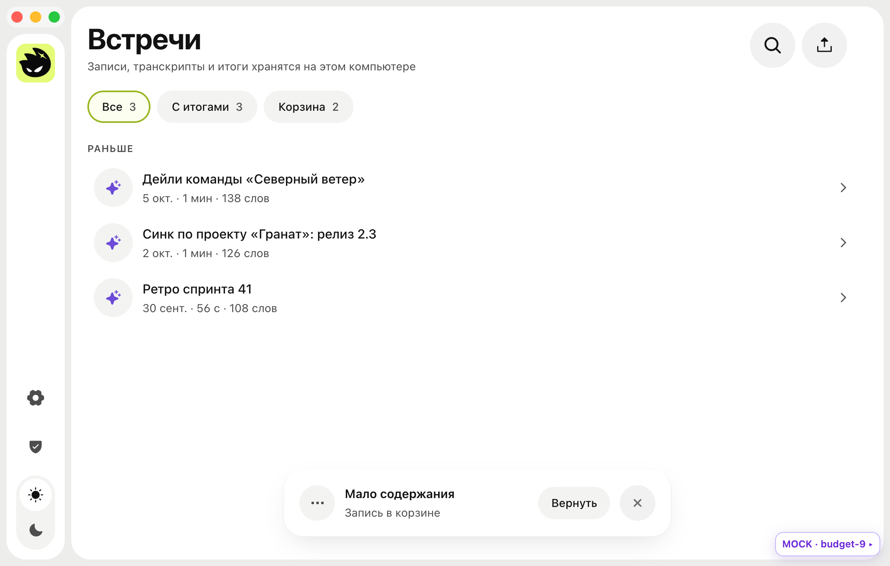 | 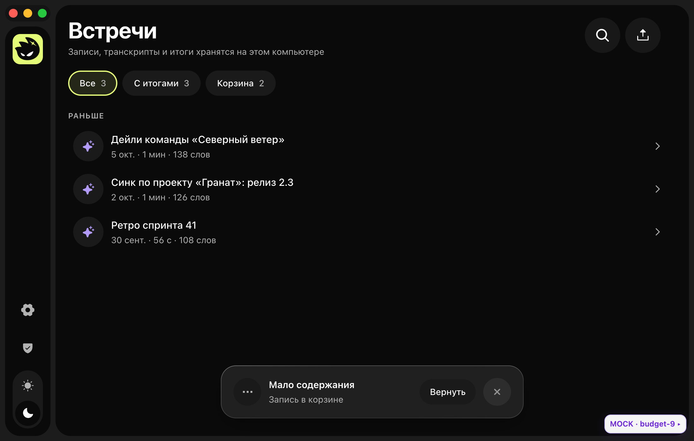 |
| Корзина: «Удалится через N дн.» | 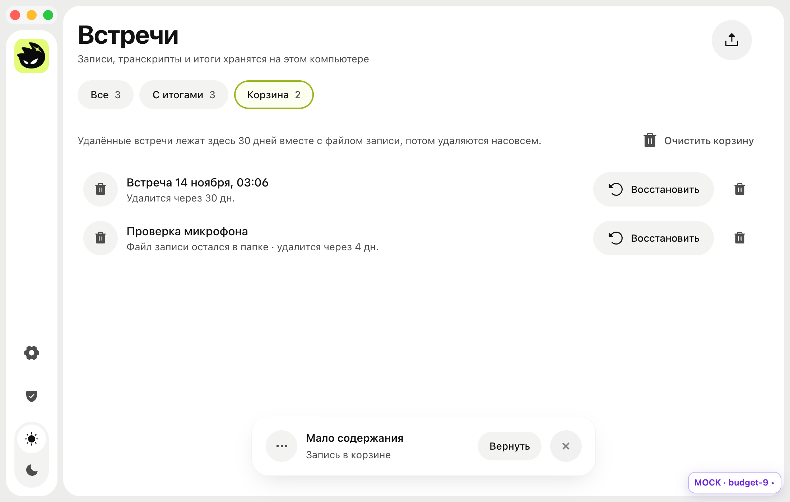 | 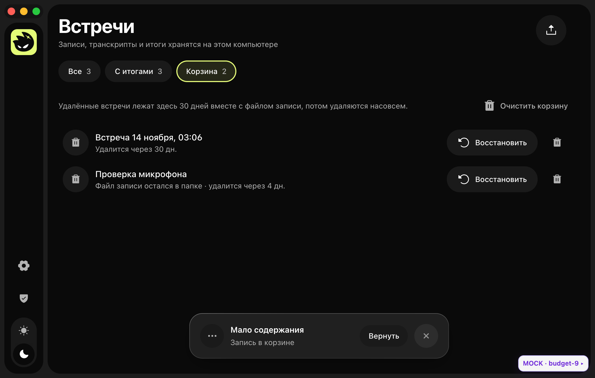 |
| «Очистить корзину»: подтверждение | 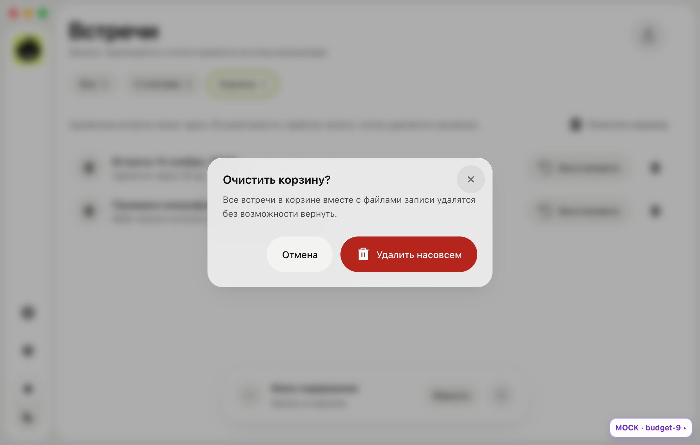 | 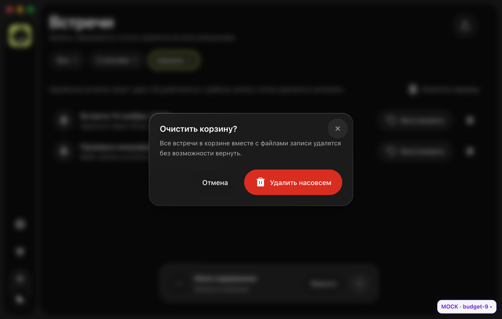 |

## Что не удалось или требует решения
- **Встроенная модель (`builtin-ai`) не проверяет.** По умолчанию итоги делает она, а ядро не даёт задать ей короткий вопрос. Модель общается с ядром только через stdin, а единственная команда, `api_process_transcript`, заполняет шаблон итогов и пишет результат в базу. При этом команда работает только для встречи, которая уже есть в базе: `summary_processes` ссылается на `meetings` внешним ключом. Поэтому со встроенной моделью слой 2 отвечает «недоступна», и встреча остаётся в списке. Проверка реально работает только с Ollama. Чтобы она работала у всех, нужна команда ядра для короткого запроса, например `summary_engine` → `generate`. Это изменение `frontend/src-tauri`, нужно отдельное разрешение.
- **Облачные провайдеры (OpenAI, Claude, Groq, OpenRouter, свой OpenAI) намеренно не спрашиваются.** Текст встречи уходит в облако только по «Подвести итоги».
- **На живой Ollama не проверено.** Запрос, разбор ответа и таймаут покрыты тестами с подменой `fetch`, исходы в интерфейсе показаны на заглушке `?check=`.
- **Изменилось поведение прежних сценариев.** «Да, хорошо, давай» и «Пять, пять, пять / Да. Да. Да.» теперь пустая запись: «да» считается заполнителем, «пять» трижды считается повтором. Раньше такие записи сохранялись.

🤖 Generated with [Claude Code](https://claude.com/claude-code)

## Обсуждение

**vercel[bot], 2026-11-13T22:09**

[vc]: #KtY+IcuG/5JztBf3wn/M6nmokdbxexwTFvk7MooUQNE=:eyJpc01vbm9yZXBvIjp0cnVlLCJ0eXBlIjoiZ2l0aHViIiwicHJvamVjdHMiOlt7Im5hbWUiOiJtZWV0aWx5IiwicHJvamVjdElkIjoicHJqX3lEek5SV21QVVVHNW0yTTdZN3N3dDJTY1BwRWciLCJpbnNwZWN0b3JVcmwiOiJodHRwczovL3ZlcmNlbC5jb20vYWlkeG8yMy0zMTE4L21lZXRpbHkvSDZVeW9iWDlDbWZ0U0NlRllwcXFEdktqd0VkVSIsInByZXZpZXdVcmwiOiJtZWV0aWx5LWdpdC1jbGF1ZGUtc21hcnQtZGlzY2FyZC1haWR4bzIzLTMxMTgudmVyY2VsLmFwcCIsIm5leHRDb21taXRTdGF0dXMiOiJERVBMT1lFRCIsImxpdmVGZWVkYmFjayI6eyJyZXNvbHZlZCI6MCwidW5yZXNvbHZlZCI6MCwidG90YWwiOjAsImxpbmsiOiJtZWV0aWx5LWdpdC1jbGF1ZGUtc21hcnQtZGlzY2FyZC1haWR4bzIzLTMxMTgudmVyY2VsLmFwcCJ9LCJyb290RGlyZWN0b3J5IjoiZnJvbnRlbmQifV19
The latest updates on your projects. Learn more about [Vercel for GitHub](https://vercel.link/github-learn-more).

| Project | Deployment | Actions | Updated |
| :--- | :----- | :------ | :------ |
| <a href="https://vercel.com/aidxo23-3118/meetily"></a> [meetily](https://vercel.com/aidxo23-3118/meetily) |  [Ready](https://vercel.com/aidxo23-3118/meetily/H6UyobX9CmftSCeFYpqqDvKjwEdU) | [Preview](https://meetily-git-claude-smart-discard-aidxo23-3118.vercel.app) | <relative-time datetime="2026-11-14T08:24:15.699Z">Nov 14, 2026 8:24am UTC</relative-time> |

