# #25 Уведомления одной стопкой: без наслоения, уход размытием, крестик в углу 4/4

- Статус: слит, 2026-11-14
- Ветка: `claude/notices` → `aid`
- Автор: katanana23
- Исходная ссылка: https://github.com/katanana23/shade/pull/25

## Описание

## Что было

Карточка итога у кнопки записи (`FinishCard`) стояла внизу по центру, тосты sonner справа снизу. На окне около 1000 pt тост «Встреча в корзине» ложился на карточку «Встреча сохранена» и прятал её крестик. Тосты подряд складывались колодой друг под другом. Крестик стоял по центру блока текста на отступе 20 px (в диалогах в углу на 12 px).

## Что сделано

**1. Одна стопка уведомлений.** Выбран вариант «одна общая стопка в одном месте»: внизу по центру колонки страницы. Внизу то, что сейчас в доке записи (кнопка, капсула, карточка итога, карточки про микрофон), над ним через 8 px тосты. Почему так, а не «тосты над карточкой справа» или «новое заменяет старое»:
- справа тост на узком окне задевает и кнопку записи 88 px, и капсулу; одна колонка не пересекается ни при какой ширине;
- замена потеряла бы «Вернуть» у «Встреча в корзине» (после #24 таких уведомлений с действием станет больше);
- один столбец читается как уведомления macOS и iOS: новое ближе к месту действия, старые выше.

Как устроено: `RecordDock` меряет себя (`lib/notice-stack.ts`, по `offsetTop`, чтобы анимации появления не сбивали замер) и пишет в `:root` `--aid-stack-x`, `--aid-stack-w`, `--aid-stack-bottom`, `--aid-stack-lift`. Тостер (`AidToaster`: `bottom-center`, `expand`, `gap` 8, до трёх, ширина 480 px как у итога, не шире колонки) встаёт по центру колонки и поднимается на высоту дока через `transform` с плавным переходом. Тосты раскрыты списком, колодой не складываются. Пока открыт диалог, тосты ждут под его затемнением, а не ложатся поверх окна.

**2. Анимация в духе Apple** (только `transform`, `opacity`, `filter`):
- тост появляется из размытия: снизу на 14 px, `blur` 10 px, прозрачность; без масштаба: sonner меряет высоту тоста в момент появления, масштаб её занижал, и соседи вставали теснее 8 px (было видно на первых снимках);
- уход на месте: гаснет, размывается, чуть уменьшается (тост за 0,2 с, пока sonner его не снял; карточки дока `.aid-dock-out`, 0,28 с);
- карточки над капсулой (про микрофон, «Не слышу речи») раньше пропадали мгновенно, теперь уходят тем же `.aid-dock-out` (`DockLeave` в `RecordDock`);
- уходящая копия итога ставится до отрисовки (`useLayoutEffect`), иначе стопка тостов на кадр дёргалась вниз и обратно;
- соседи и вся стопка сдвигаются плавно; при `prefers-reduced-motion` только прозрачность (раньше карточки дока появлялись и исчезали без перехода).

**3. Крестик в правом верхнем углу, 4 px сверху и справа, везде.** `CloseButton` сам встаёт в угол (`CLOSE_CORNER`, `absolute right-1 top-1`), у карточки справа запас 56 px (`CLOSE_RESERVE` = 4 + 44 + 8), текст и кнопки под крестик не заходят. Так в `Notice` (итог у капсулы, тосты), в карточках про микрофон (`MicAccessCard`, `MicHint`), в диалогах (`DialogContent`) и в стилизованных тостах sonner (на случай `toast.promise`). Размер 44 px не менялся. Подсказка тоста переносится ровными строками (`balance`).

**4. CLAUDE.md**: правило места крестика, стопка уведомлений и их анимация.

## Файлы
- `frontend/src/aid/lib/notice-stack.ts` (новый): замер дока и переменные стопки
- `frontend/src/aid/components/RecordDock.tsx`: замер, `DockLeave`, уходящая копия до отрисовки
- `frontend/src/aid/components/AidToaster.tsx`: позиция и раскрытый список
- `frontend/src/aid/components/ui/close-button.tsx`, `ui/notice.tsx`, `ui/dialog.tsx`, `MicNotices.tsx`: крестик в углу
- `frontend/src/aid/styles/globals.css`: позиция тостера, появление и уход, reduced-motion
- `CLAUDE.md`, снимки и видео в `docs/screenshots/aid-meeting/notices`

Ядро, `mock-tauri`, оригинальные файлы не менялись.

## Проверки
- `npx tsc --noEmit`: чисто
- `pnpm check:contrast`: всё проходит
- `pnpm build`: собирается без ошибок
- на заглушках (Playwright, Chromium, 1000 × 640 и 1100 × 700 @2x, обе темы): `?mock=full&finish=saved` + удаление двух встреч (карточка и два тоста одной колонкой, зазоры 8 px, замер по координатам), диалог удаления, `?notice=no-speech`, `mic-denied` (и уход карточки крестиком), `mic-lost`; весь путь `?mock=words-20` → «Остановить» → удаление → карточка уходит сама → закрыть тост

## Видео (тёмная тема, весь путь)

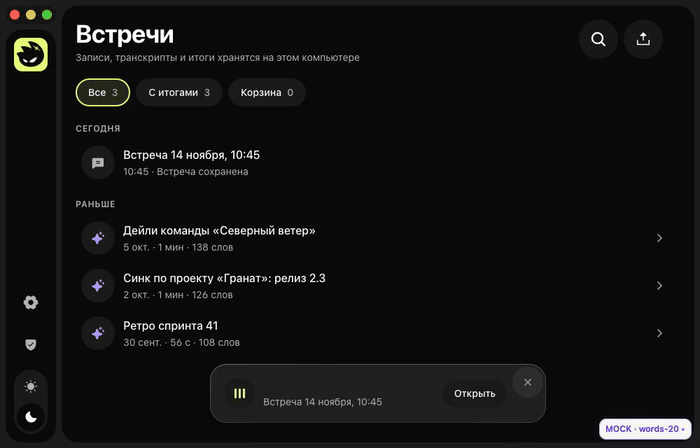

MP4 в лучшем качестве: [notices-dark.mp4](https://github.com/katanana23/shade/blob/claude/notices/docs/screenshots/aid-meeting/notices/notices-dark.mp4?raw=true)

## Скриншоты

| | Светлая | Тёмная |
|---|---|---|
| Итог и тост одновременно, 1000 × 640 | 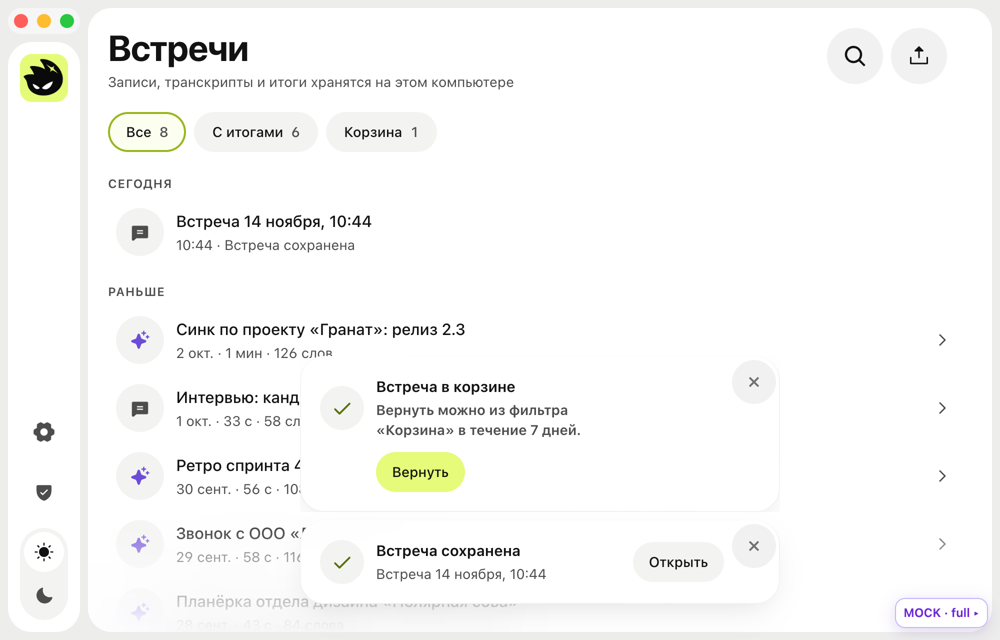 | 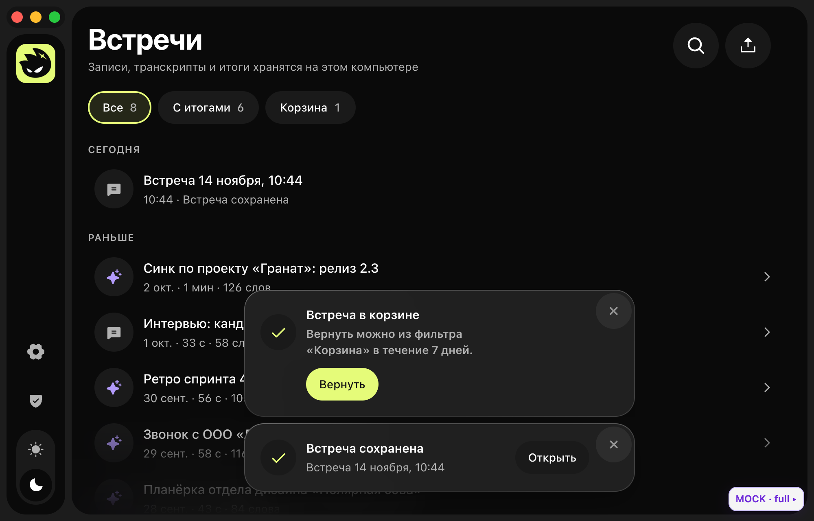 |
| Итог и два тоста | 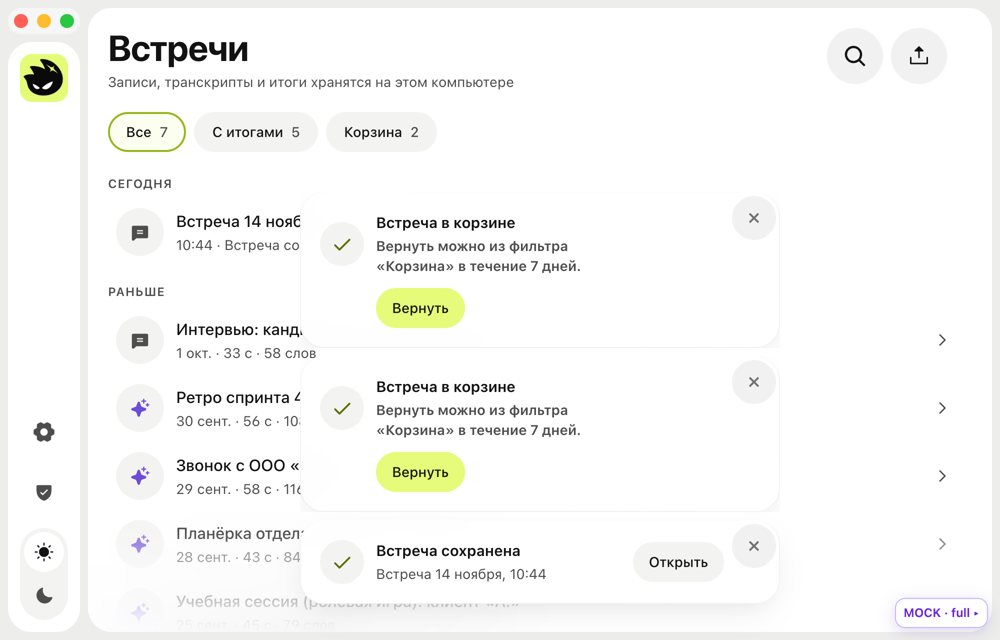 | 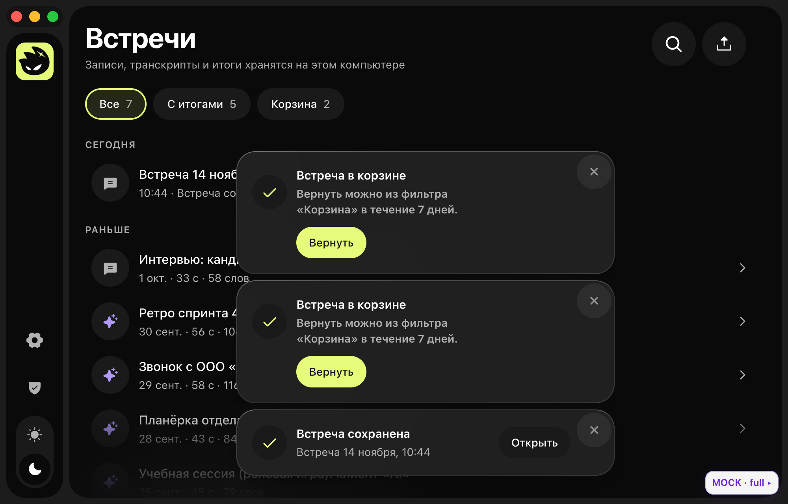 |
| Диалог: крестик в углу, тосты под затемнением | 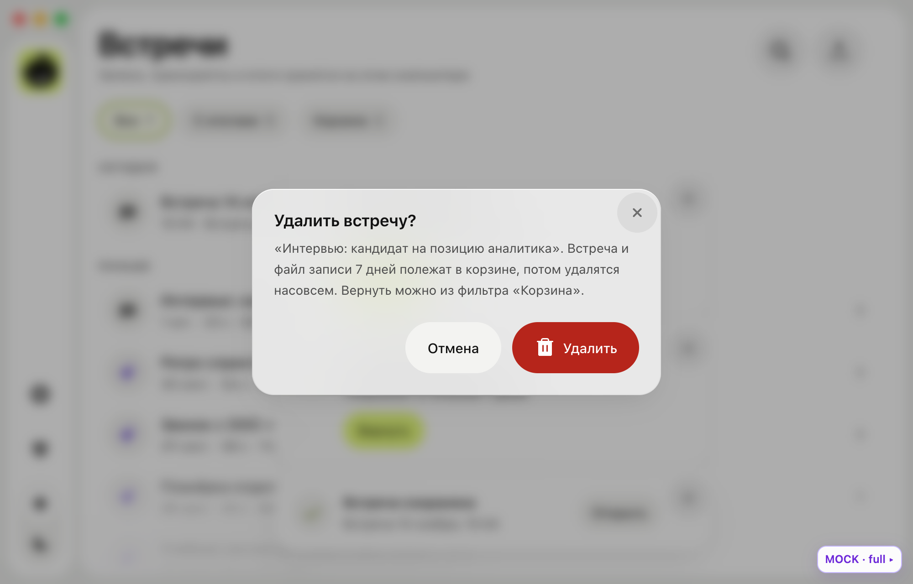 | 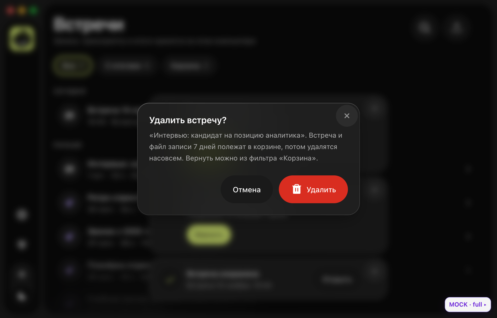 |
| Нет доступа к микрофону | 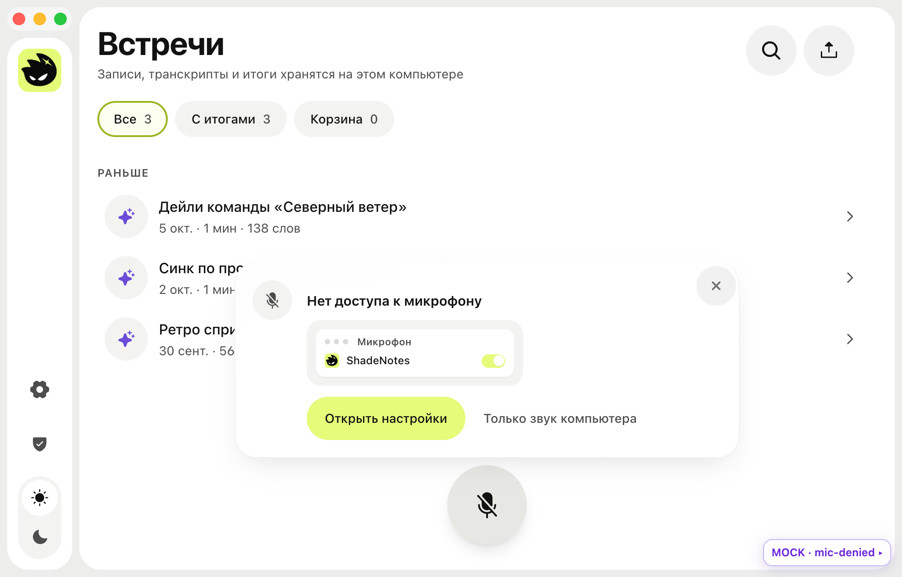 | 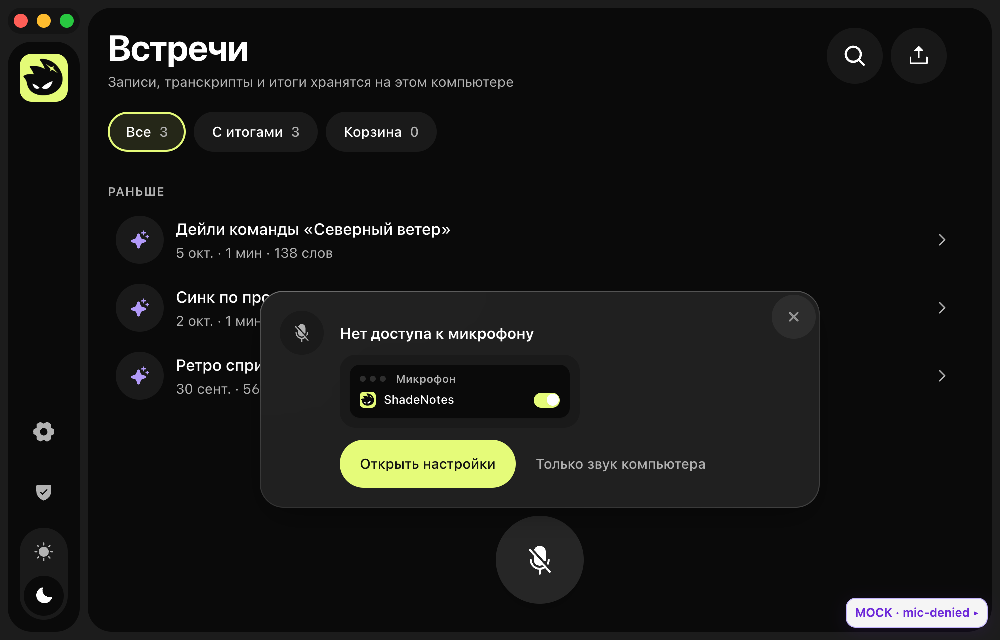 |
| «Речи не было» / «Микрофон отключился» | 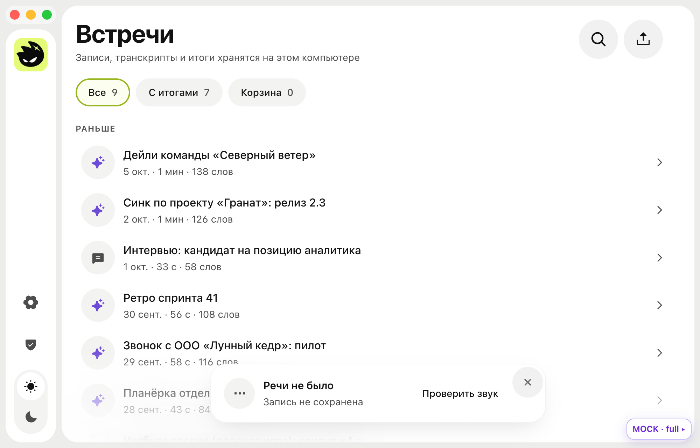 | 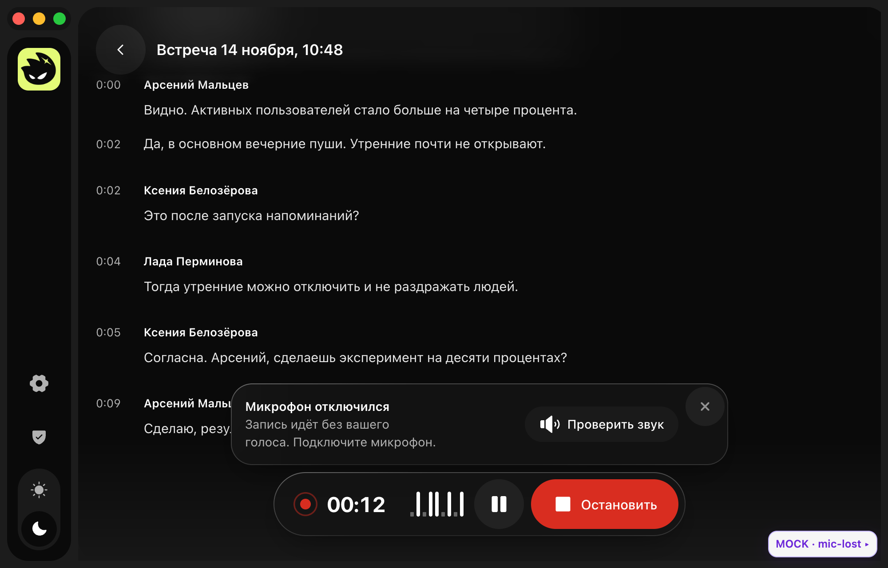 |
| Карточка про микрофон уходит размытием | | 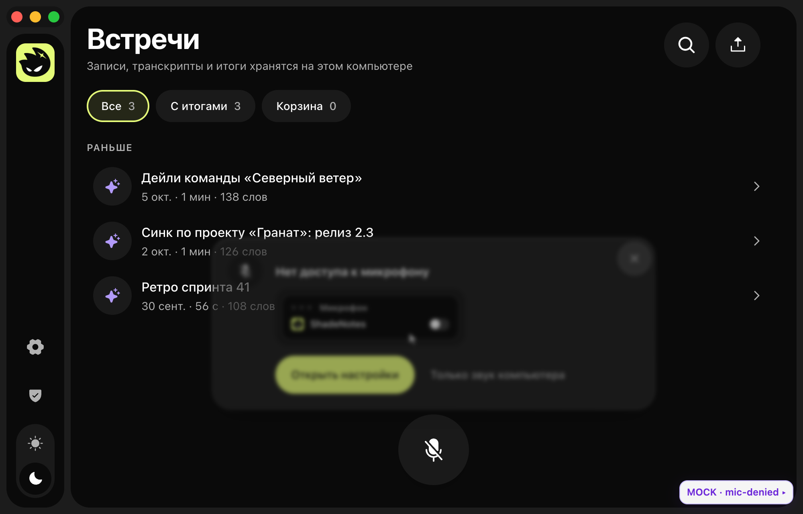 |

## Проверка в окне приложения (WebKit)
Окно ShadeNotes на macOS рисует WebKit, а снимки выше из Chromium. Поэтому отдельно проверил в настоящем окне: `tauri dev` (ядро без пересборки) со страницей из этой ветки, 1100 × 700, обе темы. Карточки итога показаны предпросмотром (`?finish=saved|discarded|transcribing|saving`, `?notice=no-speech|unrecognized`), тосты настоящие: удалял свои тестовые встречи и возвращал их из корзины (корзина снова пуста).
- Стопка: тосты над карточкой через 8 px, ширина 480 px, по центру колонки; два тоста и карточка одной колонкой, без наслоения.
- Крестик в итоге, тостах, «Речи не было», «Речь не распознана», «Слишком коротко» и в диалоге: 4 px сверху и справа, 44 px. У «Дописываю реплики» и «Сохраняю» крестика нет, как и раньше.
- Появление тоста из размытия около 150 мс, уход размытием и затуханием около 130 мс, без рывков; переход диалог → тост плавный.

| Тёмная, итог и два тоста | Светлая, итог и тост |
|---|---|
| 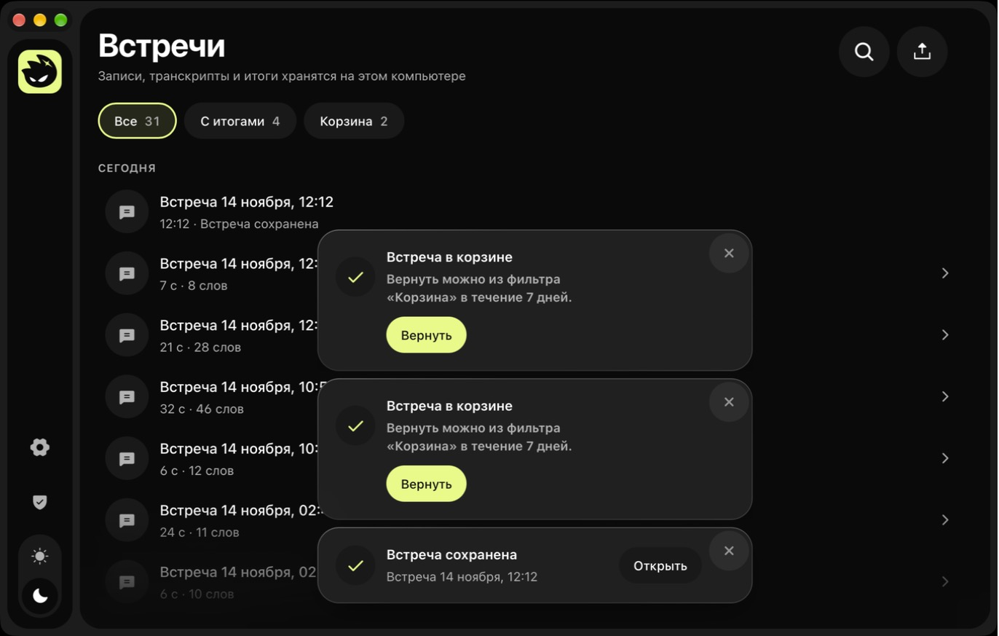 | 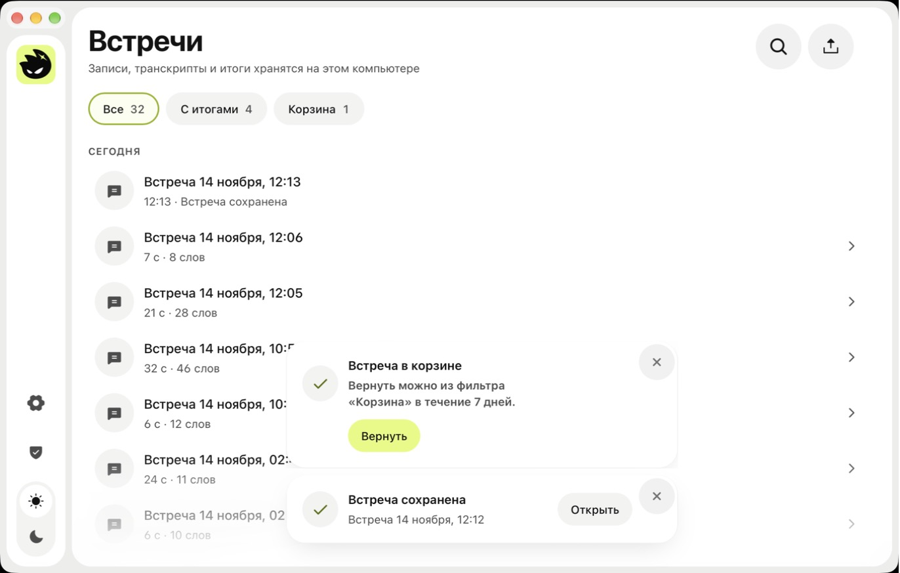 |
| **Светлая, «Речи не было»** | **Тёмная, «Слишком коротко»** |
| 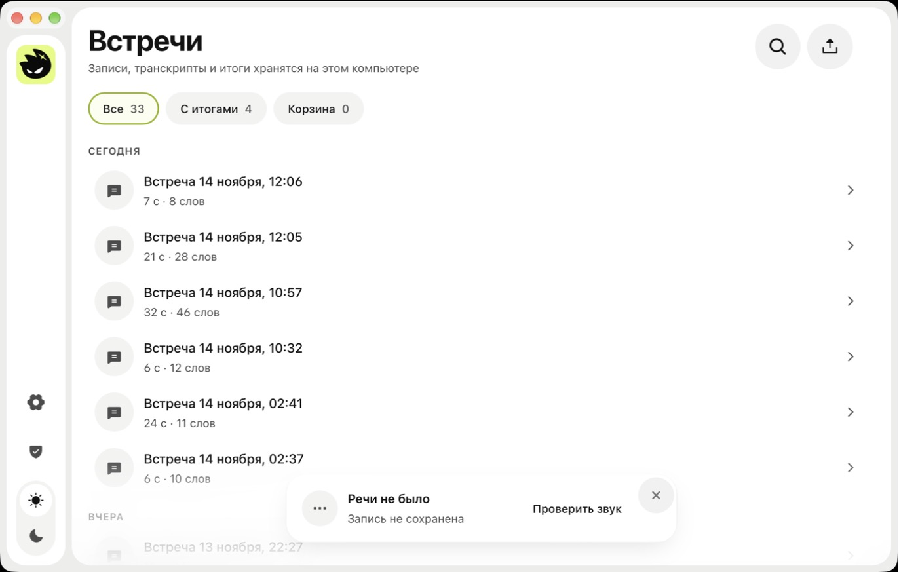 | 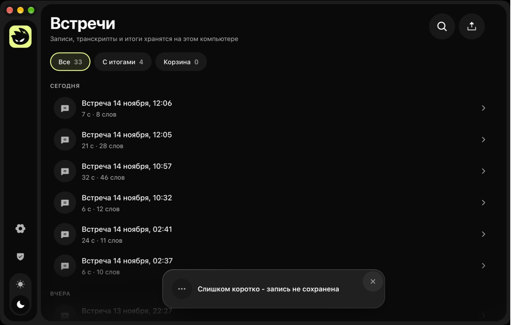 |

Снимки сняты с фильтром экрана: видно только окно приложения.

В `CLAUDE.md` добавлено правило: визуальные задачи в конце проверять в окне приложения (`50a0e3b`).

## Что не сделано или не проверено
- Карточки про микрофон и «Речи не было» в окне приложения не проверял (нужна запись), только в Chromium.
- `prefers-reduced-motion` проверен только чтением CSS, не эмуляцией.
- Свайп тоста (sonner) оставлен как был; его уход идёт анимацией sonner, а не размытием.
- Тосты под диалогом продолжают отсчёт времени и могут уйти, пока диалог открыт.
- Ширина тоста 480 px шире кнопки записи 88 px: волны кнопки уходят под нижний тост, это украшение, текст не перекрывается.

🤖 Generated with [Claude Code](https://claude.com/claude-code)

## Обсуждение

**vercel[bot], 2026-11-14T05:50**

[vc]: #IZ7zhKHwoFqDeJDFn6ivKuqdlFgUL1aMnpQgS+MhqdE=:eyJpc01vbm9yZXBvIjp0cnVlLCJ0eXBlIjoiZ2l0aHViIiwicHJvamVjdHMiOlt7Im5hbWUiOiJtZWV0aWx5IiwicHJvamVjdElkIjoicHJqX3lEek5SV21QVVVHNW0yTTdZN3N3dDJTY1BwRWciLCJpbnNwZWN0b3JVcmwiOiJodHRwczovL3ZlcmNlbC5jb20vYWlkeG8yMy0zMTE4L21lZXRpbHkvMnI5eVVGRFJCczlqRW5KRVVYNlpvaG1TY05aWiIsInByZXZpZXdVcmwiOiJtZWV0aWx5LWdpdC1jbGF1ZGUtbm90aWNlcy1haWR4bzIzLTMxMTgudmVyY2VsLmFwcCIsIm5leHRDb21taXRTdGF0dXMiOiJERVBMT1lFRCIsImxpdmVGZWVkYmFjayI6eyJyZXNvbHZlZCI6MCwidW5yZXNvbHZlZCI6MCwidG90YWwiOjAsImxpbmsiOiJtZWV0aWx5LWdpdC1jbGF1ZGUtbm90aWNlcy1haWR4bzIzLTMxMTgudmVyY2VsLmFwcCJ9LCJyb290RGlyZWN0b3J5IjoiZnJvbnRlbmQifV19
The latest updates on your projects. Learn more about [Vercel for GitHub](https://vercel.link/github-learn-more).

| Project | Deployment | Actions | Updated |
| :--- | :----- | :------ | :------ |
| <a href="https://vercel.com/aidxo23-3118/meetily"></a> [meetily](https://vercel.com/aidxo23-3118/meetily) |  [Ready](https://vercel.com/aidxo23-3118/meetily/2r9yUFDRBs9jEnJEUX6ZohmScNZZ) | [Preview](https://meetily-git-claude-notices-aidxo23-3118.vercel.app) | <relative-time datetime="2026-11-14T08:27:42.797Z">Nov 14, 2026 8:27am UTC</relative-time> |

