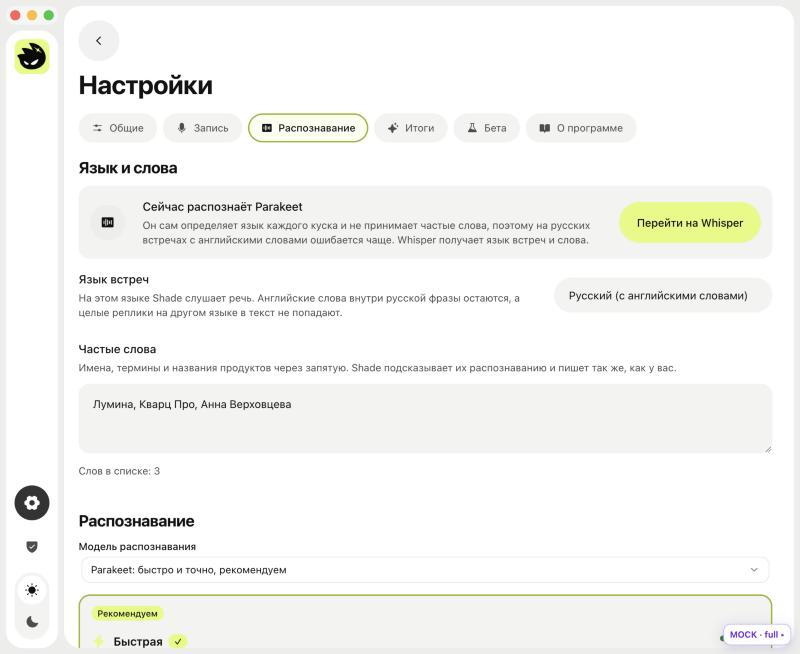
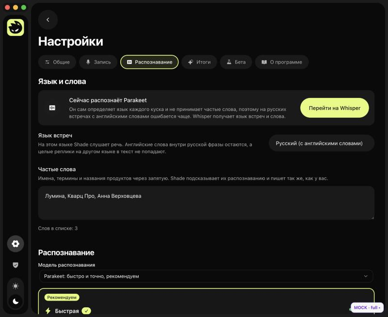
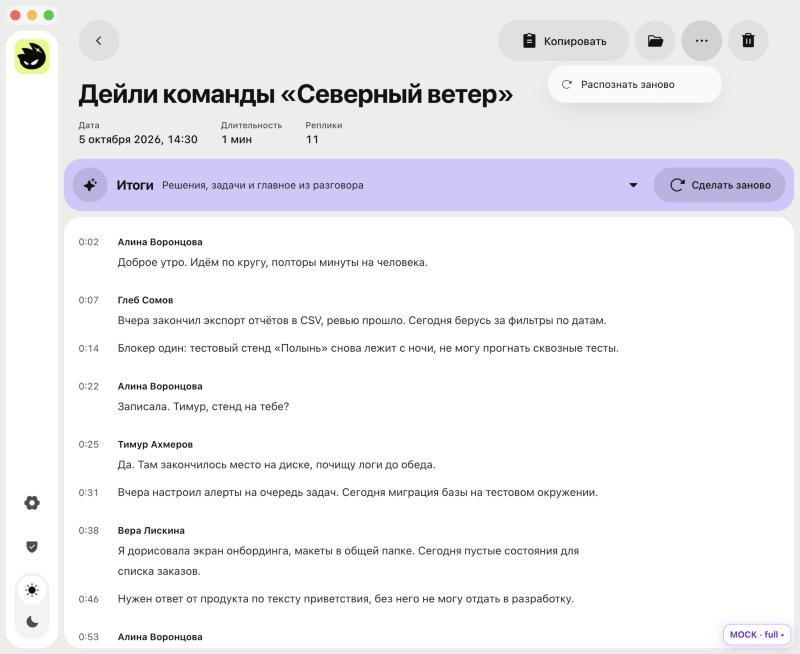
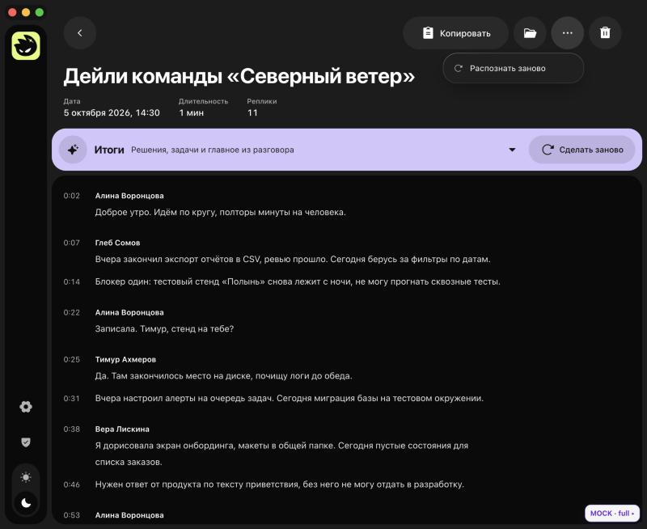
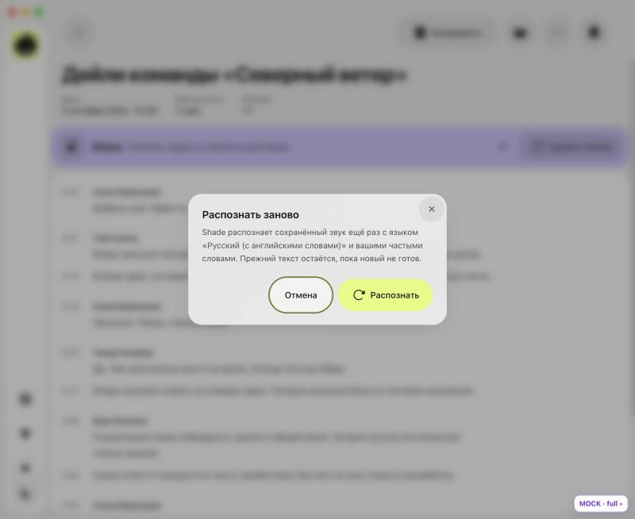
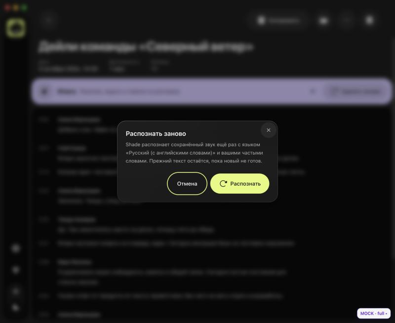
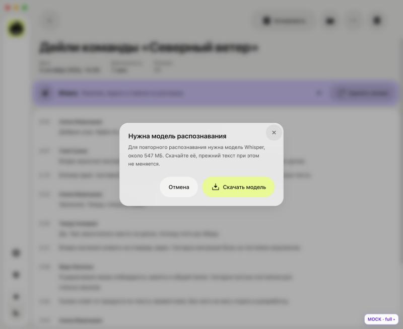
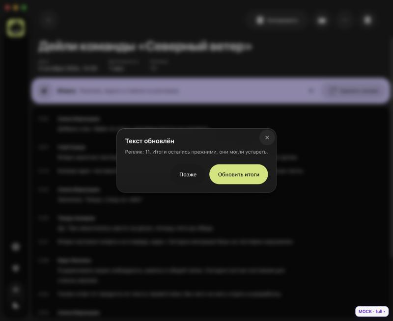

# #32 Язык встреч, частые слова и «Распознать заново»: чистка текста распознавания (замер трёх схем)

- Статус: слит, 2026-11-16
- Ветка: `shade-transcription-quality` → `shade`
- Автор: katanana23
- Исходная ссылка: https://github.com/katanana23/shade/pull/32

## Описание

**Слабое место.** Выбор схемы Б держится на двух вещах: чужие языки и `<unk>` исчезают у источника (0% против 14,9% и 0,6%), английские термины пишутся правильно (10 из 11 против 2 из 11). Общая «чистота» текста вживую у Whisper не лучше Parakeet с чисткой: на границах живых реплик мусора 30,0% против 28,2% до чистки (грубая метрика, см. ниже). Чистая картина (11,5%) получается на пакетном проходе по сохранённому звуку, то есть после «Распознать заново». Мерили одну встречу на одном Mac, упоминаний терминов всего 11.

## Что сделано

На русской встрече Parakeet писал польские и английские обрывки и метку `<unk>` внутри слов, а термины с ошибками. Теперь:

- **Выбрана схема Б** (Whisper с явным языком и подсказкой-словарём), решение и цифры в `docs/case/decisions.md`. Гибрид не выиграл, поэтому не реализован.
- **Настройки → Распознавание:** «Язык встреч» (Русский с английскими словами по умолчанию для русского интерфейса, English, Определять сам) и «Частые слова». Пока выбран Parakeet, сверху плитка «Перейти на Whisper»: скачивает модель и только потом переключает выбор.
- **Чистка текста** (ядро, `audio/transcript_quality.rs`) для любого движка: метки `<unk>` убраны (внутри слова части склеиваются), реплики вне языка встречи и «галлюцинации» тишины в текст не попадают (в журнал язык и число слов, текст не пишется), слова словаря пишутся как в списке. Работает в живой записи, в «Распознать заново», при импорте и при показе старых реплик.
- **Распознать заново:** на странице встречи в меню «Ещё». Whisper по сохранённому звуку с текущими языком и словарём; прежний текст заменяется одной транзакцией только когда новый готов целиком, перед этим копия `transcripts.previous.json`. Итоги сами не пересчитываются, окно предлагает «Обновить итоги».
- Смена языка и слов во время записи применяется со следующей встречи.

Правки ядра по разрешению владельца, только распознавание и его настройки; форматы данных, схема базы, существующие команды и события не менялись. Добавлены команда `set_vocabulary_hint`, необязательный файл `transcripts.previous.json` и код ошибки `model-missing:<имя>`. Список правок: `docs/isolation.md`, раздел 6. Коммиты ядра отдельные (`fix(core)`).

## Разбор до начала
- Что сломается первым: язык-фильтр выбросит настоящую короткую английскую реплику («Let's go»); смена языка в записи заденет идущую запись; «Распознать заново» затрёт текст пустым результатом.
- Что скажет владелец: «в живом тексте всё ещё короткие обрывки» (нарезка живой записи паузой 500 мс, это не распознавание) и «Parakeet у меня уже стоит».
- Что придётся переделывать через неделю: порог 6 слов для английской фразы и список коротких ответов (по реальным встречам), автоматический чистовик после «Стоп».

## Замер трёх схем

Встреча 16.11, 29 мин, Mac M4 16 ГБ. Звук и текст реплик не покидали временную папку, здесь только цифры. «Мусор» = не на русском, `<unk>` или 1-3 слова не из коротких ответов («да», «угу»); последнее грубо, настоящие короткие реплики вне списка тоже считаются, у всех схем одинаково.

| Схема | Реплик | Не тот язык | `<unk>` | 1-3 слова | Мусор вместе | Остаётся в тексте |
|---|---|---|---|---|---|---|
| Сейчас: Parakeet вживую | 181 | 27 (14,9%) | 1 (0,6%) | 23 (12,7%) | 51 (28,2%) | всё |
| А: Parakeet + чистка | 181 | 27, убраны | 1, убрана | 23 (14,9% оставшихся) | 23 из 154 | 154; убрано 27 (44 с, 65 слов); на 5 из них Whisper услышал русскую фразу от 4 слов |
| Б1: Whisper `ru` + словарь, куски по паузе 2 с | 96 | 0 | 0 | 11 (11,5%) | 11 (11,5%) | всё |
| Б2: то же без словаря | 96 | 0 | 0 | 12 (12,5%) | 12 (12,5%) | всё |
| Б3: Whisper `ru` + словарь на границах живых реплик | 180 | 3 (1,7%), убраны | 0 | 51 (28,8%) | 54 (30,0%) | 177 |
| В: гибрид (Parakeet вживую + Whisper на 51 подозрительной после «Стоп») | 181 | 1 (0,6%) | 0 | 30 (16,6%) | 31 (17,1%) | 180 |

Англицизмы (PR, пуш, бизнес-эффект, Figma, GitHub, Slack, Jira, API; на встрече найдено 11 упоминаний любой схемой), записано правильно: сейчас 2, А 2, Б2 1, **Б1 7, Б3 10**, В 2.

| Схема | Время на минуту звука | Процессор | Память | Видеокарта |
|---|---|---|---|---|
| Parakeet | 2,0 с | 329 с за встречу, до 5,7 ядра в работе (19% одного ядра при записи в темпе звука) | до 1,8 ГБ | нет |
| Whisper по кускам встречи | 5,4 с (6,6 с со словарём) | 8-14 с | 1,0-1,1 ГБ | 96% пока работает |
| Whisper на границах живых реплик | 12,1 с = 20% времени записи | 22 с | 0,65 ГБ | 20% времени |
| Второй проход гибрида | 3,0 с на минуту встречи, 88 с | 4 с | около 1 ГБ | 96% пока работает |

Ограничения: нагрузка во время записи посчитана по проигранным живым кускам, а не снята с работающего приложения (`scripts/measure-recording-load.sh` крутит заглушку звука без распознавания); видеокарта по `ioreg` (общая загрузка Mac); у Parakeet нет уверенности по репликам, поэтому критерий гибрида «низкая уверенность» не работает.

## Таблица случаев

| Вход | Ожидаемое | Что при отказе (модель, ядро, файл) | Тест |
|---|---|---|---|
| Короткая реплика «Да.», «угу», «Ну да» | остаётся, не подозрительна | чужой язык не отбрасывает: «Определять сам» ничего не режет | `short_replies_stay_and_are_not_suspicious`, `auto_language_filters_nothing` |
| Реплика целиком на английском, язык «Русский (с английскими словами)» | фраза от 6 слов с узнанными английскими словами остаётся; обрывок («What is it?», «Scour») в текст не попадает, в журнал | сомнение: короткие ответы `ok`, `yes` остаются | `english_only_replica_in_russian_meeting` |
| Англицизм внутри фразы | фраза остаётся целиком, слова словаря пишутся как в списке («figma» в «Figma») | словаря нет: текст как есть | `anglicism_inside_russian_phrase_is_kept`, `dictionary_case_and_prompt`, `latin_terms_from_dictionary_and_acronyms_survive` |
| `<unk>` в начале, середине, конце слова, отдельным словом | метка убрана, слово склеено, реплика подозрительна; из одной метки текст пуст | старые реплики с меткой в базе показываются чистыми | `unk_at_start_middle_end_and_alone`, `unk_never_survives_check`, `special-tokens.test.ts` |
| Польская реплика | в текст встречи не попадает, в журнал язык и число слов | «Определять сам»: остаётся | `polish_is_dropped_in_russian_meeting` |
| «Распознать заново» прервано посередине | прежний текст на месте, окно «Остановлено» | ошибка записи в базу откатывает транзакцию; пустой результат прежний текст не заменяет; копия `transcripts.previous.json` | `failure_midway_keeps_old_text`, `empty_result_keeps_old_text`, `previous_transcript_is_kept_on_disk`, `cancellation_message_is_stable`, `rerecognize.test.ts` |
| Модель Whisper не скачана | «Нужна модель распознавания» и «Скачать модель»; после загрузки распознавание начинается само | нет сети: «Модель не скачалась», прежний текст не тронут | `missing_model_code_carries_model_name`, `rerecognize.test.ts` |
| Смена языка во время записи | идущая запись как была, со следующей встречи новый язык и слова | «Распознать заново» в это время видит новое | `language_and_words_change_applies_from_next_meeting` |
| Слова из поля: запятая, `;`, перевод строки, повторы, регистр | список без пустых и двойников, до 80 слов по 60 знаков | пусто: подсказка не передаётся | `speech-settings.test.ts`, `parse_dictionary` в `dictionary_case_and_prompt` |

## Что решил сам и почему

- **Б, не гибрид.** Гибрид не чинит термины (ошибки сидят в обычных репликах, их он не трогает) и всё равно требует Whisper; раз Whisper успевает вживую (20% времени записи, процессор около нуля), черновик Parakeet не нужен.
- **Английская фраза в русской встрече** остаётся, если от 6 слов с узнанными английскими словами; на этой встрече таких 0, английских обрывков короче 15. Parakeet уверенности не даёт, «уверенно» = длина и узнанные слова.
- **Короткие русские реплики не удаляю** (при сомнении данные сохраняются), только помечаю; уходит латиница без узнанного языка, если это не слова словаря, не аббревиатуры и не короткие ответы.
- **Переход на Whisper только по кнопке.** Выбранную модель владельца сам не меняю; для него плитка в настройках.
- **Обходы.** Профиль `--release` в этом дереве не собирается (битые proc-macro библиотеки), замер шёл в обычном профиле (тяжёлое в нём оптимизировано). Модели Whisper на Mac не было (в Shade только Parakeet): скачал `large-v3-turbo-q5_0` по вашему «да» во временную папку замера, в папку моделей Shade не клал. Вольт (`00 NOW.md`) недоступен в этой сессии: работал по промпту.
- Два теста `device_detection` в полном прогоне ядра падают (зависят от устройств этого Mac, файл не менялся); на чистом `origin/shade` не прогонял.

## Проверки (вывод)

```
npx tsc --noEmit          -> TSC-OK
pnpm check:contrast       -> Контраст текста на заливках: всё проходит
pnpm check:i18n           -> check:i18n ok: кириллица только в словаре, локали только в lib/lang.ts (строк под маркером i18n-ignore: 8)
pnpm test                 -> 131 pass, 0 fail (11 файлов)
pnpm build                -> собрано, /settings 313 kB
cargo test -p meetily --lib -- retranscription transcript_quality
                          -> test result: ok. 36 passed; 0 failed
cargo test -p meetily --lib (всё ядро)
                          -> 290 passed; 2 failed (device_detection, см. выше); 7 ignored
```

CI «Shade check» зелёный (1m29s, [прогон](https://github.com/katanana23/shade/actions/runs/43869192195)), хвост вывода:

```
Контраст текста на заливках: всё проходит
check:i18n ok: кириллица только в словаре, локали только в lib/lang.ts (строк под маркером i18n-ignore: 8)
 131 pass
 0 fail
Ran 131 tests across 11 files. [1.58s]
 ✓ Compiled successfully
 ✓ Generating static pages (11/11)
```

Ядро Tauri в CI не собирается: тесты ядра локальные, вывод выше.

## Снимки и видео

На заглушках `?mock=full`, русский интерфейс, обе темы.

| Светлая | Тёмная |
|---|---|
|  |  |
|  |  |
|  |  |
|  |  |

Снимки из браузера на заглушках; в окне приложения (WebKit) не смотрел: сборку `tauri dev` не запускал.

## Проверка владельца

1. Откройте Настройки → Распознавание. «Язык встреч» должен стоять «Русский (с английскими словами)»: если там «Определять сам» от прошлых настроек, выберите русский сами. В «Частые слова» впишите свои термины и названия продуктов.
2. Нажмите «Перейти на Whisper» (скачается модель около 547 МБ, потом выбор переключится).
3. Откройте встречу 16.11 → «Ещё» (три точки) → «Распознать заново». Идёт несколько минут, окно можно закрыть. Когда появится «Текст обновлён», проверьте: польских и английских обрывков и `<unk>` нет, термины написаны как в списке. Прежний текст лежит копией `transcripts.previous.json` в папке встречи.
4. Если были итоги, в окне «Обновить итоги» (сами не пересчитываются).
5. Запишите 30 секунд русской речи с английским словом: в ленте нет чужих обрывков. Смена языка во время записи действует со следующей встречи.

## На потом

- Чистовик автоматически после «Стоп» (Whisper по всему звуку с паузой 2 с): на этой встрече 11,5% мусора против 30,0% вживую, около 3 минут фоновой работы на 30 минут. Причина разрыва в живой нарезке речи (пауза 500 мс, на 14% слов меньше, чем при паузе 2 с), это запись, не распознавание.
- Список коротких ответов и порог 6 слов подстроить по нескольким реальным встречам.

## Вопросы

Включать ли после «Стоп» тихий чистовик (Whisper по всему звуку, около 3 минут фоновой работы на 30 минут встречи, без решения вы увидите то же, что вживую)? По умолчанию: нет, сначала посмотрите «Распознать заново» на встрече 16.11.

🤖 Generated with [Claude Code](https://claude.com/claude-code)


## Обсуждение

**vercel[bot], 2026-11-16T12:43**

[vc]: #lxQUZ3J0r57zTCYZVnj17E+dXBI2ztejRaJxv5znaSg=:eyJpc01vbm9yZXBvIjp0cnVlLCJ0eXBlIjoiZ2l0aHViIiwicHJvamVjdHMiOlt7Im5hbWUiOiJzaGFkZSIsInByb2plY3RJZCI6InByal95RHpOUldtUFVVRzVtMk03WTdzd3QyU2NQcEVnIiwiaW5zcGVjdG9yVXJsIjoiaHR0cHM6Ly92ZXJjZWwuY29tL2FpZHhvMjMtMzExOC9zaGFkZS9GNXpSUU5lczFqNXB3ZkVFdm0yc1ZuY0hTZ1JOIiwicHJldmlld1VybCI6InNoYWRlLWdpdC1zaGFkZS10cmFuc2NyaXB0aW9uLXF1YWxpdHktYWlkeG8yMy0zMTE4LnZlcmNlbC5hcHAiLCJuZXh0Q29tbWl0U3RhdHVzIjoiREVQTE9ZRUQiLCJsaXZlRmVlZGJhY2siOnsicmVzb2x2ZWQiOjAsInVucmVzb2x2ZWQiOjAsInRvdGFsIjowLCJsaW5rIjoic2hhZGUtZ2l0LXNoYWRlLXRyYW5zY3JpcHRpb24tcXVhbGl0eS1haWR4bzIzLTMxMTgudmVyY2VsLmFwcCJ9LCJyb290RGlyZWN0b3J5IjoiZnJvbnRlbmQifV19
The latest updates on your projects. Learn more about [Vercel for GitHub](https://vercel.link/github-learn-more).

| Project | Deployment | Actions | Updated |
| :--- | :----- | :------ | :------ |
| <a href="https://vercel.com/aidxo23-3118/shade"><sup></sup></a> [shade](https://vercel.com/aidxo23-3118/shade) |  [Ready](https://vercel.com/aidxo23-3118/shade/F5zRQNes1j5pwfEEvm2sVncHSgRN) | [Preview](https://shade-git-shade-transcription-quality-aidxo23-3118.vercel.app) | <relative-time datetime="2026-11-16T12:44:01.124Z">Nov 16, 2026 12:44pm UTC</relative-time> |


