# #34 Названия встреч по сути разговора вместо даты в названии

- Статус: слит, 2026-11-16
- Ветка: `shade-meeting-titles` → `shade`
- Автор: katanana23
- Исходная ссылка: https://github.com/katanana23/shade/pull/34

## Описание

## Слабое место (первым)
Качество названий зависит от модели, и на живом материале я его не мерил. Что проверено: настоящая встроенная Qwen 3.5 4B через настоящий путь ядра (`generate_with_builtin`) на 17 вымышленных встречах из заглушек: 17 из 17 ответов прошли чистку, русские встречи получили русские названия, английские английские (около 2 с на встречу, первая 12 с на загрузку модели). Чего нет: настоящей длинной встречи (владельческую 16.11 не трогал по правилу «без реальных встреч»), облачного провайдера вживую (ключей нет; облачный путь закрыт тестами и запретом в ядре, но живого запроса к OpenAI/Claude я не делал) и Gemma 1B. Имена людей из названия убирает только промпт: по ответу их не распознать.

## Что сделано
- Название по сути разговора вместо «Встреча 16 ноября, 15:02»: после «Остановить» в фоне, той же моделью и провайдером, что для итогов. Локальной моделью само; облачной только вместе с итогами по «Подвести итоги» (запись в `docs/case/decisions.md`).
- Ручное название главнее: пометка `title.json` в папке встречи (рядом с `recovered.json` из #31), схему базы не менял; «Придумать название заново» в меню «⋯» только по нажатию.
- Настройки → Общие → «Придумать названия для старых встреч»: по одной в фоне, прогресс, остановка, при облаке строка и кнопка подтверждения.
- Список: название главное, под ним «16 нояб., 15:02 · 29 мин · 1 953 слова»; поиск ищет по названию (уже искал, проверено на заглушке).
- Ядро (`fix(core)`, отдельными коммитами, `docs/isolation.md` раздел 8): `summary/title.rs` с четырьмя командами; из `service.rs` убрано переименование встречи по заголовку `# …` из текста итогов: оно затирало название, заданное человеком, при каждом «Подвести итоги».

## Разбор до начала
- Что сломается первым: маленькая модель на длинной расшифровке даёт общий ответ или чужой язык, название остаётся датой, тихо (так задано), и это выглядит как «не работает». Причина только в консоли окна и в журнале ядра.
- Что скажет владелец: «почему в строке дата, если название и так дата» (мета одинаковая у названия-даты и названия-темы, чтобы строка не прыгала, когда название придумывается позже); «почему облачной не само» (приватность, решение в `decisions.md`).
- Что придётся переделывать через неделю: список общих слов («Обсуждение», «Встреча по вопросам») и пороги 1 минута и 20 слов (`meeting-title-text.ts`, `meeting-title.ts`); журнал только в консоли, возможно, нужен файл или строка в настройках «почему не названо».

## Таблица случаев
Тесты: `frontend/src/shade/lib/title-core.test.ts` (решения и массовое действие), `meeting-title.test.ts` (запрос и чистка ответа), ядро `summary/title.rs` (`cargo test -p meetily --lib summary::title`).

| Вход | Ожидаемое | Что при отказе (модель, ядро, файл) | Тест |
|---|---|---|---|
| Модель не настроена | Название остаётся датой, текст не читается, запроса нет | Тихо, в журнал `no-model` | `название: модель не настроена` (2 теста) |
| Локальная модель: пустой, «Обсуждение», «Встреча по вопросам», «не могу», не на языке | Остаётся дата, в базу ничего | `bad-answer` с причиной | `пустой ответ, общее название, отказ, не на языке…`; `ответ модели: отказ…` |
| Модель упала или молчит (таймаут 90 с) | Остаётся дата | `error` и текст ошибки | `модель упала или молчит…` |
| Облачный провайдер, автоматически (после «Остановить», после «Распознать заново», восстановление) | Ничего не уходит: текст даже не читается | `cloud-not-allowed`; то же в ядре без `allow_cloud` | `облачный провайдер: автоматически ничего не уходит`, `неизвестный провайдер…`; ядро `privacy_matches_the_interface` |
| Облачный, человек нажал «Подвести итоги» | Название создаётся вместе с итогами; итоги не получились или отменены: названия нет | | `«Подвести итоги» нажато…`, `итоги не получились…`, `итоги отменены…`, `итоги не начались…` |
| Облачный, массовое действие | Без подтверждения ничего; с подтверждением идёт | | `массовое действие без подтверждения…` |
| Ручное название | Не перезаписывается ни после итогов, ни массовым действием, ни автоматикой | Ядро тоже: `api_set_auto_title` возвращает `manual` | `переименовал человек: ни автоматика, ни массовое действие, ни итоги не трогают`; ядро `manual_title_is_never_overwritten_by_automation` |
| Переименовали, пока модель думала | Название человека на месте | `changed` | `переименовали, пока модель думала…`; ядро `renamed_while_generating…` |
| «Придумать заново» по нажатию | Меняет и ручное, ставит `auto`; плохой ответ оставляет прежнее | | `«Придумать заново» по нажатию…` (2 теста) |
| Встреча меньше минуты | Ничего не отправляется | `too-short` | `встреча меньше минуты…`, `ровно минута проходит` |
| Нет текста (меньше 20 слов) | Ничего не отправляется | `no-text` | `без текста…` |
| Восстановленная после сбоя (метка #31) | Название создаётся; `recovered.json` не тронут (байт в байт) | | `восстановленная после сбоя…`; ядро `recovered_mark_survives_title_writes` |
| Английская встреча | Английский запрос и название; русский ответ отбракован | | `английская встреча…` (3 теста), `ответ модели: не на языке встречи` |
| Массовое действие прервано | Остановка не пишет ответ, пришедший после неё; повторный запуск берёт только оставшиеся, без дублей | | `прервано: продолжение берёт только оставшиеся, без дублей запросов`, `повторный запуск, пока идёт первый…` |
| Длинный ответ | Обрезается до 6 слов по границе слова, хвостовой предлог уходит, до 60 знаков | | `ответ модели: обрезка до 6 слов по границе слова` (3 теста) |
| Идёт новая запись | Название ждёт её конца | | `идёт новая запись: название ждёт…` |
| Файл `title.json` испорчен | «Не знаем», не «ручное» и не падение | | ядро `origin_file_round_trip_and_garbage` |

## Что решил сам и почему
- **Прямой путь закрыт, обошёл.** Тесты ядра в CI не идут (Tauri-ядро там не собирается), а промпт и чистка должны быть с тестами: положил их в интерфейс (`meeting-title.ts`), ядро сделал тонким. Решения вынесены в `title-core.ts` без Tauri, чтобы тесты шли в CI.
- Убрал из ядра переименование по заголовку итогов: оно прямо противоречит правилу «ручное главнее» и давало названия без проверок. Облачным теперь название «вместе с итогами» делает отдельный запрос после того, как итоги готовы.
- Мета строки списка всегда с датой и временем (в «Сегодня» и «Вчера» только время: дата в заголовке группы); на странице встречи факт «Дата» тоже всегда.
- Заглушки (`mock-tauri`): добавил четыре команды и сценарии `titles`, `titles-en` (три существующих файла и один новый). По правилам нужна просьба; её роль сыграло требование снимков «на заглушках». Без этого «после» не снять.
- Исключение стража языка: `lib/meeting-title-text.ts` (запрос и образцы отбраковки на языке разговора), запись в `decisions.md`.
- Журнал: консоль окна и `log` ядра, без текста встречи и без самого названия.
- Находка вне задачи, не чинил: в `MeetingDetails.tsx` `useRecordingControls()` вызывается после ранних `return`, React в dev предупреждает «change in the order of Hooks» (было до меня).

## Проверки (вывод)
```
npx tsc --noEmit              : без ошибок
pnpm check:contrast           : Контраст текста на заливках: всё проходит
pnpm check:i18n               : ok: кириллица только в словаре, локали только в lib/lang.ts (строк под маркером i18n-ignore: 8)
pnpm test                     : 192 pass, 0 fail, 6320 expect() calls (13 files)
pnpm build                    : Route (app) ... / 20.2 kB, /meeting-details 268 B, /settings 275 B (успешно)
cargo test -p meetily --lib summary::title : 7 passed; 0 failed
cargo test -p meetily --lib summary        : 118 passed; 0 failed
```
CI «Shade check» зелёный ([запуск 43882648516](https://github.com/katanana23/shade/actions/runs/43882648516), 1 мин 31 с), хвост вывода:
```
Tests (pnpm test)   : 192 pass, 0 fail
Build (pnpm build)  : ✓ Compiled successfully; ✓ Generating static pages (11/11); Route (app) ...
checks              : tsc, contrast, test, build pass; migrate-from-aid pass; Vercel pass
```

## Снимки и видео
Заглушки `?mock=titles` (русский) и `?mock=titles-en`; «до» это `origin/shade` без моих правок с теми же сценариями, «после» после запуска «Придумать названия для старых встреч» в Настройках. Одна встреча в каждом сценарии короче минуты и остаётся датой.

Список, РУ, светлая и тёмная:

| До | После |
|---|---|
| 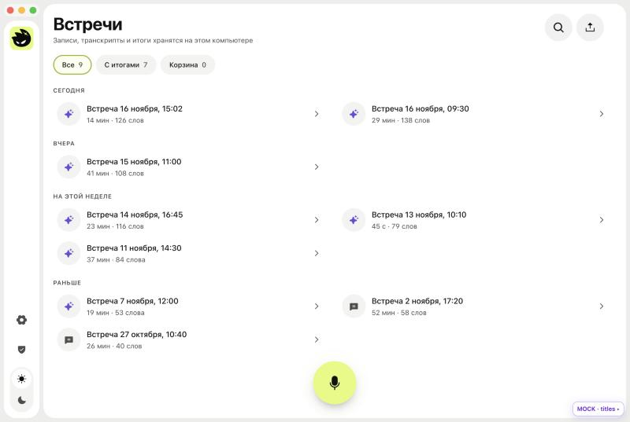 | 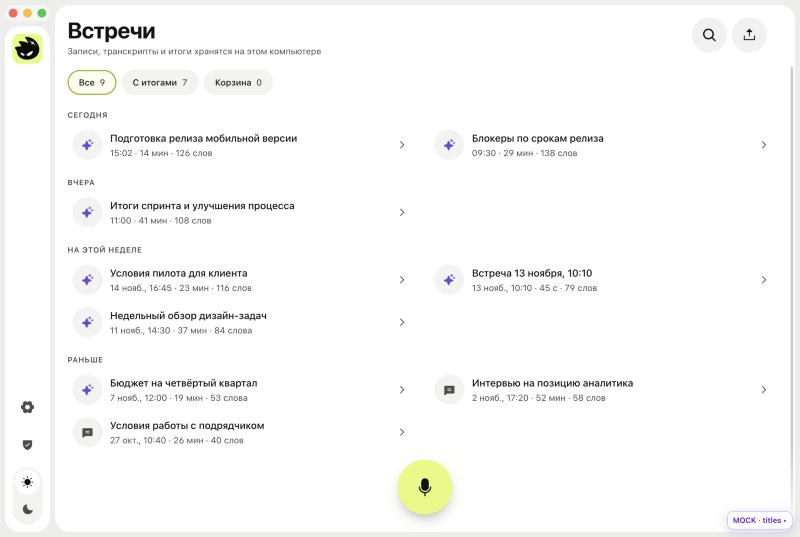 |
| 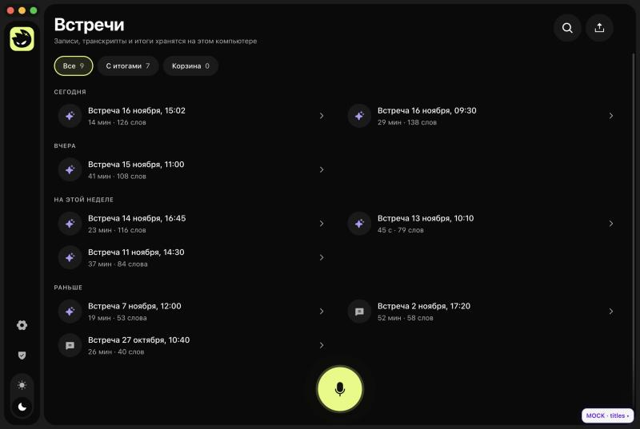 | 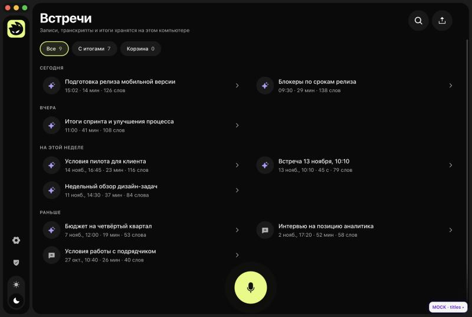 |

Список, EN, светлая и тёмная:

| До | После |
|---|---|
| 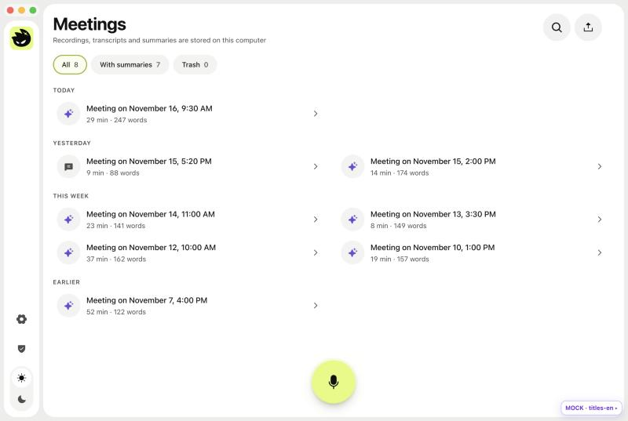 | 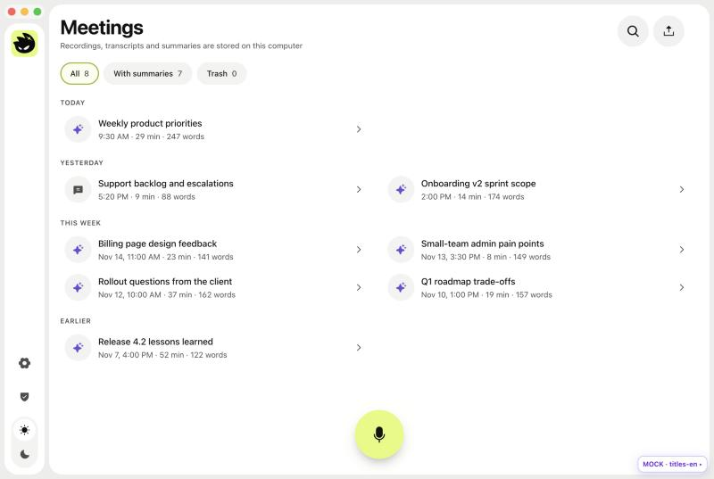 |
|  | 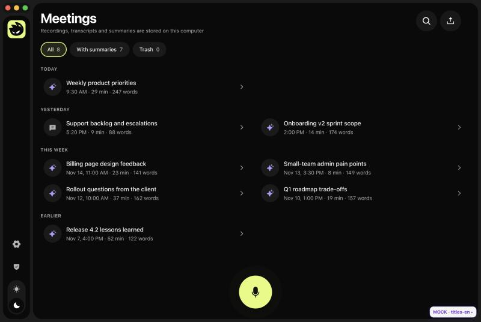 |

Страница встречи, РУ:

| До | После |
|---|---|
| 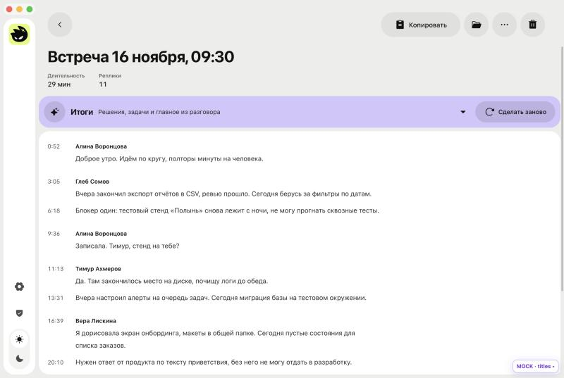 | 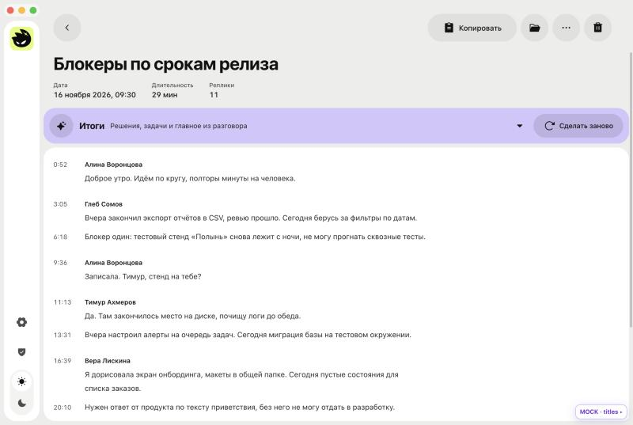 |
| 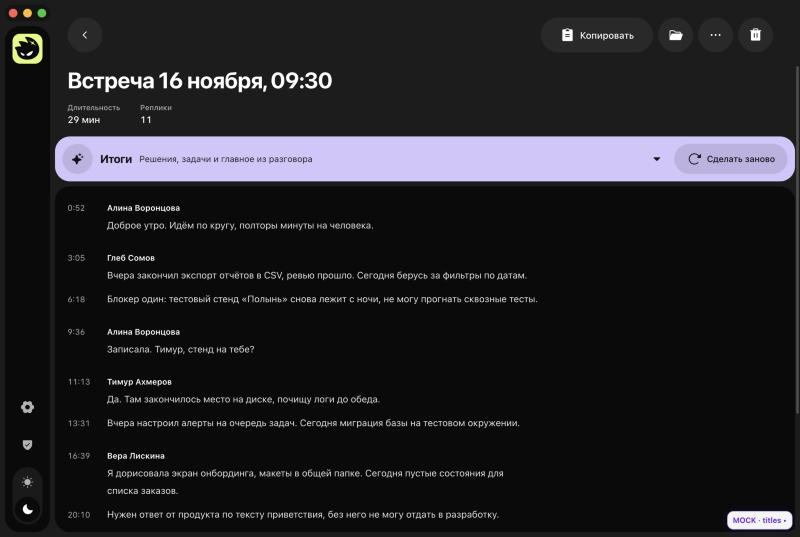 | 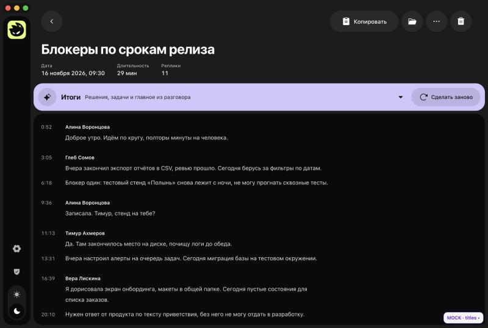 |

Страница встречи, EN:

| До | После |
|---|---|
| 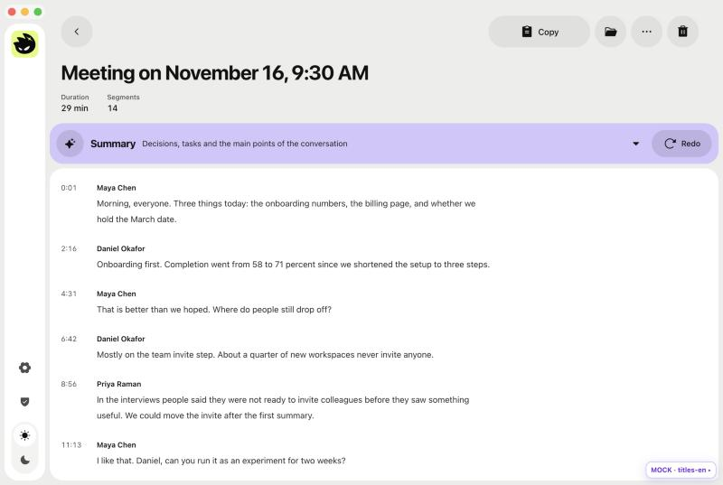 | 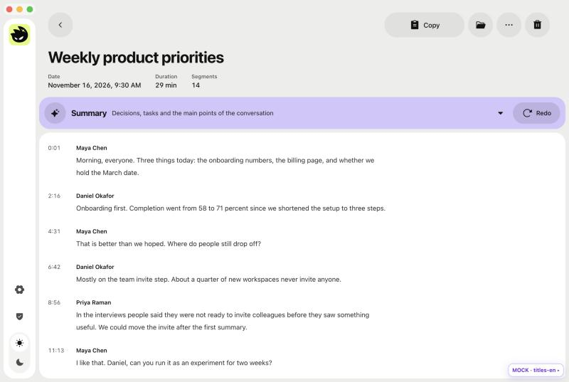 |
| 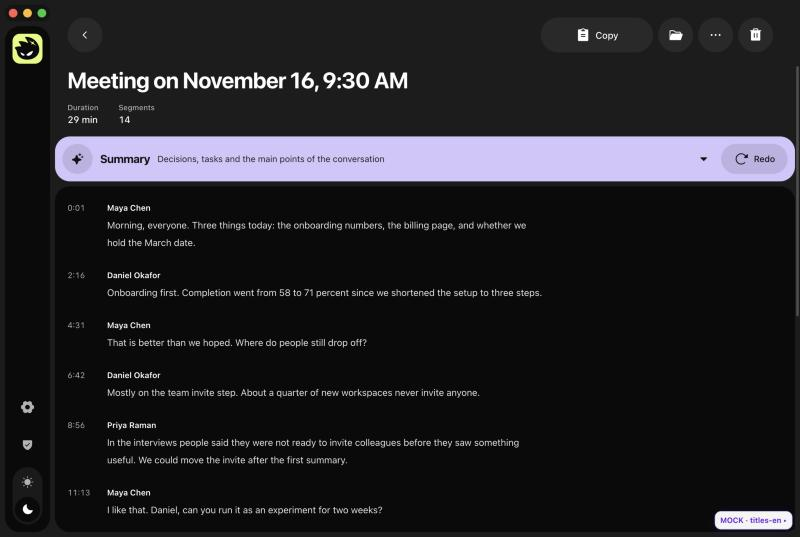 | 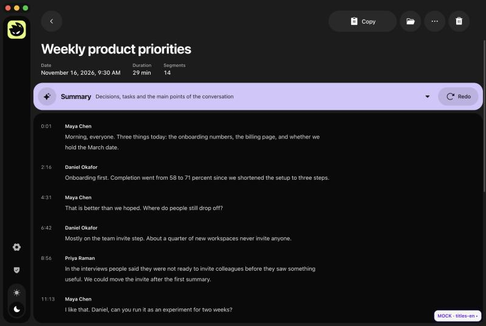 |

Настройки: идёт работа (РУ светлая, EN тёмная), готово, облачный провайдер с подтверждением:

| | |
|---|---|
| 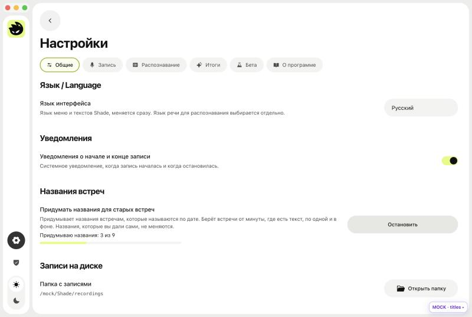 | 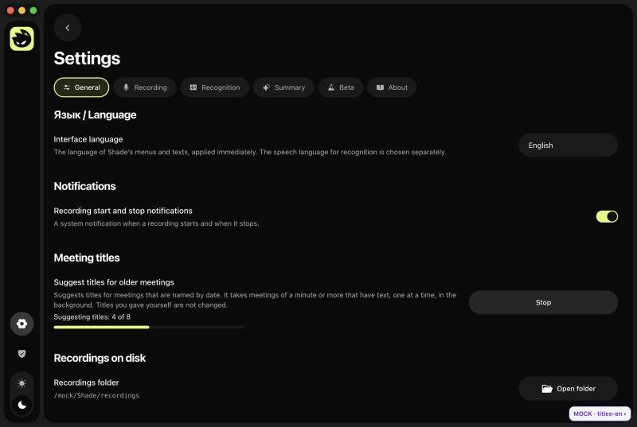 |
| 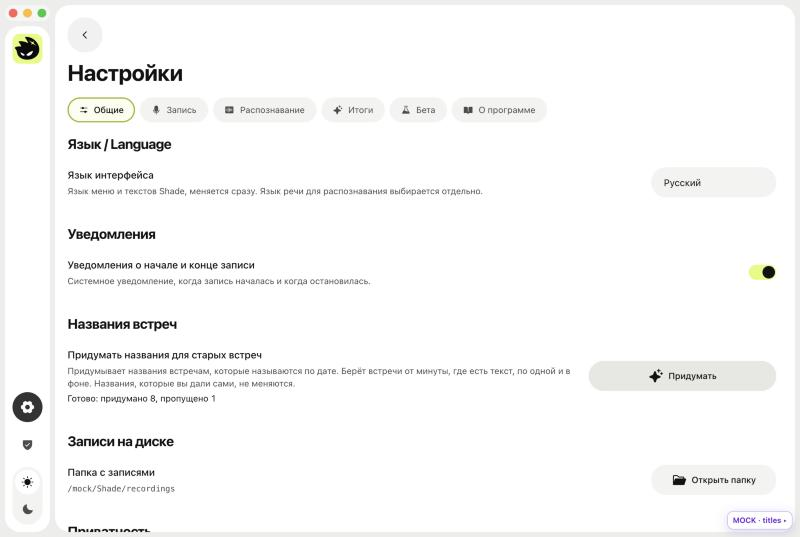 | 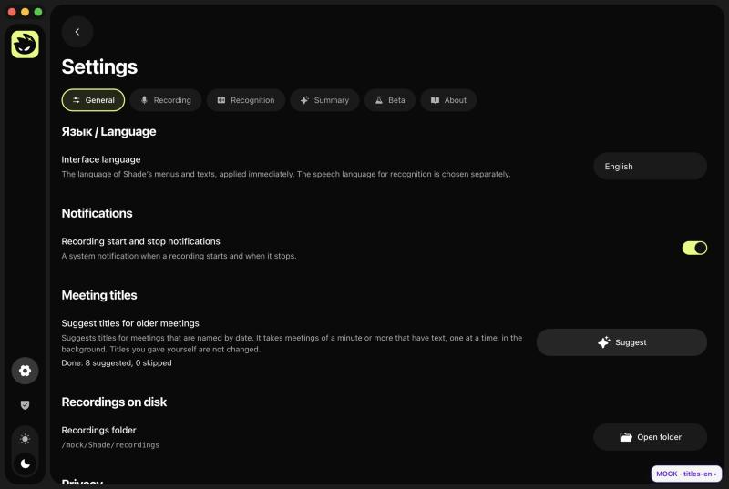 |
| 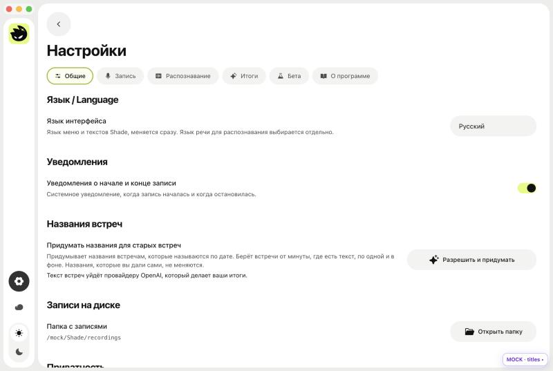 | |

Снимки сняты в браузере на заглушках, не в окне приложения: `backdrop-filter` в WebKit ведёт себя иначе, но здесь ни размытия, ни стекла нет.

## Проверка владельца
Ядро изменилось, нужна пересборка из ветки `shade-meeting-titles` (`pnpm tauri:dev`).
1. Настройки → Общие → «Названия встреч» → «Придумать». У облачной модели сначала строка «Текст встреч уйдёт провайдеру…» и кнопка «Разрешить и придумать». Дождаться «Готово: придумано N».
2. На главной в поиске набрать слово по теме встречи 16.11: встреча находится по названию, под названием дата и время.
3. Переименовать любую встречу вручную, открыть её, нажать «Подвести итоги» (или «Сделать заново»): название осталось вашим. Затем «⋯» → «Придумать название заново»: название сменилось.
4. Записать минуту-две речи и нажать «Остановить»: через несколько секунд в списке название по теме (встроенная модель или Ollama).
5. Если какая-то встреча осталась датой: смотреть консоль окна, строка `[shade] Название встречи … остаётся прежним (причина)`.

## На потом
- Название при импорте аудио (сейчас название файла, автоматика его не трогает).
- Журнал причин не только в консоли.

## Вопросы
Один: для облачной модели оставить название только по «Подвести итоги» (по умолчанию, как сделано) или разрешить и автоматически после «Остановить»?

🤖 Generated with [Claude Code](https://claude.com/claude-code)


## Обсуждение

**vercel[bot], 2026-11-16T14:08**

[vc]: #iLCpQZDObQEq8KoqA1Xur9cemeEQ98vKNfj4hBgiVJk=:eyJpc01vbm9yZXBvIjp0cnVlLCJ0eXBlIjoiZ2l0aHViIiwicHJvamVjdHMiOlt7Im5hbWUiOiJzaGFkZSIsInByb2plY3RJZCI6InByal95RHpOUldtUFVVRzVtMk03WTdzd3QyU2NQcEVnIiwiaW5zcGVjdG9yVXJsIjoiaHR0cHM6Ly92ZXJjZWwuY29tL2FpZHhvMjMtMzExOC9zaGFkZS82WXhMM2ZyVHhKb0pKTHdoTjY0aVR1WllRVXliIiwicHJldmlld1VybCI6InNoYWRlLWdpdC1zaGFkZS1tZWV0aW5nLXRpdGxlcy1haWR4bzIzLTMxMTgudmVyY2VsLmFwcCIsIm5leHRDb21taXRTdGF0dXMiOiJERVBMT1lFRCIsImxpdmVGZWVkYmFjayI6eyJyZXNvbHZlZCI6MCwidW5yZXNvbHZlZCI6MCwidG90YWwiOjAsImxpbmsiOiJzaGFkZS1naXQtc2hhZGUtbWVldGluZy10aXRsZXMtYWlkeG8yMy0zMTE4LnZlcmNlbC5hcHAifSwicm9vdERpcmVjdG9yeSI6ImZyb250ZW5kIn1dfQ==
The latest updates on your projects. Learn more about [Vercel for GitHub](https://vercel.link/github-learn-more).

| Project | Deployment | Actions | Updated |
| :--- | :----- | :------ | :------ |
| <a href="https://vercel.com/aidxo23-3118/shade"><sup></sup></a> [shade](https://vercel.com/aidxo23-3118/shade) |  [Ready](https://vercel.com/aidxo23-3118/shade/6YxL3frTxJoJJLwhN64iTuZYQUyb) | [Preview](https://shade-git-shade-meeting-titles-aidxo23-3118.vercel.app) | <relative-time datetime="2026-11-16T14:09:18.765Z">Nov 16, 2026 2:09pm UTC</relative-time> |


