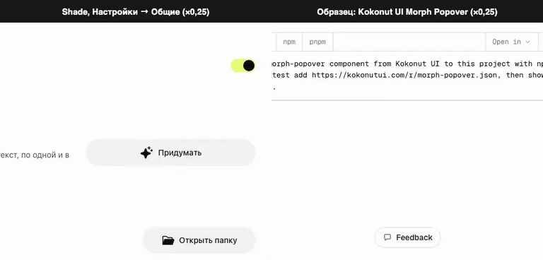
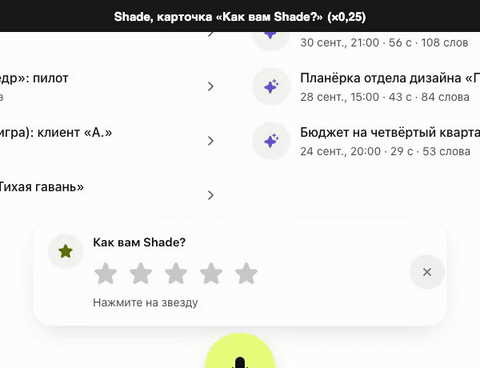
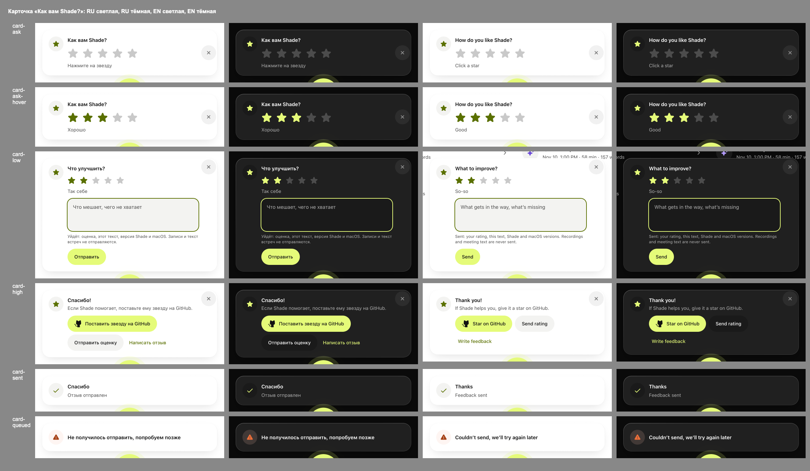
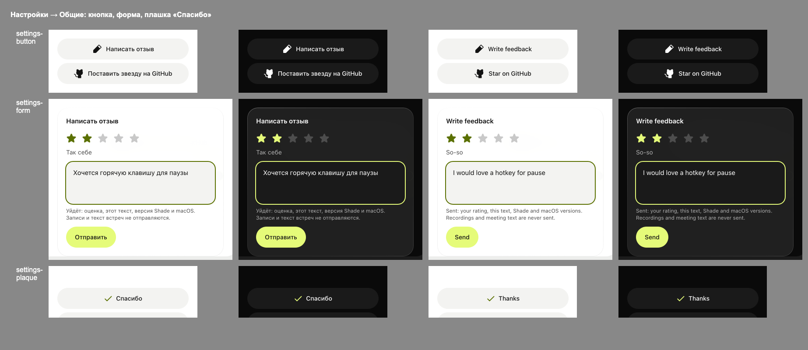

# #36 Обратная связь: «Как вам Shade?», форма в Настройках, отзыв в Telegram

- Статус: слит, 2026-11-16
- Ветка: `shade-feedback` → `shade`
- Автор: katanana23
- Исходная ссылка: https://github.com/katanana23/shade/pull/36

## Описание

## Слабое место (первым)

**Отзывы пока никуда не доходят и не дойдут без двух действий владельца.** Функция `api/feedback` собрана и работает, но только на превью-адресе Vercel, а он закрыт входом Vercel. Приложение шлёт на продакшен-домен проекта `meetily-tau.vercel.app`, а тот собирается из ветки `main`, где функции нет (`main` зеркало оригинала, коммитить туда нельзя). Пока Production Branch проекта не переключена на `shade` и не заданы `SHADE_FEEDBACK_BOT_TOKEN` и `SHADE_FEEDBACK_CHAT_ID`, каждый отзыв ложится в очередь, человек видит «Не получилось отправить, попробуем позже», а после 3 запусков отзыв выбрасывается. Шаги ниже, в «Проверке владельца».

Ещё три слабых места, по убыванию:
- В настоящем окне Tauri запрос не проверен: CORS для `tauri://localhost` проверен вызовом функции, CSP закреплён в `tauri.conf.json`, но приложение я не собирал. Все снимки из Chromium (WebKit из Playwright рисует `backdrop-filter` с просвечиванием, это не окно Shade).
- Частота по IP считается в памяти экземпляра функции: новый экземпляр начинает счёт с нуля. Против настойчивого спама не защищает.
- Версия macOS всегда `unknown`: WebKit замораживает её в User-Agent на 10.15.7, а честный путь требует плагина os в ядре.

## Что сделано

После третьей успешно завершённой встречи, когда человек открыл её итоги, в доке тихо появляется карточка «Как вам Shade?» с пятью звёздами. 1-3 звезды раскрывают «Что улучшить?», 4-5 звёзд дают «Спасибо!», «Поставить звезду на GitHub» и «Написать отзыв». В Настройках → Общие новый раздел «Обратная связь»: форма в механике Morph Popover и переключатель «Иногда спрашивать оценку». Отзыв уходит только по кнопке: в Vercel Function `frontend/api/feedback.ts`, а оттуда в Telegram. Без сети отзыв ждёт в очереди до следующего запуска. Движение на @umbra/motion из реестра Umbra, значения из образцов. Подробно: [`docs/ui/feedback.md`](../../../docs/ui/feedback.md).

Коммиты:
- `be23b4c chore(fork)`: единственная правка ядра, домен `https://meetily-tau.vercel.app` в `connect-src` CSP (`docs/isolation.md`, раздел 9);
- `93eae80`: интерфейс, функция, тесты, документы;
- `4ba69da`: функция как ES-модуль для Node на Vercel (первое превью падало 500, см. ниже);
- `aa4ff51`: две ошибки формы в Настройках, найденные на снимках; снимки и записи.

## Разбор до начала

- **Что сломается первым:** доставка. Продакшен проекта Vercel собирается из `main`, превью закрыты входом, плагина http в ядре нет. Так и вышло: функция работает только на превью, пока владелец не переключит ветку (слабое место выше).
- **Что скажет владелец:** «карточка лезет не вовремя» и «а точно ничего лишнего не уходит?». Поэтому правила показа вынесены в чистую функцию `offerVerdict` с тестом на каждое условие, а тело запроса в тесте сверяется поле в поле (ровно 5 полей).
- **Что переделывать через неделю:** счёт частоты (общий счётчик, если начнут засыпать) и версию macOS (плагин os, когда ядро будут трогать).

## Таблица случаев

| Вход | Ожидаемое | Что при отказе | Тест |
|---|---|---|---|
| Третья завершённая встреча, итоги открыты | карточка через 1,5 с | итогов нет: ждём `summary.kind === 'ready'` | `feedback.test.ts` «третья завершённая встреча, итоги открыты: карточка есть» |
| Вторая встреча | нет (и после третьей вторая не зовёт) | | «вторая встреча: нет…» |
| Идёт запись | нет; старт записи убирает карточку | | «идёт запись: нет» |
| Встреча восстановлена после сбоя | нет | | «встреча восстановлена после сбоя: нет» |
| Встреча не из записи (импорт, старая) | нет | | «встреча не из записи…: нет» |
| Два закрытия без отправки | больше никогда | | «два закрытия без отправки: больше не показывать» |
| 14 дней не прошло / прошло | нет / да | | «14 дней не прошло: нет; прошло: да» |
| Оценка ушла, переключатель выключен | нет | | «оценка уже ушла, переключатель выключен, итогов нет: нет» |
| Проверка моделью убрала встречу в корзину | выходит из счёта, «Вернуть» возвращает | | «проверка моделью убрала вторую встречу в корзину…» |
| Битое хранилище, повтор той же встречи | не падает, не считается дважды | `localStorage` недоступен: работает без памяти | «повтор той же встречи не считается дважды; битое хранилище не роняет» |
| 2 звезды без текста и закрыть | в сеть ничего, закрытие в счёт | | `feedback-card.test.tsx` «2 звезды без текста и крестик…», `feedback.test.ts` «2 звезды без текста и закрыть» |
| 5 звёзд без «Отправить оценку» | ничего не уходит; по кнопке уходит `{rating: 5, text: ''}` | | `feedback-card.test.tsx` «5 звёзд: «Спасибо!»…» |
| Повторный клик «Отправить» | один запрос, тело ровно из 5 полей | | `feedback-card.test.tsx` «повторный клик «Отправить»…», `feedback.test.ts` то же для шагов |
| Отправка без сети | в очереди, при следующем запуске ушла | | «без сети: в очереди, после запуска ушла» |
| Функция отвечает 503 | «Не получилось отправить, попробуем позже», отзыв в очереди | | «функция отвечает 503: в очереди…» |
| Сеть рвётся, 429 | в очереди | | «сеть рвётся: в очереди; 429 тоже» |
| Очередь не уходит | не больше 3 попыток, потом выброшен | | «не больше 3 попыток из очереди, потом выброшен» |
| Функция отвергла тело (400) | «Не получилось отправить», не в очередь | | «функция отвергла тело (400): не в очередь» |
| Текст длиннее 2000 знаков | приложение обрезает (эмодзи целые), функция отвечает 400; ровно 2000 проходит | | «текст длиннее 2000 знаков обрезается…», «текст длиннее 2000 знаков: 400; ровно 2000: 200» |
| Reduced motion | сразу итог, без прыжка | | «reduced motion: сразу итог, без прыжка» |
| Клавиатура | стрелки меняют, Home/End, Enter и пробел подтверждают, один Tab-стоп; Esc, Cmd+Enter | | «стрелки, Home, End, Enter, пробел», `feedback-card.test.tsx` «звёзды: radiogroup…» |
| Функция без переменных | 503, в Telegram ничего | | «без переменных окружения: 503, в Telegram ничего» |
| Функция: тело не по договору, слишком большое, не JSON | 400, 413, 400 | | «тело не по договору: 400; …413…» |
| Функция: частота | после 5 отзывов с адреса за 10 мин 429, другой адрес проходит | | «частота с одного адреса…» |
| Функция: Telegram не принял | 502, Shade кладёт в очередь | | «Telegram не принял: 502…» |
| Функция: CORS | окно Shade получает разрешение, чужой сайт нет; GET 405 | | «CORS: окно Shade получает разрешение…» |
| Версия macOS | замороженная 10.15.7 не выдаётся за настоящую | | «версия macOS: замороженная WebKit 10.15.7…» |

## Движение

| Свойство | Пружина (k/c) | Перелёт | До покоя | Что при прерывании |
|---|---|---|---|---|
| Заливка звезды (`clip-path` через `--shade-star-fill`) | 300/24, ζ 0,69 | 4,9 % (зажата в 0..1) | 567 мс | новая цель с текущей скоростью; очередь зажигания (шаг 50 мс) отменяется, гаснут в обратном порядке |
| «Прыжок» звезды (`scale`) | 520/13, ζ 0,29, старт 0,7, толчок 7 | пик 1,188 | 850 мс | только при зажигании, повторное начинает с 0,7 |
| Подпись под звёздами (перекат) | 260/22, ζ 0,68 | 5,3 % | 617 мс | новая подпись с текущего места |
| Кнопка → форма → плашка (ширина, высота, радиус, подпись) | soft Umbra 260/24, ζ 0,74 | 3,0 % | 483 мс | обратный ход с текущего места и скорости |
| Высота карточки между шагами | soft 260/24 | 3,0 % | 483 мс | так же |

Числа сняты `simulate()` движка, 60 кадров в секунду, и закреплены тестом «значения из образца…».

**Записи ×0,25** (замедление одинаковое для Shade и образца: подменённые часы Playwright, 4 мс страницы за 16 мс реального времени):

Форма в Настройках рядом с образцом Kokonut UI Morph Popover:



Звёзды: наведение по одной, уход, сразу на 4-ю (видна очередь 50 мс), щелчок на 2 → «Что улучшить?». Ссылки на образец «Star Rating» DesignBookmark в задаче не было, найти не удалось, поэтому без соседа:



## Новые ключи localStorage

| Ключ | Что |
|---|---|
| `shade.feedback.prompt.v1` | счёт завершённых встреч (последние 50), последний показ, закрытия, время оценки |
| `shade.feedback.ask` | `"0"`, если «Иногда спрашивать оценку» выключен |
| `shade.feedback.queue.v1` | неотправленные отзывы с числом попыток (не больше 10) |

Существующие ключи не менялись.

## Что решил сам и почему

- **Доставка через `fetch` из окна, а не плагин http:** плагин означал бы правку `src-tauri` шире разрешённого одного домена. Функция отвечает с CORS для `tauri://localhost`, в ядре только домен в `connect-src`.
- **Функция падала 500 на первом превью** (`Cannot use import statement outside a module`): Vercel компилирует `api/` по файлу без сборщика, а `frontend/package.json` без `"type": "module"`. Обходы: (1) `"type": "module"` на весь `frontend`, задевает конфиги Next и PostCSS; (2) свой `api/package.json` с `"type": "module"` и договор рядом с функцией в `api/_contract.ts` (файлы с `_` Vercel функциями не считает), приложение берёт его через `lib/feedback/contract.ts`. Взял второй. После этого превью отвечает: POST без переменных 503 `not-configured`, GET 405.
- **@umbra/motion:** поставил командой из задачи в черновую копию, файлы `spring.ts`, `presets.ts`, `use-spring.ts` перенёс без правок в `lib/motion/`; в `components.json` добавлен реестр `@umbra`. Поломки реестра в «На потом».
- **Закрытие без отправки идёт в счёт двух закрытий**, даже со звездой: оценка без «Отправить» не считается. После отправленной (или поставленной в очередь) оценки карточка больше не приходит.
- **«Третья встреча» считается по номеру завершения:** вторая встреча не зовёт карточку и потом. Ждём готовых итогов и 1,5 с, чтобы человек сначала увидел итог.
- **Ответы 400 и 413 не кладутся в очередь** (повтор не поможет), сеть, 429 и 5xx кладутся.
- **Две ошибки, найденные на снимках:** щелчок по звезде сжимал форму в Настройках до ширины колонки (размер стоял в `style` разметки, и React переписывал его при перерисовке; теперь размер ставит только пружина), а «Отправить» уходил под нижнюю кромку плитки (теперь плитка докручивается за краем формы в такт пружине). Строка «Оценка и отзыв» стала шириной 300 px: «Поставить звезду на GitHub» в 200 px не помещался.
- **Раздел, а не строка:** в Настройках раздел «Обратная связь» со строками «Оценка и отзыв» и «Иногда спрашивать оценку».

## Проверки (вывод)

```
$ npx tsc --noEmit
tsc: ok
$ pnpm check:contrast
Контраст текста на заливках: всё проходит
$ pnpm check:i18n
check:i18n ok: кириллица только в словаре, локали только в lib/lang.ts (строк под маркером i18n-ignore: 8)
$ pnpm test
 228 pass
 0 fail
 6857 expect() calls
Ran 228 tests across 15 files. [899.00ms]
$ pnpm build
 ✓ Generating static pages (11/11)
```

Превью Vercel (`shade-git-shade-feedback-…vercel.app`, с входом владельца): `POST /api/feedback` → `503 {"error":"not-configured"}`, `GET` → `405`.

## Снимки и видео

Карточка: шаги «Как вам Shade?», наведение на 3-ю звезду, «Что улучшить?», «Спасибо!», «Отзыв отправлен», «попробуем позже». Столбцы: RU светлая, RU тёмная, EN светлая, EN тёмная.



Настройки → Общие: кнопки, форма, плашка «Спасибо».



Окно целиком: [карточка, светлая](../../../docs/screenshots/shade-feedback/window-card-light.png), [тёмная](../../../docs/screenshots/shade-feedback/window-card-dark.png); [Настройки с плашкой, светлая](../../../docs/screenshots/shade-feedback/window-settings-plaque-light.png), [тёмная](../../../docs/screenshots/shade-feedback/window-settings-plaque-dark.png). Отдельные кадры: `docs/screenshots/shade-feedback/raw/`.

Снимки сделаны в Chromium на заглушках (`?mock=full`, `?mock=demo-en`, `&feedback-card=…`), не в окне приложения.

## Проверка владельца

1. **Бот в Telegram.** Откройте @BotFather → `/newbot` → имя (например, Shade Feedback) → имя пользователя, оканчивающееся на `bot` → скопируйте токен из ответа. Напишите своему боту любое сообщение (кнопка **Start**), затем откройте в браузере `https://api.telegram.org/bot<ТОКЕН>/getUpdates` и возьмите число из `"chat":{"id":…}`: это chat id.
2. **Переменные в Vercel.** vercel.com → проект **shade** → **Settings** → **Environment Variables** → **Add New**: Key `SHADE_FEEDBACK_BOT_TOKEN`, Value токен, Environments **Production** и **Preview** → **Save**; так же `SHADE_FEEDBACK_CHAT_ID`. Токен никуда больше не вставляйте.
3. **Ветка продакшена** (после слияния этого PR в `shade`): **Settings** → **Environments** → **Production** → **Branch Tracking** → `shade` → **Save**, затем **Deployments** → последняя сборка `shade` → **⋯** → **Redeploy**. Переменные действуют только в новых сборках.
4. **Тестовый отзыв себе:**
   ```bash
   curl -sS -X POST https://meetily-tau.vercel.app/api/feedback -H 'Content-Type: application/json' -d '{"rating":5,"text":"Проверка","appVersion":"0.0.0","macos":"unknown","locale":"ru"}'
   ```
   Ждём `{"ok":true}` и сообщение «Shade · ★★★★★ 5/5» в Telegram.
5. **В приложении:** Настройки → Общие → «Обратная связь» → «Написать отзыв» → 2 звезды, пара слов, Cmd+Enter. Форма сжимается в «Спасибо», в Telegram сообщение с вашей версией Shade.

## На потом

- **Реестр Umbra, первая установка в другом продукте:**
  - установка по URL падает `Unknown registry "@umbra"`: зависимость `@umbra/cn` указана по имени, а у потребителя ещё нет `registries` в `components.json`;
  - файлы движка ставятся в `components/lib/motion` (цель `@components/…`), а не по алиасу `lib`;
  - элемент `motion` тянет `morph-indicator`, `cn` и `motion.css`; отдельного элемента «только движок» нет;
  - для значений образцов нет пресетов, а комментарий движка разрешает свою пару k, c только внутри @umbra/motion; здесь пары лежат в `lib/motion/shade-springs.ts`.
- Общий счётчик частоты (Vercel KV или Upstash), если отзывы начнут засыпать.
- Версия macOS через плагин os, когда ядро будут трогать.
- Ссылка на образец «Star Rating», чтобы записать звёзды рядом с ним.

## Вопросы

Переключить Production Branch проекта Vercel на `shade` (шаг 3)? Тогда `meetily-tau.vercel.app` начнёт показывать демо Shade вместо старой сборки «Aid Meetings». **По умолчанию: да**, иначе отзывам некуда идти; другой путь это отдельный проект Vercel с новым доменом и вторая правка CSP в ядре.

🤖 Generated with [Claude Code](https://claude.com/claude-code)


## Обсуждение

**vercel[bot], 2026-11-16T15:40**

[vc]: #YZbx8nlPfQBJD0tQ3c8Ri7nOey81aQmRqynjB0CEdOc=:eyJpc01vbm9yZXBvIjp0cnVlLCJ0eXBlIjoiZ2l0aHViIiwicHJvamVjdHMiOlt7Im5hbWUiOiJzaGFkZSIsInByb2plY3RJZCI6InByal95RHpOUldtUFVVRzVtMk03WTdzd3QyU2NQcEVnIiwibGl2ZUZlZWRiYWNrIjp7InJlc29sdmVkIjowLCJ1bnJlc29sdmVkIjowLCJ0b3RhbCI6MCwibGluayI6InNoYWRlLWdpdC1zaGFkZS1mZWVkYmFjay1haWR4bzIzLTMxMTgudmVyY2VsLmFwcCJ9LCJpbnNwZWN0b3JVcmwiOiJodHRwczovL3ZlcmNlbC5jb20vYWlkeG8yMy0zMTE4L3NoYWRlLzRvd1JvYXR3NjRXREpiUmNEUXdoRGFFNDljaVAiLCJwcmV2aWV3VXJsIjoic2hhZGUtZ2l0LXNoYWRlLWZlZWRiYWNrLWFpZHhvMjMtMzExOC52ZXJjZWwuYXBwIiwibmV4dENvbW1pdFN0YXR1cyI6IkRFUExPWUVEIn1dfQ==
The latest updates on your projects. Learn more about [Vercel for GitHub](https://vercel.link/github-learn-more).

| Project | Deployment | Actions | Updated |
| :--- | :----- | :------ | :------ |
| <a href="https://vercel.com/aidxo23-3118/shade"><sup></sup></a> [shade](https://vercel.com/aidxo23-3118/shade) |  [Ready](https://vercel.com/aidxo23-3118/shade/4owRoatw64WDJbRcDQwhDaE49ciP) | [Preview](https://shade-git-shade-feedback-aidxo23-3118.vercel.app) | <relative-time datetime="2026-11-16T15:40:46.052Z">Nov 16, 2026 3:40pm UTC</relative-time> |


